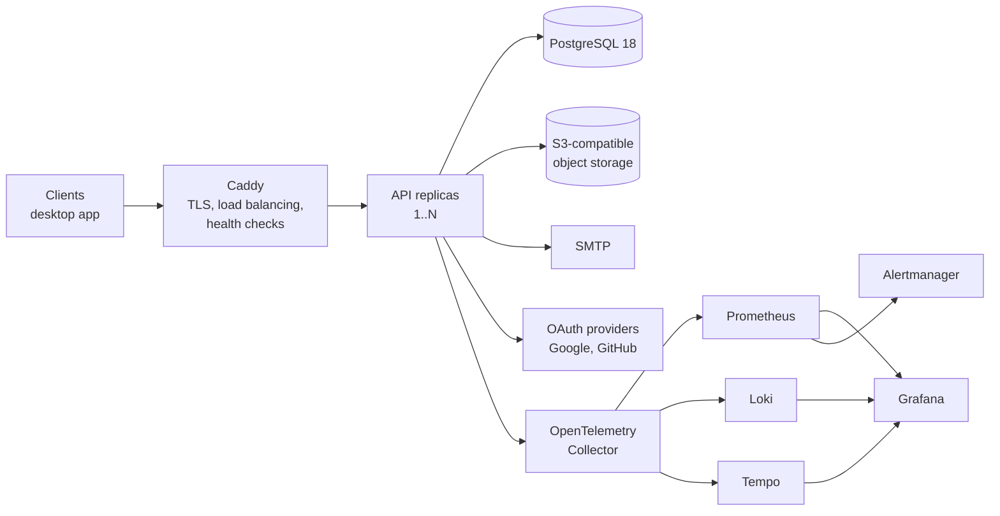
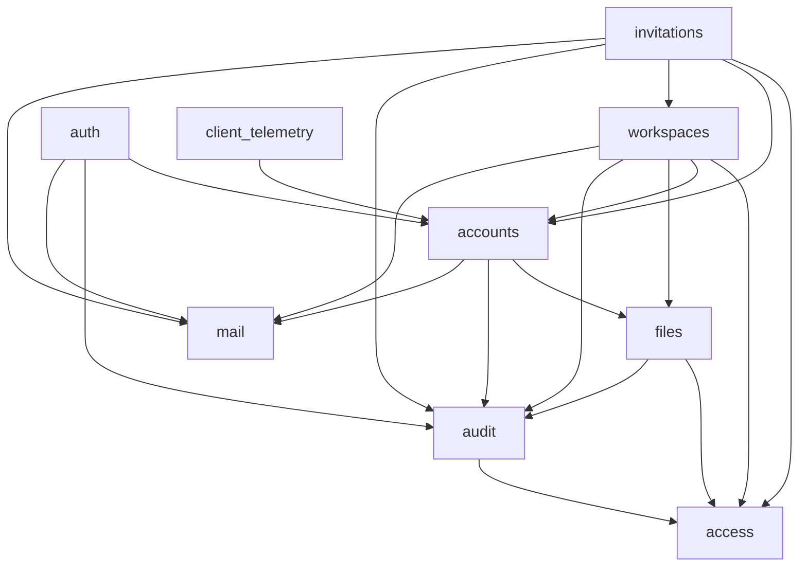
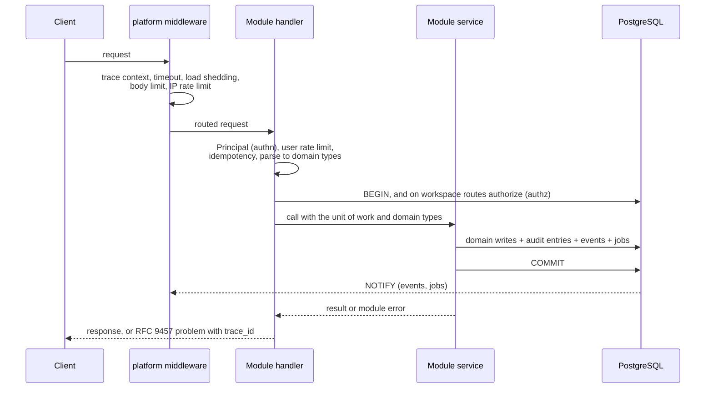

# Architecture

How the API is built: its parts, how they depend on each other, how a request flows through them, and where each rule is enforced. Read this before changing or adding a module.

While the API is being built, parts of this document describe the design to build rather than code that exists. The module table in [MIGRATION.md](MIGRATION.md#modules) shows what is built. Where this document and the code disagree, the code and its tests win, and this document is corrected.

Decision IDs (`D1` to `D36`) refer to the decision records in [inventory/SYNTHESIS.md](inventory/SYNTHESIS.md).

## 1. System context



- PostgreSQL is the system of record and the only coordination point between replicas. It holds rate limits, idempotency records, job leases, the job queue and the event log. There is no Redis or other shared cache. Adding one would need an ADR showing Postgres can't cope.
- Object storage holds file bytes. Uploads and downloads use it during the request, and deletions go through background jobs.
- SMTP delivers email, and only background jobs reach it. No request waits for an email to send (D1).
- The observability stack is always part of the codebase, and turning it on at runtime is optional.

## 2. Principles

1. **Mechanisms live in `platform`, policy lives in modules.** `platform` knows how to run a transaction, deliver a job or render an error. It does not know what a workspace member may do.
2. **One way to do each thing.** There is one transaction API, one error path, one authentication extractor, one authorization check and one outbound HTTP client. A second way needs an ADR.
3. **Enforce rules with the compiler first, then tooling, then review.** Visibility, types and crate boundaries come first. Clippy and CI scripts come second. A rule that only review can check is written so a reviewer can answer it yes or no.
4. **A side effect commits with the change that causes it** (D1).
5. **Every workspace request is authorized against the workspace named in its path** (D2, D3).
6. **Startup fails loudly; at runtime the service degrades predictably** (D9, D20).

## 3. Repository layout

```
Cargo.toml          workspace manifest
justfile            every task, run identically locally and in CI (D21)
Dockerfile
compose.yaml        the services a developer runs locally
crates/
  platform/         shared mechanisms, no product knowledge
  app/              feature modules, routes, composition root, the binary
  xtask/            the custom CI checks, which the API never depends on
migrations/         one ordered directory; each file name names its owning module
deploy/             the reference deployment and its configuration
docs/
.github/            thin workflows that call `just`
.claude/            Claude Code definitions, including the conformance reviewer
CLAUDE.md
```

Everything that only matters when deploying lives under `deploy/`, so the root holds only what a developer uses day to day.

## 4. Crates

The API has two crates. Cargo forbids `platform` from depending on `app`, so the shared mechanisms can never come to depend on a feature. The workspace's third crate, `xtask`, holds the custom CI checks, and neither API crate depends on it.

### `platform`

| Area | What it provides | Decisions |
|---|---|---|
| `config` | Typed configuration loaded once at startup. Values are trimmed, empty means unset, `*_FILE` secret files are supported, and every failure is reported in one format. | D9, D26 |
| `db` | One connection pool, the unit of work, and the `bootstrap` and `migrate` tasks. A unit of work is one transaction, opened by the route, with a writer for jobs and events. Every query in it filters by tenant itself (DATA-22). | D1, D4, D24 |
| `jobs` | A durable job queue with retry, backoff and dead letters, plus a scheduler that runs each periodic job once per interval across the fleet. A job records the user or workspace it was enqueued for, and its handler filters by them. | D1, D13 |
| `listener` | One `LISTEN` connection per instance, routing notifications to subscribers such as the real-time hub and the job dispatcher. | D20 |
| `events` | The event log and the real-time hub. A unit of work publishes events. The hub loads each new event once and delivers it to the streams allowed to receive it (SEC-17). It also replays missed events, closes or re-filters streams when an access-change signal arrives, and re-checks every open stream at a configured interval (SEC-06). | D1, D5, D20 |
| `http` | The middleware stack, extractors (JSON, path, query, pagination), RFC 9457 responses, idempotency, rate limiting, timeouts and load shedding. | D8, D11, D12, D20 |
| `authn` | Reads credentials through a credential source, a closed enum whose one variant reads the Bearer header, and verifies them through the `SessionVerifier` that `auth` implements, producing a `Principal`. | D18 |
| `authz` | The `Authorized<P>` proof and the `Memberships` type, generic over the `Permission` trait. Producing `Authorized<P>` opens the request's unit of work and asks the `AccessPolicy` that `access` implements inside it. Refusals are reported to the `SecurityEventSink` that `audit` implements. | D2, D3, D6 |
| `errors` | Error categories, the `ErrorCode` trait, and the single conversion to an HTTP response. | D17 |
| `telemetry` | Tracing and OpenTelemetry setup, the metric declaration macro, and the trace-ID response header. | D10, D19 |
| `storage` | An object storage client. | D1, D14 |
| `mail` | The SMTP transport and the template engine. The templates themselves live in `app`. | D1, D9 |
| `outbound` | The only HTTP clients: one for URLs from configuration, and one for URLs supplied by third parties, with SSRF protection (SEC-09). | D26 |
| `types` | Shared domain types: `Secret`, `EmailAddress`, the ID types. | D7, D25 |
| `clock`, `random` | The injectable clock and the operating system's secure random source (CODE-06). | D23, D26 |
| `personal_data` | The export and erasure contract that modules implement. | D31 |
| `lifecycle` | Liveness, readiness and bounded graceful shutdown. | D9, D20 |

`platform` knows two tenancy keys, a user ID and a workspace ID, because authorization, job scoping and event delivery need them. It knows nothing about memberships, roles, invitations or any other product rule.

### `app`

```
crates/app/
  src/
    main.rs            subcommands: bootstrap, migrate, serve, seed, openapi
    composition.rs     the composition root: builds every service once at startup and mounts every module's routes
    modules/
      access/ accounts/ audit/ auth/ client_telemetry/ files/
      invitations/ mail/ realtime/ system/ workspaces/
  templates/email/
  tests/               integration tests over HTTP, against real Postgres and S3, and end-to-end tests in tests/e2e/
```

## 5. Modules

### What each module owns

| Module | Owns (tables) | Responsible for |
|---|---|---|
| `access` | `workspace_memberships` | Roles, the permission matrix, the permission types used with `Authorized<P>`, and the `AccessPolicy` implementation (D2). It has no routes of its own. |
| `audit` | `audit_entries` | Recording entries inside a unit of work, the read endpoints, the action catalog, retention, and the `SecurityEventSink` implementation that records refused requests (D6). |
| `realtime` | none | The SSE endpoint and the event catalog. Delivery, replay and stream closing are handled by `platform::events` (D5). |
| `mail` | none | Email types and templates. Sending enqueues a job, and the job handler renders and delivers the email (D1). |
| `files` | `files`, `object_deletions` | Upload, list, download and delete of user and workspace files, public files, and the orphan sweep. |
| `accounts` | `users`, `user_preferences`, `data_exports` | Profile, preferences and consent, avatar, and account deletion and export, which it orchestrates across modules through the personal data contract (D16, D31). |
| `auth` | `sessions`, `verification_codes`, `identities`, `provider_tokens`, `pending_email_changes` | Registration, login with credentials or OAuth, refresh, logout, sessions, password reset and change, email verification and change, identity linking, and re-authentication for sensitive actions. Account deletion is confirmed here, then carried out by `accounts`. One file per OAuth provider in `auth/providers/`. Implements `SessionVerifier`. |
| `workspaces` | `workspaces` | Creating, updating, transferring and deleting workspaces, the members endpoints (list, change role, remove, leave), and the workspace picture. |
| `invitations` | `invitations` | Invite, list, resend, cancel, accept, decline, and expiry. |
| `client_telemetry` | none | The telemetry proxy for the desktop client, enforcing consent on the server (D7). |
| `system` | none | Health, the capabilities endpoint (D9) and the schema endpoints. |
| `platform` | `events`, `jobs`, `job_schedules`, `rate_limit_buckets`, `idempotency_records` | The mechanisms in §4. |

Table naming follows the data standard.

### Dependencies

An arrow means "uses the public API of".



`access`, `mail`, `realtime` and `system` depend on no other module.

Rules:
- The graph must stay acyclic. The edges above are the allowed list, and a CI script fails on any `use` of another module that the list doesn't include.
- A module is used only through what its `mod.rs` exports. Repositories are private to their module, so no module can query another module's tables. When a module needs another module's data, it calls a batch read in that module's API, for example `accounts::profiles(ids)`.
- An operation that spans modules passes one `&mut UnitOfWork` through every call, so it all commits or none of it does.
- `platform` calls into `app` only through four traits, each implemented by a module and registered in the composition root:
  - `SessionVerifier`, implemented by `auth`, verifies credentials for `platform::authn`.
  - `AccessPolicy`, implemented by `access`, makes authorization decisions for `platform::authz`.
  - `SecurityEventSink`, implemented by `audit`, records refused requests that `platform::authz` reports.
  - The personal data contract is implemented by every module that stores personal data. It lets `accounts` export or delete an account without depending on every module.

### Inside a module

Every module uses the same file names, and only the files it needs:

```
modules/workspaces/
  mod.rs             public API: what other modules may use, plus routes()
  routes.rs          handlers and route table: extract, authorize, call the service, shape the response
  service.rs         business rules, and the commit that ends the unit of work
  repo.rs            SQL only (private)
  model.rs           domain types
  error.rs           the module's error enum (D17)
  events.rs          event types it publishes
  audit.rs           audit actions it records
  jobs.rs            background jobs it declares (D13)
  metrics.rs         metrics it declares (D19)
  personal_data.rs   its export and erasure contract (D31)
```

Two modules have one extra entry each: `access/permissions.rs` holds the permission matrix, and `auth/providers/` holds one file per OAuth provider together with their registry.

The layers have strict jobs:
- **Handlers** contain no SQL and no business rules.
- **Services** contain no HTTP types.
- **Repositories** contain no rules.

A module that outgrows a file splits it into a directory with the same name, such as `service/`. A file never takes a new name.

A trait that abstracts a dependency exists for one of two reasons. Either it inverts a dependency the crate or module graph forbids (the four traits above), or it covers an external system with more than one implementation (object storage, email transport, the clock). Nothing gets a trait just so it can be mocked. Tests run against the real database (D23).

## 6. Request lifecycle



1. **Caddy** terminates TLS and forwards the request to a replica whose readiness check passes.
2. **Platform middleware**, outermost first. The health probes are answered before this stack (OPS-05):
   - trace context and the trace-ID response header (D10)
   - panic catching
   - request timeout
   - concurrency limit with load shedding (D20)
   - body size limit
   - pre-authentication IP rate limit (D11)
3. **The route** prepares the request, in this order:
   - `Principal` authenticates the caller (D18).
   - The per-user rate limit, then the idempotency reservation for keyed `POST`s (D12), each in its own short transaction.
   - The body is parsed into request types, then domain types (D25).
   - The unit of work opens last, so no transaction waits on a slow client, and no request holds a pooled connection while it waits for a second one. On workspace routes, opening it produces `Authorized<P>`: inside the unit of work, the caller's membership in the workspace from the path is loaded and permission `P` checked (D2, D3). A missing membership is a 404, so the response never reveals whether the workspace exists. On other routes, the unit of work opens from the `Principal`.
4. **The handler** calls the service with domain types only.
5. **The service** performs its writes in the unit of work the route opened, and in the same transaction records audit entries, publishes events and enqueues jobs (D1, D6). For a request with an `Idempotency-Key`, the same transaction stores the operation's result under the key (API-12). Then it commits.
6. **The response.** The handler maps the result to the response. A module error goes through the single conversion to an RFC 9457 problem that carries the trace ID (D17).
7. **After the commit**, Postgres notifies the listeners:
   - Each instance's real-time hub loads a new event once and delivers it to the streams allowed to see it (D5, D20).
   - The job dispatcher claims new jobs.

Nothing runs after the response except background work driven by committed rows.

## 7. Data and consistency

- **Database roles:**
  - `owner` runs migrations and owns the tables. It is never used at runtime.
  - `app` serves every request and runs every job. It can read and change data, but not the schema, and it is never a superuser (DATA-12, DATA-13).
- **Tenancy is enforced by the application (D4).** There is no row-level security. Every query on tenant data filters by tenant itself (DATA-22): workspace data by the workspace ID from `Authorized<P>` or a job's recorded scope, and user data by the caller's ID. Three things keep that true:
  - Repository functions for workspace data take the workspace ID as a parameter.
  - A CI check fails any query on a workspace table that doesn't filter by `workspace_id`.
  - A generated test sends every workspace route an ID from another workspace the caller belongs to (TEST-09).
- **No business logic lives in SQL**, and there are no stored procedures or `SECURITY DEFINER` functions (DATA-07).
- **What the role can't protect against.** A compromised API process can read and change anything `app` can. The defenses for that case are:
  - The database is not reachable from outside the private network.
  - Roles have least privilege: no DDL, no superuser, no other schemas.
  - Secrets are handled under D26.
  - The audit log and backups support detection and recovery (D6, D30).
- **Conventions (D24):**
  - UUIDv7 IDs from `uuidv7()`.
  - Timestamps from `now()` in the database.
  - SQL checked at compile time with `sqlx::query!` and a committed offline cache.
  - `ETag` and `If-Match` on editable resources.
  - Hard deletes, with cascades declared in the schema.
- **Side-effect tables.** A unit of work writes to the module's own tables, `audit_entries` (owned by `audit`), and `events` and `jobs` (owned by `platform`). After the commit:
  - Events reach every authorized stream, and a stream that reconnects replays what it missed.
  - Jobs run at least once, with retry and backoff, and land in a dead-letter state after the last attempt. Every job handler is idempotent.
- **Migrations** are forward-only and follow expand and contract, so the previous release keeps working during a rolling deploy (D15). They live in one ordered directory, and each file's description names its owning module.

## 8. Cross-cutting mechanisms

Each of these has a standard in `docs/standards/` with numbered rules. This is the one-paragraph version.

- **Errors (D17).** Each module has its own error enum. Every variant declares a stable code and a category, and the category alone sets the HTTP status. Infrastructure errors never leave their adapter. An error is logged once, where it is handled.
- **Validation (D25).** Request types reject unknown fields and convert at the boundary into domain types that can only hold valid values. Code past the boundary accepts only those types.
- **Authentication (D5, D18).** Sessions slide on refresh but have an absolute maximum lifetime. Credential transport is pluggable. Revoking a session closes its streams.
- **Authorization (D2).** One permission matrix, in `access/permissions.rs`, maps roles to permissions. Every workspace route declares its permission in its type. Role rank limits who may change whom.
- **Observability (D10, D19).** Every response except the health probes carries a trace ID that leads to its logs, and to its trace whenever the request ended in an error. Metrics are declared in code. The metric catalog is generated from the declarations, and CI checks the dashboards and alerts against it.
- **Configuration (D9).** Strict and typed, with no defaults that are unsafe in production. A disabled feature answers 503 and is advertised by the capabilities endpoint.
- **Background jobs (D13).** Declared in one registry. Each runs once per interval across the fleet, under a lease with a heartbeat, and shutdown is bounded.
- **Personal data (D31).** Every module that stores personal data implements export and erasure. CI fails if any column referencing a user isn't covered by a contract.
- **Security (D26).** OWASP ASVS Level 2 is the bar. The threat model maps each mitigation to a rule ID.

## 9. Runtime topology

- **The binary** has these subcommands:
  - `bootstrap` creates the database roles and their grants, with an administrator connection. Running it again changes nothing (DATA-12).
  - `serve` binds one HTTP port and runs the HTTP server, the real-time hub, the job dispatcher and the scheduler.
  - `migrate` is the one-shot migration step.
  - `seed` loads development data.
  - `openapi` writes the contract for the CI drift check.
- **The single-host reference deployment** runs N API replicas behind Caddy, with Postgres, SeaweedFS and, as an option, the observability stack. A deploy needs only the release's published artifacts on the server, never a checkout of the repository. It replaces replicas with no downtime and rolls back on failure (D15, OPS-16), and scheduled backups go to object storage (D30). The deploy tooling is chosen when the deployment is built.
- **Scaling out** means adding replicas. The connection budget is replicas × (pool size + 1 listener), and it must fit within Postgres's `max_connections`. The listener needs a direct connection, which rules out PgBouncer in transaction mode. Under load, each replica sheds requests with 503 and `Retry-After` instead of queuing without bound (D20).
- **Multiple hosts.** The image and its environment contract don't depend on a platform. The operations docs state what any platform must provide.

## 10. Technology

| Concern | Choice | Why |
|---|---|---|
| Language | Rust, edition 2024, toolchain pinned in `rust-toolchain.toml` | Every machine and CI job builds with the same compiler |
| Async runtime | `tokio` | The ecosystem standard |
| HTTP | `axum`, `tower`, `tower-http` | Extractors carry `Principal` and `Authorized<P>` as types |
| Database | `sqlx` with `query!` macros | Queries are checked against the schema at compile time (D24) |
| Serialization | `serde`, `serde_json` | The ecosystem standard |
| Errors | `thiserror` in modules | One enum per module (D17) |
| Telemetry | `tracing`, `opentelemetry`, `tracing-opentelemetry` | The standard bridge from Rust tracing to OpenTelemetry (D10, D19) |
| OpenAPI | `utoipa` | Generates the contract from the code (D8) |
| Passwords | `argon2` | Argon2id in PHC format (D26) |
| Outbound HTTP | `reqwest` with `rustls` | Wrapped by `platform::outbound` |
| Object storage | `object_store` | Supports any S3-compatible store and other providers, so forks can switch |
| Email | `lettre`, with templates checked at compile time | Template variables are checked like SQL queries |

Validation uses the domain types (D25), not a validation crate. Async traits are native wherever no trait object is needed.

Exact versions are pinned in `Cargo.toml`.

## 11. Glossary

Each concept has one name, used the same way in code, SQL, the API and the docs (CODE-10).

| Term | Meaning |
|---|---|
| User | A person with an account. Owns their profile, sessions, identities and user files. |
| Identity | One way a user signs in: a password, or a linked OAuth provider account. A user has one or more. |
| Session | One signed-in device or client, holding an access token and a refresh token. |
| Provider token | A credential from an OAuth provider, stored encrypted (SEC-02). It is revoked when the session or identity that needs it ends. |
| Principal | The authenticated caller of a request, produced by `platform::authn` (D18). |
| Workspace | A shared space that users are members of. Owns workspace files, invitations and its audit log. |
| Membership | A user's place in a workspace, with exactly one role. Owned by `access`. |
| Owner | The one role per workspace that can transfer or delete it. |
| Role | A named set of permissions, defined in code in `access` (D2). |
| Permission | One thing a role allows on a workspace resource, such as `members.update`. |
| Invitation | An offer to join a workspace with a role, sent to an email address. |
| Unit of work | One database transaction, opened by the route, with its side effects: audit entries, events and jobs (D1). |
| Job | Durable background work, delivered at least once (D13). |
| Event | A record of a change, delivered to clients over SSE and replayable after a reconnect (D5). |
| Stream | One client's open SSE connection. |
| Audit entry | A record of who did what, in the user's log or the workspace's log. It is never edited, except that erasing an account anonymizes its personal data (D6, D31). |
| File | Stored bytes plus metadata. A user file or a workspace file, each private or public. |
| Personal data contract | A module's export and erasure of the personal data it stores (D31). |
| Capability | A feature that a deployment has turned on, listed by the capabilities endpoint (D9). |
| Trace ID | The identifier, returned with every response except the health probes, that leads to a request's logs, and to its trace whenever the request ended in an error (D10). |
| Personal data | In these documents: information that identifies a person directly, such as email addresses, names, avatars, IP addresses, user agents, file names and text a user writes. User and workspace IDs are pseudonymous. GDPR still counts them as personal data, so export and erasure cover them (D31), but they may appear in telemetry and audit entries. |
