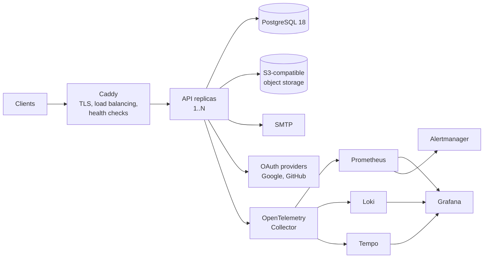
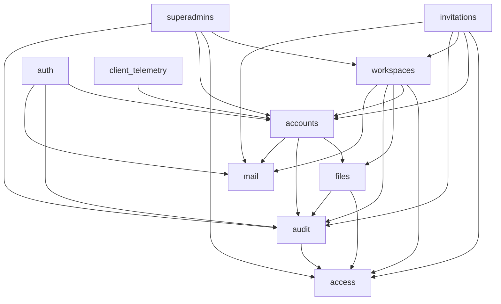
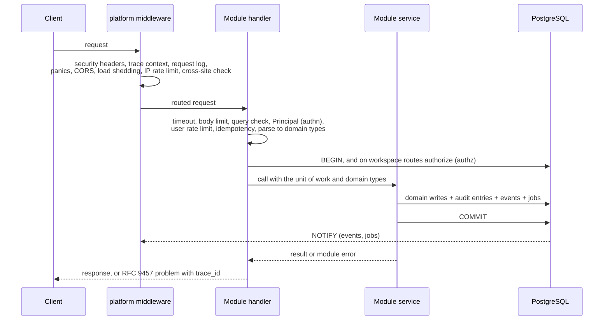

# Architecture

How the API is built: its parts, how they depend on each other, how a request flows through them, and where each rule is enforced. Read this before changing or adding a module.

While the API is being built, parts of this document describe the design to build rather than code that exists, as "Docs for unbuilt parts are the plan" in [CLAUDE.md](../CLAUDE.md) explains. The module table in [MIGRATION.md](MIGRATION.md#modules) shows what is built.

Decision IDs `D1` to `D36` refer to the decision records in [inventory/SYNTHESIS.md](inventory/SYNTHESIS.md), and later ones to the [tracker's decisions](MIGRATION.md#decisions), whose commits hold their reasons.

## 1. System context



- PostgreSQL is the system of record and the only coordination point between replicas. It holds rate limits, idempotency records, job leases, the job queue and the event log. There is no Redis, Valkey or other shared store, and adding one to the template needs an architecture decision record (ADR) showing Postgres can't cope. What commits with a unit of work stays in Postgres in any fork, since a store outside the transaction can't commit with it (D1): events, jobs, audit entries and idempotency results. What doesn't, the rate-limit counts and any cache, sits behind one type of `platform` each, so a fork that moves one to a shared store changes that type and the composition root, and no module.
- Object storage holds file bytes. Uploads and downloads use it during the request, and deletions go through background jobs.
- The Simple Mail Transfer Protocol (SMTP) delivers email, and only background jobs reach it. No request waits for an email to send (D1).
- The observability stack is always part of the codebase, and turning it on at runtime is optional.

## 2. Principles

1. **Mechanisms live in `platform`, policy lives in modules.** `platform` knows how to run a transaction, deliver a job or render an error. It does not know what a workspace member may do.
2. **One way to do each thing.** There is one transaction API, one error path, one authentication extractor, one authorization check and one outbound HTTP client. A second way needs an ADR.
3. **Enforce rules with the compiler first, then tooling, then review.** Visibility, types and crate boundaries come first. Clippy and CI scripts come second. A rule that only review can check is written so a reviewer can answer it yes or no.
4. **A side effect commits with the change that causes it** (D1).
5. **Every workspace request is authorized against the workspace named in its path** (D2, D3).
6. **Startup fails loudly; at runtime the service degrades predictably** (D9, D20).

## 3. Repository layout

```
Cargo.toml          workspace manifest
justfile            every task, run identically locally and in CI (D21)
Dockerfile          the image (OPS-15)
compose.yaml        the services a developer runs locally, and the images of the tools the tasks run
crates/
  platform/         shared mechanisms, no product knowledge
  app/              feature modules, routes, composition root, the binary
  xtask/            the custom CI checks, and the tasks that release, deploy and test
migrations/         one ordered directory; each file name names its owning module
deploy/             the configuration of the observability stack and of the reference deployment
docs/
.github/            thin workflows that call `just`, and the configuration of Dependabot
.claude/            Claude Code definitions, including the conformance reviewer
CLAUDE.md
```

The configuration of the services the API runs beside lives under `deploy/`, so the root holds only what a developer edits day to day.

## 4. Crates

The API has two crates. Cargo forbids `platform` from depending on `app`, so the shared mechanisms can never come to depend on a feature. The workspace's third crate, `xtask`, holds the custom CI checks, and the tasks that `just` runs to release, deploy and test, such as `just release`, `just deploy` and `just load-test`, and neither API crate depends on it.

### `platform`

| Area | What it provides | Decisions |
|---|---|---|
| `config` | Typed configuration loaded once at startup. Values are trimmed, empty means unset, `*_FILE` secret files are supported, and every failure is reported in one format. | D9, D26 |
| `db` | One connection pool, the unit of work, and the `bootstrap` and `migrate` tasks. A unit of work is one transaction, opened by the route, with a writer for jobs and events. Every query in it filters by tenant itself (DATA-22). | D1, D4, D24 |
| `jobs` | A durable job queue with retry, backoff and dead letters, plus a scheduler that runs each periodic job once per interval across the fleet. A job records the user or workspace it was enqueued for, and its handler filters by them. | D1, D13 |
| `listener` | One `LISTEN` connection per instance, routing notifications to subscribers such as the real-time hub and the job dispatcher. | D20 |
| `events` | The event log and the real-time hub. A unit of work publishes events. The hub loads each new event once and delivers it to the streams allowed to receive it (SEC-17). It also replays missed events, closes or re-filters streams when an access-change signal arrives, and re-checks every open stream at a configured interval (SEC-06). | D1, D5, D20 |
| `rate_limit` | The buckets that count requests in windows, in the database every replica shares: the IP and user limits that the request pipeline applies, and the per-action limits a module checks, such as sign-in's. | D11 |
| `http` | The route builders and the OpenAPI document they produce, the middleware stack with trace context, timeouts, load shedding, cross-origin resource sharing (CORS) and the protection against cross-site request forgery (CSRF), extractors (JSON, path, query, pagination), idempotency and rate limiting. | D8, D10, D11, D12, D20, D61 |
| `authn` | Reads credentials through a credential source, a closed enum with two variants: the Bearer header, for clients that set their own headers, such as the desktop client, and an `HttpOnly` cookie, for browsers. It verifies them through the `SessionVerifier` that `auth` implements, producing a `Principal`. | D18, D61 |
| `authz` | The `Authorized<P>` proof and the `Memberships` type, generic over the `Permission` trait. Producing `Authorized<P>` opens the request's unit of work and asks the `AccessPolicy` that `access` implements inside it. Refusals are reported to the `SecurityEventSink` that `audit` implements. | D2, D3, D6 |
| `errors` | Error categories, the `ErrorCode` trait, and the single conversion to an HTTP response. | D17 |
| `telemetry` | The logging and tracing setup, the export of spans, logs and metrics over the OpenTelemetry Protocol (OTLP), the list of telemetry names, and the metric declarations. | D10, D19 |
| `storage` | An object storage client. | D1, D14 |
| `mail` | The SMTP transport and the template engine. The templates themselves live in `app`. | D1, D9 |
| `outbound` | The only HTTP clients: one for URLs from configuration, and one for URLs supplied by third parties, with protection against server-side request forgery (SSRF) (SEC-09). | D26 |
| `types` | Shared domain types: `Secret`, `EmailAddress`, the ID types. | D7, D25 |
| `clock`, `random` | The injectable clock and the operating system's secure random source (CODE-06). | D23, D26 |
| `hashing` | The hashes that stand in for secrets in the database: SHA-256 of a token, and a hash-based message authentication code (HMAC) with SHA-256, under `HMAC_KEY`, of a value short or common enough to guess, such as an email (SEC-03). | D26, D32 |
| `blocking` | Runs CPU-heavy work, such as hashing a password, on a blocking thread and inside a span of its own (CODE-05, OBS-06). | D10 |
| `personal_data` | The export and erasure contract that modules implement. | D31 |
| `lifecycle` | Liveness, readiness and bounded graceful shutdown. | D9, D20 |

`platform` knows two tenancy keys, a user ID and a workspace ID, because authorization, job scoping and event delivery need them. It knows nothing about memberships, roles, invitations or any other product rule.

### `app`

```
crates/app/
  src/
    main.rs            the subcommands (§9)
    lib.rs             the crate root: makes public only the composition root's entry points (CODE-14)
    composition.rs     the composition root: builds every service once at startup and mounts every module's routes
    modules/
      access/ accounts/ audit/ auth/ client_telemetry/ files/
      invitations/ mail/ realtime/ superadmins/ system/ workspaces/
  templates/email/
  tests/               integration tests over HTTP, against real Postgres and S3, and end-to-end tests in tests/e2e/
```

## 5. Modules

### What each module owns

| Module | Owns (tables) | Responsible for |
|---|---|---|
| `access` | `workspace_memberships` | Roles, the permission matrix, the permission types used with `Authorized<P>`, and the `AccessPolicy` implementation (D2). It has no routes of its own. |
| `audit` | `audit_entries` | Recording entries inside a unit of work, the read endpoints, the action catalog, retention, and the `SecurityEventSink` implementation that records refused requests (D6). |
| `realtime` | none | The endpoint of server-sent events (SSE) and the event catalog. Delivery, replay and stream closing are handled by `platform::events` (D5). |
| `mail` | none | Email types and templates. Sending enqueues a job, and the job handler renders and delivers the email (D1). |
| `files` | `files`, `object_deletions` | Upload, list, download and delete of user and workspace files, public files, and the orphan sweep. |
| `accounts` | `users`, `user_preferences`, `data_exports` | Profile, preferences and consent, avatar, and account deletion and export, which it orchestrates across modules through the personal data contract (D16, D31). |
| `auth` | `sessions`, `verification_codes`, `identities`, `provider_tokens`, `pending_email_changes` | Registration, login with credentials or OAuth, refresh, logout, sessions, password reset and change, email verification and change, identity linking, and re-authentication for sensitive actions. Account deletion is confirmed here, then carried out by `accounts`. One file per OAuth provider in `auth/providers/`. Implements `SessionVerifier`. |
| `workspaces` | `workspaces`, `setup_runs` | Creating workspaces in each shape (below), updating, transferring and deleting them, the members endpoints (list, change role, remove, leave), and the workspace picture. |
| `invitations` | `invitations` | Invite, list, resend, cancel, accept, decline, and expiry. |
| `superadmins` | `superadmins` | The deployment's superadmins (D62): users who see every workspace's name, creation time, member count and owner, but not its content, delete any workspace, and create workspaces, the only users who do in the provisioned shape (below). Its routes are authorized by the caller being a superadmin, never by a membership, and it records each action in the superadmin's own log, since deleting a workspace deletes the workspace's log. Its subcommand adds an account to the superadmins or removes it, which the API can't. |
| `client_telemetry` | none | The telemetry proxy for clients, enforcing consent on the server (D7). |
| `system` | none | The capabilities endpoint (D9), and the schema endpoints, which list the permissions and the audit actions. The health probes belong to `platform` (§4). |
| `platform` | `events`, `jobs`, `job_schedules`, `rate_limit_buckets`, `idempotency_records` | The mechanisms in §4. |

Table naming follows the data standard.

### Workspace shapes

Data a module adds for its product lives in a workspace, and is reached through `Authorized<P>` (§6). Account data, such as the profile, sessions and the user's own audit log, belongs to the user. A product uses workspaces in one of four shapes. In the last two, each user works in one workspace, so a client can leave workspaces out of its interface.

| Shape | Who creates workspaces | Who joins one | The optional parts it keeps |
|---|---|---|---|
| Teams | each user, as many as they need | people a member invites | users creating workspaces, `invitations` |
| Provisioned organizations | a superadmin, one for each organization the deployment serves | people a member invites | `superadmins`, `invitations` |
| One organization | the setup subcommand, once, together with its owner's account (§9) | people a member invites | the setup subcommand, `invitations` |
| Personal | the client, whenever a signed-in user belongs to none | nobody | users creating workspaces |

A fork chooses its shape once, when it starts, by removing the optional parts it doesn't keep with the command ARCH-07 provides, never through a setting, so it carries no code for a shape it doesn't use. A shape is enforced by the routes it removes: a route a fork keeps treats every caller the same, whatever the fork's client offers, and lets a caller do only what their role allows (§6). In the personal shape, the API has no notion of a personal workspace: without `invitations`, nobody can join the workspace a user creates. The client works in the oldest workspace the user belongs to, so a workspace made outside the client changes nothing the user sees. The template keeps every part and serves the teams shape. Registration creates no workspace, so an invited user joins only the workspace they were invited to, and a user who signs up uninvited is offered to create one (D16). Only an operator runs the setup subcommand, so keeping it changes nothing for the template's users. A fork may keep `superadmins` in any shape, for seeing and deleting workspaces; only in the provisioned shape is it the one part that creates them. How each part creates a workspace is in the [workspaces spec](spec/workspaces.md#creating-a-workspace). In every shape, the same authorization and the same tenancy checks guard the data (DATA-22, TEST-09).

### Dependencies

An arrow means "uses the public API of".



`access`, `mail`, `realtime` and `system` depend on no other module.

The edges above are the only ones allowed, and the graph stays acyclic (ARCH-05). A module is used only through what its `mod.rs` exports (ARCH-04), and its SQL reads and writes only the tables it owns (ARCH-06). When a module needs another module's data, it calls a batch read in that module's API, such as `accounts::profiles(ids)`. An operation that spans modules passes one `&mut UnitOfWork` through every call, so all of it commits or none of it does (ARCH-11).

`platform` calls into `app` only through four traits, each implemented by a module and registered in the composition root (ARCH-12, ARCH-13):
- `SessionVerifier`, implemented by `auth`, verifies credentials for `platform::authn`.
- `AccessPolicy`, implemented by `access`, makes authorization decisions for `platform::authz`.
- `SecurityEventSink`, implemented by `audit`, records refused requests that `platform::authz` reports.
- The personal data contract is implemented by every module that stores personal data. It lets `accounts` export or delete an account without depending on every module.

### Inside a module

Every module uses the same file names, and only the files it needs (ARCH-03):

```
modules/workspaces/
  mod.rs             public API: what other modules may use, plus routes()
  routes.rs          handlers and route table: extract, authorize, call the service, shape the response
  service.rs         business rules, and the commit that ends the unit of work
  repo.rs            SQL only (private)
  model.rs           domain types
  error.rs           the module's error enum (D17)
  events.rs          event types it publishes
  audit.rs           audit actions it records
  jobs.rs            background jobs it declares (D13)
  metrics.rs         metrics it declares (D19)
  personal_data.rs   its export and erasure contract (D31)
```

Two modules have one extra entry each: `access/permissions.rs` holds the permission matrix, and `auth/providers/` holds one file per OAuth provider together with their registry.

The layers have strict jobs (ARCH-08 to ARCH-10):
- **Handlers** contain no SQL and no business rules.
- **Services** contain no HTTP types.
- **Repositories** contain no rules.

A module that outgrows a file splits it into a directory with the same name, such as `service/` (ARCH-03, CODE-07).

A trait that abstracts a dependency either inverts a dependency the crate or module graph forbids, as the four traits above do, or covers an external system with more than one implementation, such as object storage, email transport or the clock (ARCH-13). Nothing gets a trait just so it can be mocked, because tests run against the real database (D23).

## 6. Request lifecycle



1. **Caddy** terminates TLS, opens the request's trace, and forwards the request to a replica whose readiness check passes. While none passes, Caddy answers itself, with the 503 problem `request.unavailable` (OPS-05, D53).
2. **Platform middleware**, outermost first. The security headers wrap every response (SEC-11). The health probes are answered inside them, before the rest of the stack (OPS-05):
   - the security headers
   - trace context: the request's server span, and the trace-ID response header (D10)
   - the request log: one line when the request completes, and the error line of a 5xx (OBS-03, ERR-10)
   - panic catching (ERR-12)
   - CORS for the listed web origins (D61)
   - concurrency limit with load shedding (D20)
   - pre-authentication IP rate limit (D11)
   - the cross-site check (D61)
3. **The route** prepares the request, in this order:
   - Its route group's timeout and body size limit apply (OPS-07, API-08).
   - Query parameters that the route's documentation doesn't list are refused (API-09).
   - `Principal` authenticates the caller, by the Bearer header or a browser's cookie (D18, D61).
   - The per-user rate limit, then the idempotency reservation for keyed `POST`s (D12), each in its own short transaction.
   - The body is parsed into request types, then domain types (D25).
   - The unit of work opens last, so no transaction waits on a slow client, and no request holds a pooled connection while it waits for a second one. On workspace routes, opening it produces `Authorized<P>`: inside the unit of work, the caller's membership in the workspace from the path is loaded and permission `P` checked (D2, D3). A missing membership is a 404, so the response never reveals whether the workspace exists. On other routes, the unit of work opens from the `Principal`.
4. **The handler** calls the service with domain types only.
5. **The service** performs its writes in the unit of work the route opened, and in the same transaction records audit entries, publishes events and enqueues jobs (D1, D6). For a request with an `Idempotency-Key`, the same transaction stores the operation's result under the key (API-12). Then it commits.
6. **The response.** The handler maps the result to the response. A module error goes through the single conversion to an RFC 9457 problem that carries the trace ID (D17).
7. **After the commit**, Postgres notifies the listeners:
   - Each instance's real-time hub loads a new event once and delivers it to the streams allowed to see it (D5, D20).
   - The job dispatcher claims new jobs.

Nothing runs after the response except background work driven by committed rows.

## 7. Data and consistency

- **Database roles:**
  - `owner` runs migrations and owns the tables. It is never used at runtime.
  - `app` serves every request and runs every job. It can read and change data, but not the schema, and it is never a superuser (DATA-12, DATA-13).
- **Tenancy is enforced by the application (D4).** There is no row-level security. Every query on tenant data filters by tenant itself (DATA-22): workspace data by the workspace ID from `Authorized<P>` or a job's recorded scope, and user data by the caller's ID. Three things keep that true:
  - Repository functions for workspace data take the workspace ID as a parameter.
  - A CI check fails any query on a workspace table that doesn't filter by `workspace_id`.
  - A generated test sends every workspace route an ID from another workspace the caller belongs to (TEST-09).
- **No business logic lives in SQL**, and there are no stored procedures or `SECURITY DEFINER` functions (DATA-07).
- **What the role can't protect against.** A compromised API process can read and change anything `app` can. The defenses for that case are:
  - The database is not reachable from outside the private network.
  - Roles have least privilege: no data definition language (DDL) statements, no superuser, no other schemas.
  - Secrets are handled under D26.
  - The audit log and backups support detection and recovery (D6, D30).
- **Conventions (D24):**
  - UUIDv7 IDs from `uuidv7()`.
  - Timestamps from `now()` in the database.
  - SQL checked at compile time with `sqlx::query!` and a committed offline cache.
  - `ETag` and `If-Match` on editable resources.
  - Hard deletes, with cascades declared in the schema.
- **Side-effect tables.** A unit of work writes to the module's own tables, `audit_entries` (owned by `audit`), and `events` and `jobs` (owned by `platform`). After the commit:
  - Events reach every authorized stream, and a stream that reconnects replays what it missed.
  - Jobs run at least once, with retry and backoff, and land in a dead-letter state after the last attempt. Every job handler is idempotent.
- **Migrations** are forward-only and follow expand and contract, so the previous release keeps working during a rolling deploy (D15). They live in one ordered directory, and each file's description names its owning module.

## 8. Cross-cutting mechanisms

Each of these has a standard in `docs/standards/` with numbered rules. This is the one-paragraph version.

- **Errors (D17).** Each module has its own error enum. Every variant declares a stable code and a category, and the category alone sets the HTTP status. Infrastructure errors never leave their adapter. An error is logged once, where it is handled.
- **Validation (D25).** Request types reject unknown fields and convert at the boundary into domain types that can only hold valid values. Code past the boundary accepts only those types.
- **Authentication (D5, D18, D61, D63).** Sessions slide on refresh but have an absolute maximum lifetime. Desktop and web clients are both supported: credentials arrive in the Bearer header from a client that sets its own headers, or in an `HttpOnly` cookie from a browser, whose requests CSRF protection guards, from the origins that the CORS allowlist names. Every user may add a second factor, and every superadmin must. Revoking a session closes its streams.
- **Authorization (D2, D62).** One permission matrix, in `access/permissions.rs`, maps roles to permissions. Every workspace route declares its permission in its type. Role rank limits who may change whom. A route of `superadmins` is authorized by the caller being a superadmin instead, and reaches no workspace's content.
- **Observability (D10, D19).** Every response except the health probes carries a trace ID that leads to its logs, and to its trace whenever the request ended in an error. Metrics are declared in code. The metric catalog is generated from the declarations, and CI checks the dashboards and alerts against it.
- **Configuration (D9).** Strict and typed, with no defaults that are unsafe in production. A disabled feature answers 503 and is advertised by the capabilities endpoint.
- **Background jobs (D13).** Declared in one registry. Each runs once per interval across the fleet, under a lease with a heartbeat, and shutdown is bounded.
- **Personal data (D31).** Every module that stores personal data implements export and erasure. CI fails if any column referencing a user isn't covered by a contract.
- **Security (D26).** Level 2 of the Application Security Verification Standard (ASVS) of the Open Worldwide Application Security Project (OWASP) is the bar. The threat model maps each mitigation to a rule ID.

## 9. Runtime topology

- **The binary** has these subcommands:
  - `bootstrap` creates the database roles and their grants, with an administrator connection. Running it again keeps the roles and grants, and sets each role's password to the one in its URL (PLATFORM-010).
  - `serve` binds one HTTP port and runs the HTTP server, the real-time hub, the job dispatcher and the scheduler.
  - `migrate` is the one-shot migration step.
  - `seed` loads development data.
  - The setup subcommand creates the deployment's one workspace and its owner's account, in a fork that keeps it (§5, "Workspace shapes").
  - The superadmin subcommand adds an account to the superadmins or removes it, in a fork that keeps `superadmins` (D62). `just` runs it, on a deployment's server over Secure Shell (SSH), so only someone who can reach the server can change who is a superadmin.
  - `openapi` writes the contract, `openapi.json`, which a test compares with the committed one (API-17).
  - `health` asks the instance whether it is ready, for the image's health check (PLATFORM-044).
- **The single-host reference deployment** runs on one Linux server, in Docker Compose (D15, D20, D45):
  - Caddy terminates TLS for the API's address and Grafana's, with certificates it obtains through the Automatic Certificate Management Environment (ACME), and sets HTTP Strict Transport Security (HSTS) (SEC-11). It sets `X-Forwarded-For` from the connection, or keeps the one a configured trusted proxy sends, such as a content delivery network in front of the server (SEC-12). It balances requests across the replicas its own health checks find ready (OPS-05).
  - The API runs in two colors, blue and green, of N replicas each, every replica with the deployment's limits on CPU and memory. Caddy names every replica of both colors and checks each one's readiness, so a replica that isn't running fails its check and gets no request. Between deploys, one color runs.
  - The bundled Postgres runs from an image that the pipeline builds beside the API's: the official image with pgBackRest (D44). Only the deployment's private network reaches it. It archives its write-ahead log continuously, and takes scheduled base backups, encrypted, to an S3-compatible bucket off the server (OPS-17).
  - Telemetry goes where D42 says, below.
  - Each service the API depends on is bundled or a provider's, and one setting of the deployment chooses which, with no file to edit: the deployment then runs only the services that choice needs, and the API's settings change only in the addresses and credentials they hold. The database is the bundled Postgres, or a managed one, whose provider then gives the point-in-time recovery (OPS-17). Telemetry goes to the self-hosted stack or to a managed backend (D42). Object storage for files joins the deployment with the `files` module (step 5), which offers the same choice; any S3-compatible provider serves it. The backup bucket is always a provider's, since a backup on the server it protects doesn't survive losing that server.
- **A deploy** takes a release by its version, the latest release's unless the developer names one. `just deploy`, on a developer's machine, refuses a version that no release has, with a pointer to [release.md](operations/release.md), so a developer who deploys learns there that a release comes first. It verifies the release's images as `verify-release` does, and gives the server only what the release published: the images, which the server pulls by digest, and the deployment's files from the release's tag, never a checkout of the repository. On the server, the deploy runs `bootstrap` and `migrate`, starts the idle color, waits until Caddy finds every new replica ready, then stops the live color, whose replicas drain (OPS-06), and removes what earlier deploys left and nothing uses: the other releases' files, and their images but the previous release's API image, which stays for a rollback, so the server's disk doesn't fill with them, while every container's log is capped (D57). A new replica that doesn't become ready rolls the deploy back: the deploy removes the idle color, and the live one never stopped (OPS-16). Migrations follow expand and contract, so both colors work during the switch (DATA-10). Postgres and Caddy each run once, so restarting one interrupts requests for a few seconds, and a deploy restarts them only when the operator allows it. One deploy runs at a time, so two `bootstrap` runs never overlap.
- **Telemetry in a deployment** goes to one of two places (D42):
  - The self-hosted stack, the default. Grafana answers on an HTTPS address of its own behind Caddy, and every viewer signs in; nobody views it anonymously.
  - A managed backend that accepts OTLP, such as Grafana Cloud, instead of Prometheus, Loki, Tempo, Grafana and Alertmanager. The collector still runs beside the API, keeps its receivers and processors, tail sampling among them (OBS-08), and holds the backend's credentials. It exports to the backend, and does there what the stack's Prometheus does: it scrapes its own metrics, and turns resource attributes into labels. The API's configuration is the same. Grafana Cloud is the worked example, into which the dashboards and the rules are imported. With another vendor, the telemetry arrives the same way, and a fork rebuilds the dashboards and alerts in the vendor's tools.
- **Scaling out** means adding replicas. An instance opens at most its pool's size plus one connection of its own, for readiness and the listener, and logs that number when it starts. While a deploy runs, both colors do, and a deploy refuses replicas whose connections wouldn't fit within Postgres's, as [deploy.md](operations/deploy.md#scaling) works out (OPS-21). The listener needs a direct connection, which rules out PgBouncer in transaction mode. Under load, each replica sheds requests with 503 and `Retry-After` instead of queuing without bound (D20).
- **Multiple hosts.** The image and its environment contract don't depend on a platform. The operations docs state what any platform must provide: Postgres that the replicas share, with point-in-time recovery, on a server that holds no other deployment's database, readiness checks that stop traffic before an instance drains, a grace period longer than its shutdown, and TLS and encryption at rest (OPS-20).

## 10. Technology

### In use

| Concern | Choice | Why |
|---|---|---|
| Language | Rust, edition 2024, toolchain pinned in `rust-toolchain.toml` | Every machine and CI job builds with the same compiler |
| Async runtime | `tokio` | The ecosystem standard |
| HTTP | `axum` | Extractors carry `Principal` and `Authorized<P>` as types |
| Database | `sqlx` with `query!` macros | Queries are checked against the schema at compile time (D24) |
| Serialization | `serde`, `serde_json` | The ecosystem standard |
| Errors | `thiserror` in modules | One enum per module (D17) |
| Logging | `tracing`, `tracing-subscriber`, with `json-subscriber` for JSON lines and `tracing-appender` for the logging thread | The ecosystem standard; `json-subscriber` puts the trace context and the service's fields at the top level of a line (OBS-02, OBS-05) |
| Trace context | `opentelemetry`, `opentelemetry_sdk`, `tracing-opentelemetry` | The standard bridge from `tracing` spans to OpenTelemetry (D10, D19) |
| Telemetry names | `opentelemetry-semantic-conventions` | The conventions' names, checked at compile time (OBS-05) |
| Telemetry export | `opentelemetry-otlp` over HTTP with protobuf bodies, through a blocking `reqwest` client on `rustls` with its ring provider, and `opentelemetry-appender-tracing` for log records | The protocol's default transport; the client runs on a thread of its own, so an export never needs the async runtime (D10, D19) |
| Observability stack | the OpenTelemetry Collector's contrib distribution, Prometheus, Loki, Tempo, Grafana and Alertmanager | D19's stack, configured once under `deploy/observability/` for development and production |
| Auto-reload | watchexec | `just dev` restarts the API when its code changes, on Windows, macOS and Linux (D28) |
| Middleware | `tower`, `tower-http` | The concurrency limit, load shedding, timeouts, panic catching and headers that axum is built to use |
| OpenAPI | `utoipa`, `utoipa-axum` | The document comes from the handlers' own annotations, and a route is registered with its documentation (API-14, API-17) |
| Command line | `clap` | The binary's subcommands (ARCH-14) |
| Container image | BuildKit, through `docker buildx`; zig, through cargo-zigbuild, which compiles both platforms' static binaries against musl on one machine; cargo-chef; cargo-auditable; distroless's static base (D43) | One build gives both platforms' images, the compiled dependencies stay cached, the scans and the software bill of materials (SBOM) see the binary's crates, and the base has no shell, package manager or C library (OPS-14, OPS-15) |
| Allocator of the image's binary | `mimalloc`, for the musl targets only | Under musl's own allocator, a replica's memory grows with every request it serves, until the container's memory limit kills it; under mimalloc it stays flat (OPS-18) |
| Reverse proxy and TLS | Caddy | It obtains and renews certificates through the ACME protocol on its own, and checks the replicas' readiness before it sends them requests (OPS-16, OPS-20) |
| Deployment | Docker Compose on one server, set up by `deploy/server-setup.sh` and driven by `deploy/deploy.sh`, scripts for any shell of the Portable Operating System Interface (POSIX), which `just server-setup`, `just server-check`, `just deploy`, `just backup`, `just restore`, `just status` and `just logs` run over Secure Shell (SSH) from a developer's machine (OPS-22) | The server needs only Docker, which the setup installs; the release's files and its signed images are all a deploy takes, with no agent and no checkout on the server (D45, D51) |
| Load testing | k6 | Constant-arrival-rate scenarios measure the rate a replica serves within the latency objective (OPS-18) |
| Backups | pgBackRest, in the reference deployment's image of the official Postgres | Continuous archiving of the write-ahead log, and point-in-time recovery from an S3-compatible bucket, encrypted, with retention (D44) |
| Image scan | Grype | It reads both the base's packages and the crates the binary records (SEC-13) |
| Shell linting | shellcheck | The standard linter for shell, run on the justfile's recipes and the deployment's scripts (CODE-16) |
| Registry and signing | crane, and cosign with keyless signing | crane copies and tags an image without changing its digest, so promoting it never rewrites it (OPS-14) |
| Dependency updates | Dependabot | It reads the crates, the actions, the images of both Dockerfiles and of every Compose file, and the toolchain, and needs no app installed (OPS-13) |

### Starting points

A part's tools and libraries are chosen when it is built, as "Docs for unbuilt parts are the plan" in [CLAUDE.md](../CLAUDE.md) says. These are the candidates the design started from, with the step of the [build order](MIGRATION.md#build-order) that chooses each. Where another section of this document names one, it describes the plan, not a choice.

| Concern | Starting point | Chosen in |
|---|---|---|
| Password hashing | the `argon2` crate, for the Argon2id that SEC-04 requires | `auth` (2.1) |
| Email | `lettre`, with Mailpit catching development email (D28) | `mail` (2.3) |
| Object storage | `object_store`, with SeaweedFS in development (D28) | `files` (5) |
| Outbound HTTP | `reqwest` with `rustls` | the first outbound caller (5) |

The decided parts of the stack are decisions with recorded reasons: OpenTelemetry and the Grafana stack (D10, D19), GitHub Actions and `just` (D21), and Postgres as the only shared state (D20).

Validation uses the domain types (D25), not a validation crate. Async traits are native wherever no trait object is needed.

Exact versions are pinned in `Cargo.toml`.

## 11. Glossary

Each concept has one name, used the same way in code, SQL, the API and the docs (CODE-10).

| Term | Meaning |
|---|---|
| User | A person with an account. Owns their profile, sessions, identities and user files. |
| Identity | One way a user signs in: a password, or a linked OAuth provider account. A user who registered has one or more. An account an operator creates for its owner has none until the owner sets a password ([the setup subcommand](spec/workspaces.md#the-setup-subcommand)). |
| Session | One signed-in device or client, holding an access token and a refresh token. |
| Provider token | A credential from an OAuth provider, stored encrypted (SEC-02). It is revoked when the session or identity that needs it ends. |
| Principal | The authenticated caller of a request, produced by `platform::authn` (D18). |
| Workspace | A space whose members share its data: a team's, an organization's, or one user's own (§5). Owns workspace files, invitations and its audit log. |
| Workspace shape | How a product uses workspaces: teams, provisioned organizations, one organization, or personal (§5). |
| Membership | A user's place in a workspace, with exactly one role. Owned by `access`. |
| Owner | The one role per workspace that can transfer or delete it. A superadmin can also delete it. |
| Superadmin | A user whom the deployment's operator made one through `just`, who sees every workspace without being a member, but not its content, and deletes any workspace (§5, D62). Not a role: roles belong to memberships. |
| Role | A named set of permissions, defined in code in `access` (D2). |
| Permission | One thing a role allows on a workspace resource, such as `members.update`. |
| Invitation | An offer to join a workspace with a role, sent to an email address. |
| Unit of work | One database transaction, opened by the route, with its side effects: audit entries, events and jobs (D1). |
| Job | Durable background work, delivered at least once (D13). |
| Migration | One forward-only change to the schema, in a file of `migrations/`, applied by `migrate` (DATA-09). |
| Startup | What a subcommand does before it serves: reading the configuration and running its checks. For a one-shot subcommand, such as `migrate`, its whole run. A startup failure ends the process (OPS-03). |
| Event | A record of a change, delivered to clients over SSE and replayable after a reconnect (D5). |
| Stream | One client's open SSE connection. |
| Audit entry | A record of who did what, in the user's log or the workspace's log. It is never edited, except that erasing an account anonymizes its personal data (D6, D31). |
| File | Stored bytes plus metadata. A user file or a workspace file, each private or public. |
| Personal data contract | A module's export and erasure of the personal data it stores (D31). |
| Release | A version that `just release` asked for, which a run of CI on `main` then signed and tagged `v<version>` (OPS-14). A final release is `X.Y.Z`. A prerelease, `X.Y.Z-rc.N`, comes before the final release of the same number, and is a version to try: a final release fixes the HTTP contract, the error codes and the applied migrations (API-18, ERR-02, DATA-09), and a prerelease doesn't. |
| Digest | The hash of an image's content, which names exactly that image. A tag can move to another image; a digest can't. |
| Image index | The list in a registry that names one image's version for each platform, with each one's SBOM and provenance. A multi-platform image's digest is its index's. |
| Capability | A feature that a deployment can turn off, which the capabilities endpoint lists with whether it is on (D9). |
| Trace ID | The identifier, returned with every response except the health probes, that leads to a request's logs, and to its trace whenever the request ended in an error (D10). |
| Personal data | In these documents: information that identifies a person directly, such as email addresses, names, avatars, IP addresses, user agents, file names and text a user writes. User and workspace IDs are pseudonymous. The General Data Protection Regulation (GDPR) still counts them as personal data, so export and erasure cover them (D31), but they may appear in telemetry and audit entries. |
| Point-in-time recovery | A restore of a database as it stood at any moment its backups reach, from a base backup and the write-ahead log archived after it: what the reference deployment's bundled Postgres provides, and what it requires of a managed one (OPS-17). |

The documents assume a developer knows these acronyms, and don't spell them out (DOC-09): API, CI, CPU, DNS, HTML, HTTP, HTTPS, ID, IP, JSON, REST, RFC, SDK, SQL, TCP, TLS, UI, URL, UTC and UUID. These names are written in capitals, and aren't acronyms to spell out: AES, BSD, CDLA, GCM, IETF, ISC, MIT, QEMU, README, S3, SHA, SIGINT, SIGKILL, SIGTERM, SOC and W3C.
