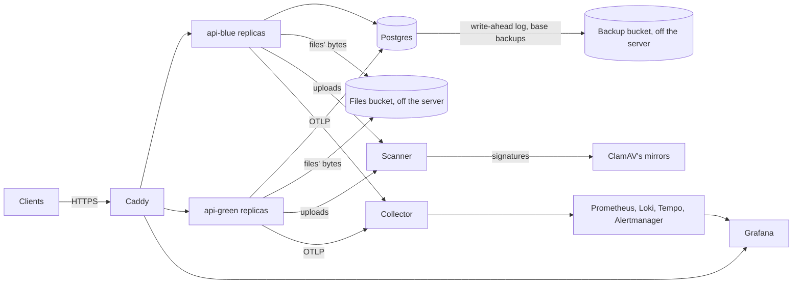

# Deploys

The reference deployment runs the API on one Linux server, in Docker Compose, with no downtime when a release replaces the last one. This document says what runs, what a server needs, how to set one up, how to deploy and roll back a release, how to check on a deployment, and how to choose the services the API depends on. [backups.md](backups.md) describes the database's backups and restores, and [release.md](release.md) how a release is made.

## What runs



- **Caddy** is the only service the server publishes, on ports 80 and 443 (SEC-14). It obtains a certificate for each address through the Automatic Certificate Management Environment (ACME), from Let's Encrypt, answers HTTP with a redirect to HTTPS, and sets HTTP Strict Transport Security (HSTS) (OPS-17). It sends each request to a replica that its own health checks find ready (OPS-05).
- **The API** runs in two colors, `api-blue` and `api-green`, of `API_REPLICAS` replicas each, every replica limited to `API_CPUS` CPUs and `API_MEMORY` of memory. Between deploys one color runs; a deploy starts the other, then stops the first (D45).
- **Postgres**, when the deployment bundles it, runs from the release's Postgres image, the official image with pgBackRest (D44). It archives its write-ahead log continuously to a bucket off the server, and the `backup` service takes a base backup every day ([backups.md](backups.md)). Only the deployment's private network reaches it.
- **The files bucket**, a provider's, holds the bytes of the files that users upload, which the replicas write and read over HTTPS ([below](#the-files-bucket)). <!-- part: files -->
- **The scanner**, ClamAV's daemon, scans each upload for malware before a replica stores it, with ClamAV's signatures, which it keeps up to date ([below](#the-scanner)). Only the replicas reach it. <!-- part: files -->
- **The collector** receives the API's telemetry, and passes it to the self-hosted stack, whose Grafana answers on its own address behind Caddy, where every viewer signs in (D42). [observability.md](observability.md) describes the stack.

[deploy/compose.yaml](../../deploy/compose.yaml) defines the services, and [deploy/deploy.sh](../../deploy/deploy.sh) runs them on the server, with each task's code in a file of `deploy/tasks/` that it sources.

## What a server needs

- **Linux on amd64 or arm64, with Docker Engine 29 or later and its Compose and Buildx plugins**, which Docker's own packages install as `docker compose` and `docker buildx`; `deploy/verify-release.sh` reads a release's images through `docker buildx imagetools`. `just server-setup` installs them on Debian and Ubuntu. The user that Secure Shell (SSH) signs in as for the deployment's tasks belongs to the `docker` group: on a new server, which often has only `root`, the setup creates such a user, `deploy`, and gives it root's SSH keys. The `docker` group can do whatever `root` can, so guard that key as you would root's.
- **Memory for the services the settings choose.** On a trial server with 4 gigabytes, the bundled database and two replicas, the server used about 1.2 gigabytes with the self-hosted stack, Grafana the most at about 300 megabytes, and 0.75 gigabytes with a managed backend, the operating system and Docker included. Give it at least 2 gigabytes with the self-hosted stack, which needs room for its data to grow, and 1 gigabyte without it, since a deploy runs twice the replicas while it switches colors; `just server-check` checks it. The images take about 5 gigabytes of disk.
  The scanner needs 2 gigabytes more: it holds about 1 gigabyte, and 2 while it loads new signatures ([below](#the-scanner)), and its signatures take about 120 megabytes of disk. <!-- part: files -->
- **An encrypted disk** for its volumes (OPS-17). A provider encrypts below the server, where the server can't see it, so confirm it in the provider's documentation or in writing from its support: some providers encrypt neither their servers' disks nor their copies of them. Without it, encrypt the disk that holds Docker's data with Linux Unified Key Setup (LUKS), and plan where its key comes from at each boot, since a key on the same disk protects nothing: typed at the provider's console, sent over SSH, or fetched from a key server on another machine. Until the disk is unlocked, nothing of the deployment starts.
- **A firewall** that admits SSH, and ports 80 and 443 from anywhere. Ports 80 and 443 must be open for Let's Encrypt to issue the certificates. The server reaches out over HTTPS, to the registry and the buckets, among others.
  The scanner reaches ClamAV's mirrors, `database.clamav.net`, the same way. <!-- part: files -->
- **DNS records** that point `API_ADDRESS`, and with the self-hosted stack `GRAFANA_ADDRESS`, to the server, such as `api.example.com` and `grafana.example.com`.
- **A registry login** that can read the release's images, for a private repository: `just server-setup` makes it with a token that can read the repository's packages. The tools that verify a release read the login from `~/.docker/config.json`.
- **A bucket for files' bytes, off the server**, at any provider that speaks the S3 protocol over HTTPS, such as Backblaze B2, Cloudflare R2, Hetzner Object Storage or Amazon S3, with encryption at rest, and a key pair that reaches only that bucket ([below](#the-files-bucket)). <!-- part: files -->
- **With the bundled database, a bucket off the server for its backups**, at a provider, as [backups.md](backups.md#the-bucket) says: a bucket of its own, since pgBackRest manages everything its bucket holds.
- **Buckets that expire each noncurrent version a day after it becomes one.** A noncurrent version is S3's name for the old version that a bucket with versioning keeps of an object deleted or replaced: kept, it would hold each backup that retention let go, for as long as the bucket lasts.
  It would hold the bytes of each file that the API deleted too (FILES-011). <!-- part: files -->
  So each bucket of the deployment has versioning off, or an enabled lifecycle rule of the whole bucket that expires noncurrent versions after 1 day (D102). Backblaze B2 keeps versions in every bucket: give each bucket its lifecycle setting "Keep only the last version of the file", which deletes a version at its first daily run a day after it became noncurrent, so within 2 days. `just server-check` reads each bucket's versioning and lifecycle rules, and fails while one keeps versions without such a rule.

## Setting up a server

From your machine, in your checkout of the repository, run:

```
just server-setup root@203.0.113.7
```

The argument is the server as SSH names it, signed in as `root`, or as a user that may run `sudo` without a password. The setup follows the files of the latest release, or of the release a second argument names, as a deploy of it does: it sends that release's `deploy/` to the server, and asks for what that release's settings and Alertmanager need. Before it changes anything, it asks, on your machine:

- For each setting of [deploy/settings.env.example](../../deploy/settings.env.example) that the choices need, such as the backups' bucket's with the bundled database, and the managed backend's with `TELEMETRY=managed`, under the comment that says what it means, with the value the server holds, or the example's, which Enter keeps. `IMAGE_REPOSITORY` and `SOURCE` start from the checkout's repository on GitHub.
- For each secret the choices need, which you type unseen, and which Enter keeps when the server holds it:
  - In every deployment: `encryption_keys`, the ring of the keys that encrypt the secrets the database holds, which the setup generates the first time and shows once; type a lost server's to restore its backups, or a ring with a new key to replace one ([the encryption keys](#the-encryption-keys)).
  - In every deployment: `files_s3_key` and `files_s3_key_secret`, the files bucket's key pair, which reaches only that bucket ([the files bucket](#the-files-bucket)). <!-- part: files -->
  - With the bundled database: `backup_s3_key` and `backup_s3_key_secret`, the bucket's key pair; `backup_cipher_pass`, the passphrase that encrypts the backups, which the setup generates the first time and shows once; and `postgres_password`, the database's superuser password, which the setup also generates the first time and shows once, unless you give a lost server's, whose backups the new server restores. Keep a copy of the passphrase off the server: without it, no backup can be restored ([backups.md](backups.md#what-to-keep-off-the-server)).
  - With a managed database: `database_admin_url`, `database_owner_url` and `database_url`, as `.env.example` describes `DATABASE_ADMIN_URL`, `DATABASE_OWNER_URL` and `DATABASE_URL`, each with `sslmode=verify-full` (OPS-17).
  - With a managed backend: `managed_otlp_token`, the token the collector signs in with, and with `MANAGED_GRAFANA_URL`, `managed_grafana_token`, the token of a service account of that Grafana with the Admin role, which imports the dashboards and the alert rules ([observability.md](observability.md#a-managed-backend)).
  - With the self-hosted stack: each credential of an alert integration that the release's `alertmanager.yaml` names, in `secrets/alertmanager/` ([observability.md](observability.md#alerts)).
  - With `EMAIL=smtp` and an `SMTP_USERNAME`: `smtp_password`, the mail server's password ([Email](#email)). Without one, the deploy writes the file empty, which the API reads as no password.
  - With a provider's client ID: that client's secret ([Signing in through a provider](#signing-in-through-a-provider)). Without one, the deploy writes the file empty, which turns the client off.
    `github_client_secret`, with `GITHUB_CLIENT_ID`. <!-- part: github -->
    `google_client_secret`, with `GOOGLE_CLIENT_ID`, and `google_desktop_client_secret`, with `GOOGLE_DESKTOP_CLIENT_ID`. <!-- part: google -->
    `openid_connect_client_secret`, with `OPENID_CONNECT_CLIENT_ID`. <!-- part: openid_connect -->
- For the certificate of a private authority, as a file on your machine, when one signed the certificate of a bucket of your own or of a managed backend.
- For a token that can read the repository's packages, through which the server pulls the release's images; a public repository's images need none.

Then, on the server, it:

1. Installs Docker Engine and its Compose and Buildx plugins from Docker's apt repository, on Debian and Ubuntu, once it has checked the repository's key against the fingerprint that Docker's documentation gives. A server that runs Docker 29 or later keeps it. On another distribution, install Docker first, as Docker's documentation says.
2. Signed in as `root`, creates the user `deploy`, which runs the deployment, and gives it root's authorized SSH keys; signed in as another user, that user runs it. The user joins the `docker` group. The other tasks sign in as that user.
3. Logs that user in to the registry, and writes `~/deployment/settings.env`, the secrets in `~/deployment/secrets/` and the certificates in `~/deployment/certs/`.

It ends with the lines to add to `~/.ssh/config` on your machine, which name the server, its address and the deployment's user, unless the server you gave it is such a `Host` already:

```
Host production
    HostName 203.0.113.7
    User deploy
```

With them, every task names the server `production`, as the rest of this document does, and `ssh production` signs in. Choose any name, and add a `Host` for each server, such as `staging` beside `production`.

Run it again to change a setting, a secret or the login: it asks again, starting from what the server holds, and keeps any setting the example doesn't list; the next deploy applies what changed. The deploy writes the other secrets the first time the services need them: the bundled database's other passwords and the URLs made from them, and Grafana's administrator password. When `DATABASE` moves from `managed` to `bundled`, the deploy moves the managed database's URLs aside, to `<name>.before-bundled`, and writes the bundled one's. Compose mounts each secret file into the containers that read it, where any user of the container can read it, so each file is readable by every user, while the directory admits only the deployment's user. A container keeps the files it started with, and the setup writes each secret as a new file, so a deploy recreates each service whose secrets changed since it started, as it records their fingerprints, the SHA-256 of each file's SHA-256, in the environments of the containers that mount them, which only those who can read the files themselves can read (D103): the backups, the collector of a managed backend and Alertmanager restart, and Postgres only with `--allow-restart` ([below](#restarting-a-service-that-runs-once)).

### Checking a server

```
just server-check production
```

checks what a deploy of the latest release, or of the release a second argument names, needs, and changes nothing of the deployment. It runs that release's files, as the deploy will. On the server, it reads the settings and the secrets as a deploy does, and refuses what a deploy would refuse, the connection budget included (OPS-18); checks that Docker 29 or later runs, with both plugins; verifies the release, as a deploy does first ([release.md](release.md#verifying-a-release)), and pulls its images; checks the server's memory against the services the settings choose; with the bundled database, reads the bucket through the release's pgBackRest, with the key pair, the passphrase and the authority a deploy would use; reads each bucket's versioning and lifecycle rules, and fails while one keeps noncurrent versions with no rule that expires them a day after they become noncurrent ([above](#what-a-server-needs)); and with a managed backend, sends it an export of no telemetry, and asks its Grafana for its folders with the import's token. From your machine, it checks that each address the settings name resolves to the server, which Let's Encrypt needs before it issues the address's certificate, and that the server's ports 80 and 443 answer, or refuse, where a firewall that drops them would leave no answer at all.
Reading the files bucket's rules also checks its key pair. <!-- part: files -->
Each check prints `ok` or `FAIL` with what it found, and `note` with what it can't see, whether the provider encrypts the disk, and with what a deploy will then do: when the bucket holds a database's backups and the server has no database yet, as after losing a server, the first deploy stops before its replicas start, for `just restore` to restore them ([backups.md](backups.md#restoring-onto-a-new-server)). Then deploy a release, as below. The first deploy that runs the bundled database creates the backups' stanza in the bucket, pgBackRest's record of the database it backs up, and takes the first full backup.

## Deploying a release

On your machine, in your checkout of the repository, run:

```
just deploy production
```

The argument is the server as SSH names it: a `Host` of `~/.ssh/config`, such as `production`, or `user@address`. The deploy takes the latest release, and says which; name another after the server, such as `just deploy production 1.4.0`. `just deploy` needs git and SSH, which Windows, macOS and Linux all ship, and no login to the registry: the server pulls the images.

It refuses a version that no release has, and says to make one first ([release.md](release.md)). Otherwise it copies the deployment's files from the release's tag, `v1.4.0`, to `~/deployment/releases/1.4.0` on the server, never a checkout of the repository, and runs that release's `deploy.sh` there, which:

1. Verifies the release's two images, as `just verify-release` does ([release.md](release.md#verifying-a-release)), and refuses a release that doesn't verify.
2. Installs the release's files into `~/deployment`, beside the settings and the secrets. A deploy that refuses or fails from here on, until step 7 ends, puts back the files it replaced; a service that already read the new ones keeps them until the next deploy makes it read its files. When a deploy can't put them back, because it was stopped by force, such as by a reboot, or the copy failed, which it reports, the next deploy, backup or restore puts them back before anything else.
3. Checks the settings, and the connection budget below (OPS-18).
4. Pulls the images by digest, and starts the services the replicas use, such as Caddy, the bundled Postgres and its backups, and the collector and the stack.
5. Runs `bootstrap` and `migrate` from the release's image. Migrations follow expand and contract, so the running replicas keep working against the new schema (DATA-10).
6. Starts the idle color's replicas from the release's image, waits until Docker reports each one healthy, then until Caddy's health checks find each one ready.
7. Stops the live color's replicas. Each one first answers its readiness probe with `draining`, keeps serving while Caddy stops sending it requests, then finishes the requests it holds (OPS-06). The release's replicas now serve, so its files stay, even if what follows fails.
8. Removes what earlier deploys left and nothing uses, so the disk doesn't fill with it (D57): every other release's files in `~/deployment/releases`, and the images of the deployment's repositories that no container uses and that neither the services the settings choose nor the tools name, such as the releases' before the previous one and those of pins a release moved. The previous release's API image stays, so rolling back to it pulls nothing, and so does every image of another repository.
9. With a managed backend, imports the release's dashboards and alert rules into its Grafana, and only warns if that fails ([observability.md](observability.md#a-managed-backend)).

A request in flight during a deploy is never refused: CI deploys the real images under continuous requests, and none fails (OPS-14).

What a deploy refuses, and what to do:

| It refuses when | What to do |
|---|---|
| No release has the version | Make the release with `just release` ([release.md](release.md)), then deploy it |
| The release doesn't verify | Read the error: the registry login on the server, or a release whose images aren't signed by your repository's CI |
| A setting is missing or invalid | Set it with `just server-setup`, which asks for it, as `deploy/settings.env.example` describes it |
| A secret that the settings need is missing | Give it with `just server-setup`, which asks for each one |
| The connections wouldn't fit | Lower `API_REPLICAS` or `DATABASE_MAX_CONNECTIONS`, or raise `POSTGRES_MAX_CONNECTIONS` (below) |
| The deploy changes a service that runs once, such as Postgres or Caddy, through the release, a setting, a secret or a file it reads | Deploy it again with `--allow-restart` when what its restart interrupts is acceptable (below) |
| The new replicas don't become ready | Nothing to undo: the deploy removed them, and the live replicas never stopped. Its output ends with their last log lines |
| Another deploy, backup or restore runs | Wait for it. Its lock goes when its processes end, however they end, so a task stopped by force leaves none |

### Restarting a service that runs once

Postgres and Caddy each run once, so restarting either interrupts requests for a few seconds.
The scanner runs once too, and restarting it fails uploads with 503 until it has loaded its signatures ([the scanner](#the-scanner)). <!-- part: files -->
A deploy restarts them only when you allow it: when a release changes the Postgres image or another's, their service in its `compose.yaml`, such as a health check, a setting or a secret they read, such as the backup bucket's key pair, which Postgres archives with, the deploy refuses and says which, and the same command with `--allow-restart`, such as `just deploy production 1.4.0 --allow-restart`, restarts them.
A change to a file of `scanner/` is one such change of the scanner. <!-- part: files -->
Caddy reads `TELEMETRY`, which says whether it exports its spans, so a move of `TELEMETRY` to or from `off` restarts it. A release whose Postgres image is built from the same files as the running one leaves Postgres running, since such an image runs the same Postgres and pgBackRest, at the versions it pins ([release.md](release.md#the-images)). Changes to Caddy's sites or to the replicas it names reload Caddy, which drops no connection.

## Rolling back

To go back to an earlier release, deploy it by its version: `just deploy production 1.3.2`. `just status production` shows the version that serves. Its replicas run against the schema the later release migrated, which expand and contract keeps compatible, and `serve` starts against a schema with later migrations than its own (PLATFORM-030).

## Checking on a deployment

```
just status production
```

shows whether a deploy, backup or restore runs, or a deploy stopped before its replicas served, whose files the next task puts back, then which color serves, each of the deployment's containers with its state, such as `Up 2 hours (healthy)`, and its image's version, when the backups last archived the write-ahead log and last completed a base backup, the data that each restore moved aside, with its size, until you remove it ([backups.md](backups.md#restoring)), and the server's free disk and memory. It changes nothing, so it also runs while a deploy does.

```
just logs production api
```

shows the last 100 lines of the logs of both colors' replicas. Name any of the deployment's services instead, such as `caddy`, `postgres` or `backup`, or none for all of them, and add `--follow` to go on showing the lines that follow, until Ctrl-C. With `caddy`, or no service named, the last 100 of Caddy's lines of the requests it answered itself follow, such as its 503 while no replica runs, each headed `caddy requests`: Caddy writes them to a file, which the collector reads when the deployment has telemetry, and each holds the request's trace ID as `traceID`. Each container keeps the last 100 megabytes of its log, in five files of 20 megabytes, the older ones compressed. With the self-hosted stack, Grafana also keeps the API's logs, to search ([observability.md](observability.md)).

## Removing a lost second factor

A user who lost their authenticator app and their recovery codes can't sign in on their own. Once you have checked, your own way, that the person who asks owns the account,

```
just remove-second-factor production ada@example.com
```

removes the account's app and its recovery codes, ends every session of the account, records the removal in the account's own log, and tells the address ([auth spec](../spec/auth.md#second-factors), D135). The account then signs in with its password alone, and its user sets up an app again, at once when `SECOND_FACTOR_REQUIRED` is true. It runs the API's subcommand `remove-second-factor` with the image of the color that serves, in a service of `compose.yaml` of its own, one for each color, which passes it only the telemetry's, the database's and the email's settings (OPS-02), so it needs a replica running, and it exits 1, changing nothing, when no account holds the address or the account has no app.

## Scaling

`API_REPLICAS` sets how many replicas serve, and `API_CPUS` and `API_MEMORY` what each one may use; `just load-test` measures what one replica serves under the default limits (OPS-16). A replica hashes one password at once per whole CPU it may use, and at least one, each hash with 19 MiB of memory (AUTH-014), and a burst of sign-ins waits its turns (PLATFORM-060), so raising `API_CPUS` raises the memory such a burst takes too.

Each replica opens at most `DATABASE_MAX_CONNECTIONS` pooled connections, plus the listener, and logs that number when it starts (PLATFORM-007). While a deploy runs, both colors do, so the deploy refuses settings under which

2 × `API_REPLICAS` × (`DATABASE_MAX_CONNECTIONS` + 1) + 2, for `migrate` and an operator's subcommand, such as `remove-second-factor`, which may run beside a deploy, one connection each

exceeds `POSTGRES_MAX_CONNECTIONS` less the 3 connections Postgres reserves for its superusers (OPS-18). The other connections fit in those 3: on the bundled database, `bootstrap`, the backups and a restore connect as its superuser, one connection each, beside the scheduled backup: a deploy runs its `bootstrap` and its first backup one after the other, and a restore asks whether Postgres runs and replays the log, then runs pgBackRest's check, before it stops the replicas. On a managed database, `bootstrap` runs before the new color starts, while only the live one runs. With the defaults of [deploy/settings.env.example](../../deploy/settings.env.example), that is 46 of 97. With a managed database, set `POSTGRES_MAX_CONNECTIONS` to the provider's limit.

## Choosing the services

The database and telemetry are each bundled or a provider's, chosen by one setting, with no file to edit; [deploy/settings.env.example](../../deploy/settings.env.example) gives each one's default.
The files bucket is a provider's in every deployment ([the files bucket](#the-files-bucket)). <!-- part: files -->
The deploy runs only the services the choice needs, and stops the ones an earlier choice started once no replica uses them: their volumes stay, with the bundled database's data, while its backups' status goes, so no alert watches backups the deployment doesn't take. Before `DATABASE` moves to `managed`, write the managed database's URLs into `secrets/`: the deploy refuses while `database_url` names the bundled database. The API's settings change only in the addresses and credentials they hold.

| Setting | Values | What runs |
|---|---|---|
| `DATABASE` | `bundled` | Postgres and its backups, on the server ([backups.md](backups.md)) |
| | `managed` | Nothing: the API connects to a provider's Postgres server, which must back it up with point-in-time recovery, which restores the database as it stood at any moment it reaches, as OPS-15 requires, encrypt what it stores, as OPS-17 does, and hold no other deployment's database, such as a staging one's, which each deploy's `bootstrap` refuses, since deployments on one server share its roles ([platform spec](../spec/platform.md#database-roles)), and a staging deployment there would share production's connections, locks, disk and administrator (D75): a staging deployment runs the bundled Postgres on a server of its own instead |
| `TELEMETRY` | `self-hosted` | The collector, Prometheus, Loki, Tempo, Alertmanager, and Grafana at `GRAFANA_ADDRESS` |
| | `managed` | The collector alone, which sends every signal to a managed backend, into whose Grafana each deploy imports the dashboards and the alert rules ([observability.md](observability.md#a-managed-backend)) |
| | `off` | Nothing: the API's logs go only to its containers' output |

Files' bytes always go to a provider's bucket, off the server, as the backups do: a bucket on the server would lose what it holds with the server, so it would need its own backup off the server (D106, [the files bucket](#the-files-bucket)). <!-- part: files -->

<!-- part: files -->
## The files bucket

The replicas keep the bytes of the files that users upload in a bucket that a provider holds off the server, at any provider that speaks the S3 protocol over HTTPS ([files spec](../spec/files.md#storage)). Give it:

- encryption at rest, which most providers apply to every bucket;
- a key pair that reaches only this bucket, in `secrets/files_s3_key` and `secrets/files_s3_key_secret`, which `just server-setup` asks for;
- the settings `FILES_S3_ENDPOINT`, the provider's host, `FILES_S3_REGION` and `FILES_S3_BUCKET`, and `FILES_S3_URI_STYLE=path` for a provider whose bucket names don't appear in its host names, which [deploy/settings.env.example](../../deploy/settings.env.example) describes;
- for a bucket of your own, whose certificate a private authority signs, that authority's certificate in `certs/files-ca.crt`.

Use a bucket of its own, not the backups' one, which pgBackRest manages whole. The API deletes the bytes of a file that no row names only `FILE_DELETION_DELAY_DAYS` after it first finds it so: by default the backups' reach, `BACKUP_RETENTION_DAYS` plus 7, with the bundled database, so a restore to any moment it reaches finds every file's bytes; with a managed database, set it to the provider's recovery window if that is longer than 35 days. Like every bucket of the deployment, it has versioning off, or expires each noncurrent version a day after it becomes one, which `just server-check` checks ([What a server needs](#what-a-server-needs)); the API itself never replaces an object, and deletes one only once no restore can need it. Set no lifecycle rule that deletes the bucket's current files.

The bucket holds the only copy of each file's bytes: the backups hold the files' rows, never their bytes. The provider's durability is the files' durability, so choose a provider that states it.

## The scanner

The `scanner` service runs ClamAV's daemon, clamd, which scans each upload for malware before a replica stores it ([files spec](../spec/files.md#scanning)), beside freshclam, which keeps ClamAV's signatures up to date in the volume `scanner-signatures`, both from ClamAV's own image, with the files in [deploy/scanner/](../../deploy/scanner/). It runs as the image's own user, `clamav`, with no capabilities, on a read-only root, and keeps each stream it scans in memory. freshclam checks ClamAV's mirrors 12 times a day, over HTTPS, keeps a database only once ClamAV's own signature of it checks, and has clamd load what it downloads, while clamd goes on scanning with the signatures it has. clamd loads the signatures each time it starts, in about 15 seconds on the development server, and answers no scan until then. A scanner whose volume holds no signatures, as on a new server, downloads them first, which took 11 seconds for about 115 megabytes there, so a new server's first deploy waits that long more; while ClamAV's mirrors can't be reached, it tries again every minute, and the deploy waits up to 10 minutes.

- **Memory.** clamd holds about 1 gigabyte with ClamAV's signatures, and about 2 while it loads new ones beside the old, so that no scan waits for the load. The service has no memory limit of its own, since a limit that the load reached would kill it; [What a server needs](#what-a-server-needs) counts it.
- **CPU.** Each scan takes one processor while it runs, for a time that grows with the file's size and kind, the longest for a Word, Excel or PowerPoint file ([files spec](../spec/files.md#scanning)). The scans together use at most `SCANNER_CPUS`, 1 by default, so the scans of a burst of uploads share those processors, each taking longer, and leave the rest of the server to the replicas and Postgres; an upload whose scan passes its 30 seconds answers 503, which its client sends again. A server with processors to spare, whose users upload many large documents, raises it.
- **Its signatures' age.** The alert ScannerSignaturesOutdated fires once the daily signatures are 2 days old, as when the server can't reach ClamAV's mirrors, or the mirrors refuse it for checking too often ([runbooks](runbooks.md#scannersignaturesoutdated)).
- **Restarts.** It runs once, so a deploy restarts it only with `--allow-restart` ([above](#restarting-a-service-that-runs-once)), and uploads answer 503 while it loads its signatures.

<!-- end part: files -->
## Email

The API sends email through a provider's mail server, over the Simple Mail Transfer Protocol (SMTP), from background jobs, so no request waits on it ([platform spec](../spec/platform.md#mail)). `EMAIL` has no default: `just server-setup` asks for it, and a deploy refuses to start without it, so no deployment goes without email by accident.

- **`smtp`** sends email.
- **`off`** sends none. Since no email can prove an address, an address is whatever its account claims (D67). The capabilities endpoint says so, and clients hide what needs email. Choose it for a trial, a deployment that only your own people reach, or one whose users sign in only through providers that vouch for their addresses.
  An invitation is still created, but its invitee hears of it only from whoever invited them, and it reaches whichever account holds its address. <!-- part: invitations -->

Any provider with an SMTP relay works. From it, take:

1. **The relay's host and port, and its security.** Most providers offer port 587, where the connection upgrades to TLS before anything else is sent, which `SMTP_SECURITY=starttls`, the default, requires; with a connection that starts with TLS, usually on port 465, set `tls`.
2. **The SMTP credentials**, which providers often issue apart from their API keys: the user name goes in `SMTP_USERNAME`, and the password in the secret file `smtp_password`, which `just server-setup` asks for once the user name is set.
3. **A sender on a domain of yours.** The provider asks you to add DNS records to the domain, usually for the Sender Policy Framework (SPF) and DomainKeys Identified Mail (DKIM), and recommends one for Domain-based Message Authentication, Reporting and Conformance (DMARC); until they verify, the provider refuses or holds the email, and receiving servers file what does arrive as spam. Set the sender, with a name, in `EMAIL_FROM`, such as `AntWorker <noreply@example.com>`.

A provider's refusal, such as of a sender it hasn't verified, dead-letters the email at once, and `JobsDeadLettered` fires, whose runbook finds the reply's code ([runbooks.md](runbooks.md#jobsdeadlettered)). A provider that doesn't answer delays the emails while they retry, for as long as the [platform spec](../spec/platform.md#sending-email) says, before they dead-letter.

## Signing in through a provider

Users may sign in through an OAuth provider, once the deployment registers a client with it and sets the client's ID, its redirect uniform resource identifiers (URIs) and its secret; a client left empty is off ([auth spec](../spec/auth.md#signing-in-through-a-provider)). A redirect URI is where the provider sends the user back with a code: a page of the web client, such as `https://app.example.com/callback/<provider>`, or, for the desktop client, a loopback one without a port, such as `http://127.0.0.1/callback/<provider>`, which matches the port the desktop client picks. Register the same URIs at the provider and in the settings, and give each provider URIs of its own, which startup checks, so a code reaches the provider it came from (AUTH-081). The capabilities endpoint lists each provider that is on, with what a client needs to start a sign-in.
- **Google:** in the Google Cloud console, create an OAuth client of the type "Web application" for browsers, whose ID and redirect URIs go in `GOOGLE_CLIENT_ID` and `GOOGLE_REDIRECT_URIS`, and one of the type "Desktop app" for the desktop client, in `GOOGLE_DESKTOP_CLIENT_ID` and `GOOGLE_DESKTOP_REDIRECT_URIS`; `just server-setup` asks for each client's secret. Its consent screen asks for the scopes `openid`, `email` and `profile`. <!-- part: google -->
- **GitHub:** in GitHub's developer settings, create an OAuth app, list its callback URLs, with matching that isn't by wildcard, and put its client ID and the same URLs in `GITHUB_CLIENT_ID` and `GITHUB_REDIRECT_URIS`; `just server-setup` asks for its client secret. <!-- part: github -->
- **A provider that the settings name:** any provider that follows OpenID Connect, such as an organization's own, with no code of its own. Register a client at the provider, of the kind that keeps a secret and sends it in HTTP's Basic scheme (`client_secret_basic`), with the redirect URIs, and put its ID and the same URIs in `OPENID_CONNECT_CLIENT_ID` and `OPENID_CONNECT_REDIRECT_URIS`; `just server-setup` asks for its secret. Open the provider's discovery document, at `<issuer>/.well-known/openid-configuration`, and copy its `issuer`, `authorization_endpoint`, `token_endpoint` and `userinfo_endpoint` into `OPENID_CONNECT_ISSUER`, `OPENID_CONNECT_AUTHORIZATION_ENDPOINT`, `OPENID_CONNECT_TOKEN_ENDPOINT` and `OPENID_CONNECT_USERINFO_ENDPOINT`; the name that the clients show goes in `OPENID_CONNECT_NAME`. Its access tokens must lapse, as its token endpoint's `expires_in` says: the API deletes none, so it takes no other, and its sign-ins answer 503. Its users prove their address with a code when email is on, since the API takes no address on such a provider's word. The issuer names the provider's users: change it only to name another provider, whose sign-ins then reach none of the accounts that the first's users registered. With email on, each of those users gets back in with a password set through a reset; with email off, an account that signs in only through the provider stays out of reach (AUTH-084). <!-- part: openid_connect -->

## TLS and proxies

Caddy obtains and renews the certificates on its own, and keeps them in its `caddy-data` volume. HSTS tells browsers to reach the API over HTTPS only, for a year, and so do its subdomains.

Caddy replaces each request's `X-Forwarded-For` with the address it came from, so a client can't pretend to come from elsewhere. When a content delivery network or a load balancer stands in front of the server, list its addresses in `TRUSTED_PROXIES`, and Caddy keeps the header they send (SEC-13).

## Grafana

With the self-hosted stack, Grafana answers at `https://<GRAFANA_ADDRESS>`. Sign in as `admin`, with the password in `~/deployment/secrets/grafana_admin_password`, which the first deploy with the self-hosted stack wrote; Grafana reads it only the first time it starts, so change it in Grafana afterwards. Add every other viewer as a user in Grafana: nobody views it anonymously, and nobody signs up (SEC-14). The dashboards are read-only, and change only through their files (OBS-13). Grafana shows the alerts that fire, but no alert notifies anyone until your fork's `alertmanager.yaml` names an integration, such as email or a chat webhook, and every deploy warns until then ([observability.md](observability.md#alerts)).

With a managed backend, its Grafana shows the dashboards in the folder `API`, and its notification policies route the alerts ([observability.md](observability.md#a-managed-backend)).

## The encryption keys

The API encrypts each secret that it must read back, such as an authenticator app's, under the key ring in `secrets/encryption_keys`, which `just server-setup` generates the first time, with one key, version 1, and shows once (SEC-02, PLATFORM-086). Keep a copy off the server ([backups](backups.md#what-to-keep-off-the-server)). A key is the base64 of 32 random bytes, as `head -c 32 /dev/urandom | base64` writes it. To replace a key, such as one that may have leaked:

1. Run `just server-setup`, and give `encryption_keys` the ring with a key of the next version beside the old one, such as `1:<old key>,2:<new key>`, and `ENCRYPTION_KEY_VERSION` the old version, 1; then deploy, so that every replica holds the new key before any encrypts with it.
2. Run `just server-setup` again, and give `ENCRYPTION_KEY_VERSION` the new version, 2, since Enter keeps the version the server holds; then deploy. Each check that accepts an app's code, and the hourly job `auth.reencrypt_secrets`, stores its secret again under the new key (AUTH-066). While the deploy's old replicas still serve, one of them may store a secret under the old key again, which the next run moves back.
3. Once no restore reaches a moment before that deploy, `BACKUP_RETENTION_DAYS` after it, or a managed database's recovery window after it, run `just server-setup`, and give `encryption_keys` the ring without the old key, such as `2:<new key>`; then deploy. A restore to a moment before the move brings back secrets under the old key, which a ring without it opens nowhere ([restoring](backups.md#restoring)). A replica refuses to start while a stored secret still needs the old key, so the deploy keeps the replicas that serve until the job has moved every secret.

## The files on the server

| Path in `~/deployment` | Holds | Written by |
|---|---|---|
| `settings.env` | The deployment's settings | `just server-setup` |
| `secrets/` | One secret per file | `just server-setup`, and the first deploy that needs each generated one |
| `certs/backup-ca.crt`, `certs/managed-otlp-ca.crt`, `certs/managed-grafana-ca.crt` | The authority of a private bucket's certificate, for backups, and of a managed backend's and its Grafana's, if any | `just server-setup` |
| `certs/files-ca.crt` | The authority of the files bucket's certificate, for a bucket of your own | `just server-setup` <!-- part: files --> |
| `compose.yaml`, `deploy.sh`, `tasks/`, `verify-release.sh`, `import-grafana.sh`, `settings.env.example`, `caddy/`, `observability/`, `tools/` | The deployment files of the last deploy whose replicas served, once one has: a deploy that refuses or fails before its own serve puts these back, as [Deploying a release](#deploying-a-release) says | each deploy |
| `scanner/` | The scanner's files, of the same deploy | each deploy <!-- part: files --> |
| `releases/<version>/` | The files of the release that `just deploy` last copied; a deploy whose replicas serve removes every other release's | `just deploy` |
| `state/` | Which color serves, the images each color runs, Caddy's sites and replicas, the files each service of the stack last read, the files that a deploy replaced until its replicas serve, and the tasks' locks | each deploy, backup and restore |

## On another platform

The image and its settings don't depend on this deployment, so a fork can run the API on Kubernetes, Amazon's Elastic Container Service or any platform that runs containers. That platform must provide:

- one Postgres that every replica shares, with point-in-time recovery (OPS-15), on a server that holds no other deployment's database, since deployments on one server share its roles ([platform spec](../spec/platform.md#database-roles));
- a bucket that speaks the S3 protocol over HTTPS, for files' bytes, which every replica reaches with `S3_ENDPOINT` and the settings that [.env.example](../../.env.example) lists beside it, and `FILE_DELETION_DELAY_DAYS` at least the database's recovery window ([the files bucket](#the-files-bucket)); <!-- part: files -->
- ClamAV's daemon, clamd, which every replica reaches at `CLAMD_ADDRESS` over a private network only, since clamd speaks no TLS ([platform spec](../spec/platform.md#scanner)), with [deploy/scanner/clamd.conf](../../deploy/scanner/clamd.conf)'s limits and ClamAV's signatures kept up to date ([the scanner](#the-scanner)); <!-- part: files -->
- routing that sends requests only to replicas whose `/health/ready` answers 200, and stops within `SHUTDOWN_DELAY_SECONDS` of a replica answering `draining`;
- every proxy between the clients and the replicas listed in `TRUSTED_PROXIES`, each adding the address it received the request from to `X-Forwarded-For`, so that the rate limits count each client by its own address (PLATFORM-053);
- a grace period after the shutdown signal longer than `SHUTDOWN_DELAY_SECONDS` plus `SHUTDOWN_DRAIN_SECONDS` plus the time that writing out telemetry may take, which the platform spec's [Telemetry export](../spec/platform.md#telemetry-export) bounds;
- TLS for every connection that leaves the host, and encryption at rest (OPS-17);
- a connection budget that fits, as above, counting every replica that runs at once during a rollout.
