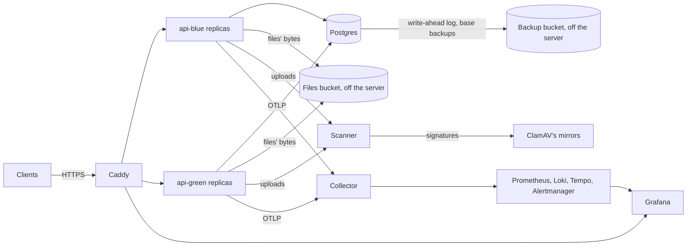

# Deploys

The reference deployment runs the API on one Linux server, in Docker Compose, with no downtime when a release replaces the last one. This document says what runs, what a server needs, how to set one up, how to deploy and roll back a release, how to check on a deployment, and how to choose the services the API depends on. [backups.md](backups.md) describes the database's backups and restores, and [release.md](release.md) how a release is made. `just server-setup`, `just server-check` and `just deploy` each take a release, so a new fork makes its first release, as [release.md](release.md#how-to-release) says, before it sets up a server. An ID in parentheses names what a sentence follows: a rule of the [standards](../standards/README.md), such as OPS-14, a behavior of a [spec](../spec/README.md), such as PLATFORM-030, or a decision, such as D45, whose records [architecture.md](../architecture.md) says where to find. The [glossary](../architecture.md#11-glossary) defines the terms these documents share.

## What runs



- **Caddy** is the only service the server publishes, on ports 80 and 443 (SEC-14). It obtains a certificate for each address through the Automatic Certificate Management Environment (ACME), from Let's Encrypt, answers plain HTTP with nothing at the API's address and with a redirect to HTTPS at Grafana's, and sets HTTP Strict Transport Security (HSTS) (OPS-17). It sends each request to a replica that its own health checks find ready (OPS-05).
- **The API** runs as replicas, each a container of the release's image, in two colors, `api-blue` and `api-green`, of `API_REPLICAS` replicas each, every replica limited to `API_CPUS` CPUs and `API_MEMORY` of memory. Between deploys one color runs; a deploy starts the other, then stops the first (D45).
- **Postgres**, when the deployment bundles it, runs from the release's Postgres image, the official image with pgBackRest (D44). It archives its write-ahead log continuously to a bucket off the server, and the `backup` service takes a base backup every day ([backups.md](backups.md)). Only the deployment's private network reaches it. Its log holds each error without the error's detail, which names the values that a constraint refused, such as an address (OBS-04).
- **The files bucket**, a provider's, holds the bytes of the files that users upload, which the replicas write and read over HTTPS ([below](#the-files-bucket)). <!-- part: files -->
- **The scanner**, ClamAV's daemon, scans each upload for malware before a replica stores it, with ClamAV's signatures, which it keeps up to date ([below](#the-scanner)). Only the replicas reach it. <!-- part: files -->
- **The collector** receives the API's telemetry, and passes it to the self-hosted stack, whose Grafana answers on its own address behind Caddy, where every viewer signs in (D42). [observability.md](observability.md) describes the stack.

[deploy/compose.yaml](../../deploy/compose.yaml) defines the services, and [deploy/deploy.sh](../../deploy/deploy.sh) runs them on the server, with each task's code in a file of `deploy/tasks/` that it sources.

## What a server needs

- **Linux on amd64 or arm64, with Docker Engine 29 or later and its Compose and Buildx plugins**, which Docker's own packages install as `docker compose` and `docker buildx`; `deploy/verify-release.sh` reads a release's images through `docker buildx imagetools`. `just server-setup` installs them on Debian and Ubuntu. The user that Secure Shell (SSH) signs in as for the deployment's tasks belongs to the `docker` group: on a new server, which often has only `root`, the setup creates such a user, `deploy`, and gives it root's SSH keys. The `docker` group can do whatever `root` can, so guard that key as you would root's.
- **Memory for the services the settings choose.** On a trial server with 4 gigabytes, the bundled database and two replicas, the server used about 1.2 gigabytes with the self-hosted stack, Grafana the most at about 300 megabytes, and 0.75 gigabytes with a managed backend, the operating system and Docker included. Give it at least 2 gigabytes with the self-hosted stack, which needs room for its data to grow, and 1 gigabyte without it, since a deploy runs twice the replicas while it switches colors. `just server-check` checks the server's memory against these figures, which don't grow with `API_REPLICAS` or `API_MEMORY`: each replica may use up to `API_MEMORY`, and a deploy runs twice `API_REPLICAS` of them. The images take about 5 gigabytes of disk.
  The scanner needs 2 gigabytes more, which `just server-check` counts too, so 4 with the self-hosted stack: it holds about 1 gigabyte, and 2 while it loads new signatures ([below](#the-scanner)), and its signatures take about 120 megabytes of disk. <!-- part: files -->
- **An encrypted disk** for its volumes (OPS-17). A provider encrypts below the server, where the server can't see it, so confirm it in the provider's documentation or in writing from its support: some providers encrypt neither their servers' disks nor their copies of them. Without it, encrypt the disk that holds Docker's data with Linux Unified Key Setup (LUKS), and plan where its key comes from at each boot, since a key on the same disk protects nothing: typed at the provider's console, sent over SSH, or fetched from a key server on another machine. Until the disk is unlocked, nothing of the deployment starts.
- **Ports 80 and 443 open from anywhere, and SSH from your machine**, through any firewall of the server or of its provider. Ports 80 and 443 must be open for Let's Encrypt to issue the certificates. A firewall that also bounds what leaves the server lets through [what the deployment reaches](#what-the-deployment-reaches).
- **A synchronized clock**, which a service of the operating system keeps, such as systemd-timesyncd or chrony: it stamps the logs and the metrics and, with the bundled database, every time that the database stores (DATA-03); `just server-check` checks it. A managed database stores the times of its provider's clock.
- **DNS records** that point `API_ADDRESS`, and with the self-hosted stack `GRAFANA_ADDRESS`, to the server, such as `api.example.com` and `grafana.example.com`.
- **A registry login** that can read the release's images, for a private repository: `just server-setup` makes it with a token that can read the repository's packages. The tools that verify a release read the login from `~/.docker/config.json`.
- **A bucket for files' bytes, off the server**, at any provider that speaks the S3 protocol over HTTPS, such as Backblaze B2, Cloudflare R2, Hetzner Object Storage or Amazon S3, with encryption at rest, and a key pair that reaches only that bucket ([below](#the-files-bucket)). <!-- part: files -->
- **With the bundled database, a bucket off the server for its backups**, at a provider, as [backups.md](backups.md#the-bucket) says: a bucket of its own, since pgBackRest manages everything its bucket holds.
- **Buckets that keep what is deleted in them, where the server can't remove it** (OPS-22). Whoever holds the server holds its buckets' key pairs, and could otherwise delete the backups with the data.
  The files' bytes too. <!-- part: files -->
  So each bucket of the deployment keeps what is deleted or replaced in it for `BUCKETS_KEEP_DELETED_DAYS` days, 7 unless you set it:
  - Its versioning is on, so an object that is deleted or replaced stays as a noncurrent version, S3's name for it.
  - Its lifecycle holds one expiry of noncurrent versions (`NoncurrentVersionExpiration`): that of an enabled rule of the whole bucket, with the setting's days as its `NoncurrentDays`. Set no rule that deletes the bucket's current objects.
  - Its key pair on the server reads, writes and lists objects, deletes them by name, and reads the versions that the bucket keeps, its versioning and its lifecycle. It may neither delete a version nor write the versioning or the lifecycle. The end-to-end tests' stand-in for a provider's buckets holds the server's key pair to a policy of S3's actions `s3:GetObject`, `s3:GetObjectVersion`, `s3:PutObject`, `s3:DeleteObject`, `s3:ListBucket`, `s3:ListBucketVersions`, `s3:GetBucketVersioning`, `s3:GetLifecycleConfiguration`, `s3:GetBucketLocation`, `s3:AbortMultipartUpload`, `s3:ListMultipartUploadParts` and `s3:ListBucketMultipartUploads`, which names neither `s3:DeleteObjectVersion`, `s3:PutBucketVersioning` nor `s3:PutLifecycleConfiguration`; a provider may name its permissions its own way. Turn the versioning on, and write the rule, with a key pair that stays off the server, such as your account's at the provider.

  `just server-check` checks these, as [Checking a server](#checking-a-server) says. What a bucket keeps costs its storage: the backups' bucket holds a week of backups and of log more, at 7 days, beside the four to five weeks that the default retention holds. Backblaze B2 keeps versions in every bucket. By its documentation, its lifecycle setting "Keep prior versions for this number of days" expires them after the days it is given, and an application key without the capability `deleteFiles` can delete a file by its name, but not one of its versions.
  With a provider that can't keep a version from a key pair, as one without versioning, set `BUCKETS_KEEP_DELETED_DAYS=0`: each bucket then keeps no version for more than a day, with its versioning off, or with an enabled lifecycle rule of the whole bucket that expires noncurrent versions after 1 day, such as Backblaze B2's "Keep only the last version of the file", which deletes a version at its first daily run a day after it became noncurrent, so within 2 days; and nothing keeps the buckets from whoever holds the server ([threat model](threat-model.md#data-protection)).

## What the deployment reaches

The server answers on ports 80 and 443, and to SSH. Beyond itself, the deployment reaches these systems, each over TLS that checks the certificate (OPS-17), but for what the operating system reaches for itself, which is the server's to configure:

| What reaches out | Where | For |
|---|---|---|
| Caddy | Let's Encrypt, at `acme-v02.api.letsencrypt.org`, which the Caddyfile names; Caddy's code also names Let's Encrypt's staging address, `acme-staging-v02.api.letsencrypt.org`, for the attempts that follow a failed one, which no run here has shown | The certificates of the addresses, and when to renew them |
| Docker, at a deploy | The registry that holds the release's images, `ghcr.io`, and Docker Hub and `gcr.io`, for the other images that the deployment's Compose files pin | The images |
| A deploy, as it verifies a release | Sigstore's trust data, at `tuf-repo-cdn.sigstore.dev`, and the release's registry, which holds the signatures | [Verifying a release](release.md#verifying-a-release) |
| pgBackRest, with the bundled database | The backups' bucket, at `BACKUP_S3_ENDPOINT` | The write-ahead log and the base backups ([backups.md](backups.md)) |
| The replicas, with a managed database | The database, at the host of its URLs | Every query |
| The replicas, with email on | The mail server, at `SMTP_HOST` | Each email ([Email](#email)) |
| The collector, with a managed backend | The backend, at `MANAGED_OTLP_ENDPOINT`; and each deploy, its Grafana, at `MANAGED_GRAFANA_URL` | The telemetry, and the dashboards and alert rules ([observability.md](observability.md#a-managed-backend)) |
| Alertmanager | The integrations that your fork's `alertmanager.yaml` names | The alerts ([observability.md](observability.md#alerts)) |
| The operating system | Its packages' mirrors, Docker's packages at `download.docker.com`, which `just server-setup` installs, a time source, and its name servers | The server itself |
| The replicas, and `just restore-files` | The files bucket, at `FILES_S3_ENDPOINT` | Files' bytes ([the files bucket](#the-files-bucket)), and the versions that the bucket keeps of them ([writing deleted files back](#writing-deleted-files-back)) <!-- part: files --> |
| The scanner | ClamAV's mirrors, at `database.clamav.net` | Its signatures ([the scanner](#the-scanner)) <!-- part: files --> |
| The replicas | Google, at `oauth2.googleapis.com` and `openidconnect.googleapis.com` | A sign-in's exchange ([Signing in through a provider](#signing-in-through-a-provider)) <!-- part: google --> |
| The replicas | GitHub, at `github.com` and `api.github.com` | A sign-in's exchange ([Signing in through a provider](#signing-in-through-a-provider)) <!-- part: github --> |
| The replicas | The provider that the settings name, at its token and userinfo endpoints | A sign-in's exchange ([Signing in through a provider](#signing-in-through-a-provider)) <!-- part: openid_connect --> |
| The replicas | The hosts that the providers that are on name for their users' pictures ([Signing in through a provider](#signing-in-through-a-provider)) | The picture that a provider gives for a new account, copied as its avatar <!-- part: files --> |

Of the self-hosted stack, Grafana's settings turn off each thing it would reach on its own ([Grafana](#grafana)), and Loki's and Tempo's the reports of their use to their maker.
One address is a third party's to choose, among those hosts: that of a user's picture, which a sign-in provider gives, and which a replica fetches over HTTPS, through the untrusted client, from no other host (SEC-10, AUTH-097, ACCOUNTS-028). <!-- part: files -->

## Setting up a server

The tasks on the server run from your machine, in your checkout of the repository, through `just` and Rust's Cargo, installed as the [README](../../README.md) says, with git and an SSH client: each reaches the server through SSH, and `just server-setup`, `just server-check` and `just deploy` fetch the release tags from the checkout's `origin` with git. To set a server up, run:

```
just server-setup root@203.0.113.7
```

The argument is the server as SSH names it, signed in as `root`, or as a user that may run `sudo` without a password. The setup follows the files of the latest release, or of the release a second argument names, as a deploy of it does: it sends that release's `deploy/` to the server, and asks for what that release's settings and Alertmanager need. Before it changes anything, it asks, on your machine:

- For each setting of [deploy/settings.env.example](../../deploy/settings.env.example), under the comment that says what it means, with the value the server holds, or the example's, which Enter keeps. It leaves out the settings of a choice of `DATABASE`, `TELEMETRY` or `EMAIL` that you didn't make, such as the backups' bucket's with a managed database, and the managed backend's without `TELEMETRY=managed`; [Choosing the services](#choosing-the-services) and [Email](#email) describe the choices. `IMAGE_REPOSITORY` and `SOURCE` start from the checkout's repository on GitHub.
- For each secret the choices need, which you type unseen, and which Enter keeps when the server holds it:
  - In every deployment: `encryption_keys`, the ring of the keys that encrypt the secrets the database holds, which the setup generates the first time and shows once; type a lost server's to restore its backups, or a ring with a new key to replace one ([the encryption keys](#the-encryption-keys)).
  - In every deployment: `files_s3_key` and `files_s3_key_secret`, the files bucket's key pair, which reaches only that bucket ([the files bucket](#the-files-bucket)). <!-- part: files -->
  - With the bundled database: `backup_s3_key` and `backup_s3_key_secret`, the bucket's key pair; `backup_cipher_pass`, the passphrase that encrypts the backups, which the setup generates the first time and shows once; and `postgres_password`, the database's superuser password, which the setup also generates the first time and shows once, unless you give a lost server's, whose backups the new server restores. Keep a copy of the passphrase off the server: without it, no backup can be restored ([backups.md](backups.md#what-to-keep-off-the-server)).
  - With a managed database: `database_admin_url`, `database_owner_url` and `database_url`, as `.env.example` describes `DATABASE_ADMIN_URL`, `DATABASE_OWNER_URL` and `DATABASE_URL`, each with `sslmode=verify-full`, without which a deploy refuses it, since the driver would otherwise fall back to a connection that checks nothing, or encrypts nothing (OPS-17). When an authority of the provider's own signed the database's certificate, each URL also names that authority's certificate, which the setup asks for below, as `sslrootcert=/etc/deployment-certs/database-ca.crt`, the path at which the API's containers read it. Give the roles `owner` and `app` random passwords, as a password manager generates them: `bootstrap` stores each as a verifier of 4,096 iterations (SEC-16), which protects a random password, and not one that a person made up.
  - With a managed backend: `managed_otlp_token`, the token the collector signs in with, and with `MANAGED_GRAFANA_URL`, `managed_grafana_token`, the token of a service account of that Grafana with the Admin role, which imports the dashboards and the alert rules ([observability.md](observability.md#a-managed-backend)).
  - With the self-hosted stack: `grafana_admin_password`, the password that Grafana's administrator signs in with, under the name in `GRAFANA_ADMIN_USER`: one of your own, of 15 characters or more ([Grafana](#grafana)); and each credential of an alert integration that the release's `alertmanager.yaml` names, in `secrets/alertmanager/` ([observability.md](observability.md#alerts)).
  - With `EMAIL=smtp` and an `SMTP_USERNAME`: `smtp_password`, the mail server's password ([Email](#email)). Without one, the deploy writes the file empty, which the API reads as no password.
  - With `GITHUB_CLIENT_ID`: `github_client_secret`, that client's secret ([Signing in through a provider](#signing-in-through-a-provider)). Without the ID, the deploy writes the file empty, which turns the client off. <!-- part: github -->
  - With `GOOGLE_CLIENT_ID`: `google_client_secret`, and with `GOOGLE_DESKTOP_CLIENT_ID`: `google_desktop_client_secret`, each that client's secret ([Signing in through a provider](#signing-in-through-a-provider)). Without a client's ID, the deploy writes its file empty, which turns the client off. <!-- part: google -->
  - With `OPENID_CONNECT_CLIENT_ID`: `openid_connect_client_secret`, that client's secret ([Signing in through a provider](#signing-in-through-a-provider)). Without the ID, the deploy writes the file empty, which turns the client off. <!-- part: openid_connect -->
- For the certificate of a private authority, as a file on your machine, when one signed the certificate of a managed database, of a bucket of your own or of a managed backend.
- For a token that can read the repository's packages, through which the server pulls the release's images, and for its user, the owner that `IMAGE_REPOSITORY` names, if it names one, unless you type another; a public repository's images need none.

Then, on the server, it:

1. Installs Docker Engine and its Compose and Buildx plugins from Docker's apt repository, on Debian and Ubuntu, once it has checked the repository's key against the fingerprint that Docker's documentation gives. A server that runs Docker 29 or later keeps it. On another distribution, install Docker first, as Docker's documentation says.
2. Signed in as `root`, creates the user `deploy`, which runs the deployment, and gives it root's authorized SSH keys; signed in as another user, that user runs it. The user joins the `docker` group. The other tasks sign in as that user.
3. Logs that user in to the registry, and writes `~/deployment/settings.env`, the secrets in `~/deployment/secrets/` and the certificates in `~/deployment/certs/`.

It ends with the lines to add to `~/.ssh/config` on your machine, which name the server, its address and the deployment's user, unless the server you gave it is such a `Host` already:

```
Host production
    HostName 203.0.113.7
    User deploy
```

With them, every task names the server `production`, as the rest of this document does, and `ssh production` signs in. Choose any name, and add a `Host` for each server, such as `staging` beside `production`.

Run it again to change a setting, a secret or the login, signed in as on its first run, such as `just server-setup root@203.0.113.7`: for any user but `root`, it checks Docker through `sudo`, and it gives `deploy`, the user that `production` names, no `sudo`. It asks again for each setting and secret, starting from what the server holds, which Enter keeps, and keeps any setting the example doesn't list; the next deploy applies what changed. After a rollback, name the release that serves ([Rolling back](#rolling-back)). The deploy writes the other secrets the first time the services need them: the bundled database's other passwords and the URLs made from them, and [the two keys that it generates](#the-keys-that-a-deploy-generates), the key of the API's keyed hashes and the one under which Grafana encrypts what it stores. When `DATABASE` moves from `managed` to `bundled`, the deploy moves the managed database's URLs aside, to `<name>.before-bundled`, and writes the bundled one's. Compose mounts each secret file into the containers that read it, where any user of the container can read it, so each file is readable by every user, while the directory admits only the deployment's user. A container keeps the files it started with, and the setup writes each secret as a new file. The replicas that a deploy starts read the secrets as they stand. The deploy also recreates each other service whose secrets changed since it started: the backups, the collector of a managed backend, Alertmanager and Grafana restart, and Postgres only with `--allow-restart` ([below](#restarting-a-service-that-runs-once)). It finds them by their files' fingerprints, the SHA-256 of each file's SHA-256, which it records in the environments of the containers that mount them, where only those who can read the files themselves can read them (D103).

### Checking a server

```
just server-check production
```

checks what a deploy of the latest release, or of the release a second argument names, needs, and changes nothing of the deployment but an object that it writes to each bucket and deletes. It runs that release's files, as the deploy will. On the server, it:

- reads the settings and the secrets as a deploy does, and refuses what a deploy would refuse, the connection budget included (OPS-18); the checks of the buckets and of a managed backend, below, run once both passed;
- checks that Docker 29 or later runs, with both plugins;
- verifies the release, as a deploy does first ([release.md](release.md#verifying-a-release)), and pulls its images;
- checks the server's memory against the services the settings choose;
- checks that the server's clock is synchronized, as systemd's `timedatectl` reports it;
- with the bundled database, reads the bucket through the release's pgBackRest, with the key pair, the passphrase and the authority a deploy would use;
- checks that each bucket keeps what is deleted in it, where its key pair can't remove it ([above](#what-a-server-needs), OPS-22);
- with a managed backend, sends it an export of no telemetry, and asks its Grafana for its folders with the import's token.

From your machine, it checks that each address the settings name resolves to the server, which Let's Encrypt needs before it issues the address's certificate, and that the server's ports 80 and 443 answer, or refuse, where a firewall that drops them would leave no answer at all.

The check of the files bucket also checks its key pair. <!-- part: files -->
For each bucket, the check reads its versioning and its lifecycle, with S3's `GetBucketVersioning` and `GetBucketLifecycleConfiguration`, and fails unless the versioning is on and the lifecycle holds the one expiry that [What a server needs](#what-a-server-needs) describes. It then asks the bucket for a listing of its versions, writes the object `server-check/probe`, deletes it by name, asks the bucket to delete the version that it kept, and reads that version again: a bucket that gives it back kept it from its key pair, whatever it answered. Last, it sends the bucket the lifecycle that it read, and the versioning `Enabled`, neither of which changes a bucket that takes it, and fails unless the bucket answers each with 403, S3's refusal of what a key pair may not do. It fails as well when the bucket refuses the key pair the listing, the write, the deletion by name or the version. On a bucket that passes, each check leaves one noncurrent version of the object, for the lifecycle to expire, and a delete marker. With `BUCKETS_KEEP_DELETED_DAYS=0`, the check reads the versioning and the lifecycle alone, writes nothing, and fails while the bucket keeps noncurrent versions with no rule that expires them a day after they become noncurrent.

Each check prints `ok` or `FAIL` with what it found, and `note` with what it can't see, whether the provider encrypts the disk, and the clock on a server without `timedatectl`, and with what a deploy will then do: when the bucket holds a database's backups and the server has no database yet, as after losing a server, the first deploy stops before its replicas start, for `just restore` to restore them ([backups.md](backups.md#restoring-onto-a-new-server)). Then deploy a release, as below.

## Deploying a release

On your machine, in your checkout of the repository, run:

```
just deploy production
```

The argument is the server as SSH names it: a `Host` of `~/.ssh/config`, such as `production`, or `user@address`. The deploy takes the latest release, and says which; name another after the server, such as `just deploy production 1.4.0`. It needs no login to the registry on your machine: the server pulls the images.

It refuses a version that no release has, and says to make one first ([release.md](release.md)). Otherwise it copies the deployment's files from the release's tag, `v1.4.0`, to `~/deployment/releases/1.4.0` on the server, never a checkout of the repository, and runs that release's `deploy.sh` there, which:

1. Verifies the release's two images, as `just verify-release` does ([release.md](release.md#verifying-a-release)), and refuses a release that doesn't verify.
2. Installs the release's files into `~/deployment`, beside the settings and the secrets. A deploy that refuses or fails from here on, until step 7 ends, puts back the files it replaced; a service that already read the new ones keeps them until the next deploy makes it read its files. When a deploy can't put them back, because it was stopped by force, such as by a reboot, or the copy failed, which it reports, the next deploy, backup or restore puts them back before anything else.
3. Checks the settings, and the connection budget below (OPS-18).
4. Pulls the images by digest, and starts the services the replicas use, such as Caddy, the bundled Postgres and its backups, and the collector and the stack. With the bundled database, it then prepares the backups' stanza in the bucket, pgBackRest's record of the database it backs up, and takes the first full backup when the bucket holds none.
5. Runs `bootstrap` and `migrate` from the release's image. Migrations follow expand and contract: a column or a table goes, or takes a new name, only after a release in which no code uses it, so the running replicas keep working against the new schema (DATA-10). A migration that adds an index to a table builds it without holding up the table's writes, and its build ends only once the transactions that were open on the table when it began have ended. If such a build fails, the deploy stops here, as for any migration that fails, and leaves an index that no query uses: the next deploy drops it and builds it again (PLATFORM-005).
6. Starts the idle color's replicas from the release's image, waits until Docker reports each one healthy, then until Caddy's health checks find each one ready.
7. Stops the live color's replicas. Each one first answers its readiness probe with `draining`, keeps serving while Caddy stops sending it requests, then finishes the requests it holds (OPS-06). The release's replicas now serve, so its files stay, even if what follows fails.
8. Removes what earlier deploys left and nothing uses, so the disk doesn't fill with it (D57): every other release's files in `~/deployment/releases`, and the images of the deployment's repositories that no container uses and that neither the services the settings choose nor the tools name, such as the releases' before the previous one and those of pins a release moved. The API image of the release that served before this deploy stays, so rolling back to it pulls nothing, and so does every image of another repository.
9. With a managed backend, imports the release's dashboards and alert rules into its Grafana, and only warns if that fails ([observability.md](observability.md#a-managed-backend)).

A deploy that succeeds says so before step 9, in a line that starts `deploy: deployed`, with the image, and how many replicas of which color serve.

A request in flight during a deploy is never refused: CI deploys the real images under continuous requests, and none fails (OPS-14).

What a deploy refuses, and what to do:

| It refuses when | What to do |
|---|---|
| No release has the version | Make the release with `just release` ([release.md](release.md)), then deploy it |
| The release doesn't verify | Read the error: the registry login on the server, or a release whose images aren't signed by your repository's CI |
| A setting is missing or invalid | Set it with `just server-setup`, which asks for it, as `deploy/settings.env.example` describes it |
| A secret that the settings need is missing | Give it with `just server-setup`, which asks for each one |
| A managed database's URL doesn't set `sslmode=verify-full` | Give the URL again with `just server-setup`, with `sslmode=verify-full` in its query, and `sslrootcert` for a provider whose authority is its own ([above](#setting-up-a-server)) |
| The connections wouldn't fit | Lower `API_REPLICAS` or `DATABASE_MAX_CONNECTIONS`, or raise `POSTGRES_MAX_CONNECTIONS`, with `just server-setup` ([Scaling](#scaling)) |
| The deploy changes a service that runs once, such as Postgres or Caddy, through the release, a setting, a secret or a file it reads | Deploy it again with `--allow-restart` when what its restart interrupts is acceptable (below) |
| `PROXY_SUBNET` names another subnet than the one that the network of Caddy and the replicas has | Deploy it again with `--allow-restart` when a deployment that answers no request until the release's replicas serve is acceptable (below) |
| Docker can't create the network `deployment_proxy`, whose pool overlaps another | Set `PROXY_SUBNET` to a range that none of the server's networks uses, with `just server-setup` ([TLS and proxies](#tls-and-proxies)) |
| The new replicas don't become ready | Nothing to undo: the deploy removed them, and the replicas that served before it, if any, never stopped. Its output holds their last log lines |
| Another deploy, backup or restore runs | Wait for it. Its lock goes when its processes end, however they end, so a task stopped by force leaves none |

A deploy that fails stops at the step that failed, and its output says why: the last log lines of the services that didn't start, or of the replicas that didn't become ready, come before the line that says so, and `bootstrap` and `migrate` write their own lines into it. Fix what it names, and deploy again: a deploy that fails before step 7 ends puts back the files it replaced, as step 2 says. `just logs` shows the services' logs ([Checking on a deployment](#checking-on-a-deployment)).

### Restarting a service that runs once

Postgres and Caddy each run once, so restarting either interrupts requests for a few seconds.
The scanner runs once too, and restarting it fails uploads with 503 until it has loaded its signatures ([the scanner](#the-scanner)). <!-- part: files -->
A deploy restarts them only when you allow it: when a release changes the Postgres image or another's, their service in its `compose.yaml`, such as a health check, a setting or a secret they read, such as the backup bucket's key pair, which Postgres archives with, the deploy refuses and says which, and the same command with `--allow-restart`, such as `just deploy production 1.4.0 --allow-restart`, restarts them. A deploy that starts one that isn't running, as a server's first deploy does, needs no `--allow-restart`.
A change to a file of `scanner/` is one such change of the scanner. <!-- part: files -->
Caddy reads `API_ADDRESS`, `GRAFANA_ADDRESS`, `TRUSTED_PROXIES`, and `TELEMETRY`, which says whether it exports its spans, so a change of one of the first three, or a move of `TELEMETRY` to or from `off`, restarts it. A release whose Postgres image is built from the same files as the running one leaves Postgres running, since such an image runs the same Postgres and pgBackRest, at the versions it pins ([release.md](release.md#the-images)). Changes to Caddy's sites or to the replicas it names reload Caddy, which drops no connection.

A change of `PROXY_SUBNET` interrupts more: Docker changes no network's subnet, so a deploy that finds the network of Caddy and the replicas with another subnet than the setting's refuses, and with `--allow-restart` it stops Caddy and every replica, removes the network, and goes on as a first deploy does, so the deployment answers no request until the release's replicas serve ([TLS and proxies](#tls-and-proxies)).

## Rolling back

`just status production` shows the version that serves, so note it before a deploy. To go back to an earlier release, deploy it by its version: `just deploy production 1.3.2`. A rollback is a deploy, so it refuses, as any deploy does, to restart a service that runs once, such as Postgres when the earlier release's Postgres image is built from other files, without `--allow-restart` ([above](#restarting-a-service-that-runs-once)). Its replicas run against the schema the later release migrated, which expand and contract keeps compatible, and `serve` starts against a schema with later migrations than its own (PLATFORM-030). A job of a kind that the earlier release doesn't know waits until a release that knows it serves ([JobsDelayed](runbooks.md#jobsdelayed)).

`just server-setup`, `just server-check` and `just deploy` take the latest release unless you name one, which after a rollback is not the release that serves. Until a later release replaces it, name the version that serves in each, such as `just server-setup root@203.0.113.7 1.3.2` and `just deploy production 1.3.2`. A deploy of the release that serves, such as to apply a changed setting, starts its replicas in the other color, as any deploy does.

## Checking on a deployment

```
just status production
```

shows whether a deploy, backup or restore runs, or a deploy stopped before its replicas served, whose files the next task puts back, then which color serves, each of the deployment's containers with its state, such as `Up 2 hours (healthy)`, and its image's version, when the backups last archived the write-ahead log and last completed a base backup, the data that each restore moved aside, with its size, until you remove it ([backups.md](backups.md#restoring)), and the server's free disk and memory. It changes nothing, so it also runs while a deploy does.

From anywhere, `https://<API_ADDRESS>/v1/capabilities`, a public route, answers 200 with the deployment's features, such as whether it sends email, once a replica serves (SYSTEM-001), and Caddy's 503 while none does.

```
just logs production api
```

shows the last 100 lines of the logs of both colors' replicas. Name any of the deployment's services instead, such as `caddy`, `postgres` or `backup`, or none for all of them, and add `--follow` to go on showing the lines that follow, until Ctrl-C. With `caddy`, or no service named, the last 100 of Caddy's lines of the requests it answered itself follow, such as its 503 while no replica runs, each headed `caddy requests`: Caddy writes them to a file, which the collector reads when the deployment has telemetry, and each holds the request's trace ID as `traceID`. Each container keeps the last 100 megabytes of its log, in five files of 20 megabytes, the older ones compressed. With the self-hosted stack, Grafana also keeps the API's logs, to search ([observability.md](observability.md)).

## Removing a lost second factor

A user who lost their authenticator app and their recovery codes can't sign in on their own. Once you have checked, your own way, that the person who asks owns the account,

```
just remove-second-factor production ada@example.com
```

removes the account's app and its recovery codes, ends every session of the account, records the removal in the account's own log, and, with email on, tells the address ([auth spec](../spec/auth.md#second-factors), D135). The account then signs in without a second factor, and its user sets up an app again, at once when `SECOND_FACTOR_REQUIRED` is true. It runs the API's subcommand `remove-second-factor` with the image of the color that serves, in a service of `compose.yaml` of its own, one for each color, which passes it only the telemetry's, the database's and the email's settings (OPS-02), so it needs a replica running. It exits 0 once it has removed them, and 1, changing nothing, when no account holds the address or the account has no app. Such a subcommand runs beside a deploy or a backup, and refuses to run while another of the operator's subcommands runs, of any kind, since a deploy counts one connection for them (OPS-18): it says `another of the operator's subcommands is running`, so run it again once that one ends.

## Ending sessions

When an account's tokens may have reached someone else, such as on a device that its owner lost and can't sign in to end from another,

```
just end-sessions production ada@example.com
```

ends every session of the account that holds the address: its clients' next requests are refused, their streams close, and its owner signs in again. Each end is recorded in the account's own log, with no actor ([auth spec](../spec/auth.md#a-users-sessions), AUTH-094). The account keeps its password and its second factor, so an owner whose password someone else may know also resets it.

```
just end-sessions production --all
```

ends every session of every account, for when the tokens of many may have reached someone else, such as after a fault that wrote them where they don't belong. It ends them one account after another, so a run that stops partway has ended those it came to, and a second run ends the rest; a session that starts while it runs, once its account's turn has passed, stays. Each runs the API's subcommand `end-sessions` as `remove-second-factor` runs, with the image of the color that serves, so it needs a replica running, and exits 1, changing nothing, when no account holds the address, or no session is there to end.

<!-- part: workspace_setup -->
## Setting up a workspace

An operator sets a workspace up for its owner, such as one for each subsidiary of an organization:

```
just setup-workspace production "Acme Labs" ada@example.com "Ada Lovelace"
```

creates the workspace Acme Labs, owned by the account that holds the address ([workspaces spec](../spec/workspaces.md#the-setup-subcommand), D65). What it does about the account follows the deployment's `EMAIL`:

- With email on, it creates the account, with the name given, when no account holds the address, and emails the address: the owner sets their first password by asking for a password reset where they sign in, which proves the address. The name may be left out for an account that holds the address, which owns the workspace as WORKSPACES-024 says: one that signs in and hasn't proved the address is refused, since someone else may have registered the owner's address, so run the task again once its owner has proved it.
- With email off, nothing proves an address, and no account can reset a password, so it creates no account: ask the owner to register first, with a password of their own, and run the task once they have. The workspace goes to whichever account holds the address, so run it only for an owner who told you that they registered.

An owner who signs in through a provider signs in first, which registers their account, and then you run the task.

A name is given to one run: a second run with it, by mistake or at the same time, sets nothing up, until the workspace is deleted. The task logs the new workspace's ID, and never its name or the address. It runs the API's subcommand `setup-workspace` as `remove-second-factor` runs, with the image of the color that serves, so it needs a replica running, and it exits 1, changing nothing, when it sets nothing up, with a line that says why.
<!-- end part: workspace_setup -->

<!-- part: superadmins -->
## Superadmins

A superadmin sees every workspace of the deployment: its name, when it was created, how many members it has, and its owner, and nothing of its content, deletes any of them, and creates workspaces, which they own until they hand them over ([superadmins spec](../spec/superadmins.md), D62). No route makes a superadmin, so only someone who reaches the server does:

```
just superadmin production add ada@example.com
```

makes the account that holds the address a superadmin, and records it in the account's own log. The account exists first: its owner registers, or signs in through a provider. With email on, it must have proved the address, since someone else may have registered it, so run the task again once its owner has proved it; with email off, nothing proves an address, so run it only for an owner who told you that they registered. A superadmin's routes serve the account once it has an authenticator app, which every superadmin must have (D63): one without is asked to set one up.

```
just superadmin production remove ada@example.com
```

ends the account's being a superadmin, from the moment the task ends.

```
just superadmin production list
```

shows who the deployment's superadmins are: a line for each, the one made first first, with the account's address, the user's ID, which the logs and the audit entries name them by, and when they became one (D157). The addresses reach your terminal alone: the task prints them outside the logs, which hold only how many it listed, and the container that ran it goes when it ends.

Each runs the API's subcommand `superadmin` as `remove-second-factor` runs, with the image of the color that serves, so it needs a replica running. A change that changes nothing exits 1, with a line that says why, such as that no account holds the address, or that the account is a superadmin already. It logs what it did, and never the address.
<!-- end part: superadmins -->

## Scaling

`API_REPLICAS` sets how many replicas serve, and `API_CPUS` and `API_MEMORY` what each one may use, which `just server-setup` asks for ([above](#setting-up-a-server)), and the next deploy applies; `just load-test` measures what one replica serves under the default limits (OPS-16). A replica hashes one password at once per whole CPU it may use, and at least one, each hash with 19 MiB of memory (AUTH-014), and a burst of sign-ins waits its turns (PLATFORM-060), so raising `API_CPUS` raises the memory such a burst takes too. `just load-test sign-ins` measures how many sign-ins a second one replica serves beside its other requests ([release.md](release.md#before-you-release)).

Each replica opens at most `DATABASE_MAX_CONNECTIONS` pooled connections, plus the listener, and logs that number when it starts (PLATFORM-007). While a deploy runs, both colors do. `migrate` takes one connection more, and so does an operator's subcommand, such as `remove-second-factor`, which may run beside a deploy, and of which one runs at a time. So the deploy refuses settings under which

2 × `API_REPLICAS` × (`DATABASE_MAX_CONNECTIONS` + 1) + 2

exceeds `POSTGRES_MAX_CONNECTIONS` less the 3 connections Postgres reserves for its superusers (OPS-18). The other connections fit in those 3: on the bundled database, `bootstrap`, the backups and a restore connect as its superuser, one connection each, beside the scheduled backup: a deploy runs its `bootstrap` and its first backup one after the other, and a restore asks whether Postgres runs and replays the log, then runs pgBackRest's check, before it stops the replicas. On a managed database, `bootstrap` runs before the new color starts, while only the live one runs. With the defaults of [deploy/settings.env.example](../../deploy/settings.env.example), that is 46 of 97. With a managed database, set `POSTGRES_MAX_CONNECTIONS` to the provider's limit. With the bundled database, it sets Postgres's `max_connections`, so a change of it restarts Postgres, which a deploy does only with `--allow-restart` ([above](#restarting-a-service-that-runs-once)).

## Choosing the services

The database and telemetry are each bundled or a provider's, chosen by one setting, with no file to edit; [deploy/settings.env.example](../../deploy/settings.env.example) gives each one's default.
The files bucket is a provider's in every deployment ([the files bucket](#the-files-bucket)). <!-- part: files -->
The deploy runs only the services the choice needs, and stops the ones an earlier choice started once no replica uses them: their volumes stay, with the bundled database's data, while its backups' status goes, so no alert watches backups the deployment doesn't take. Before `DATABASE` moves to `managed`, write the managed database's URLs into `secrets/`: the deploy refuses while `database_url` names the bundled database. For the API, a choice changes only the addresses and the credentials that its settings hold, such as the database's URLs.

| Setting | Values | What runs |
|---|---|---|
| `DATABASE` | `bundled` | Postgres and its backups, on the server ([backups.md](backups.md)) |
| | `managed` | Nothing: the API connects to a provider's Postgres server, which must back it up with point-in-time recovery, which restores the database as it stood at any moment it reaches, as OPS-15 requires, encrypt what it stores, as OPS-17 does, and write its errors to its log without their detail (`log_error_verbosity` set to `terse`), where it lets you, as the bundled one does (OBS-04). The provider's Postgres server must hold no other deployment's database, such as a staging one's, which each deploy's `bootstrap` refuses, since deployments on one server share its roles ([platform spec](../spec/platform.md#database-roles)), and a staging deployment there would share production's connections, locks, disk and administrator (D75): a staging deployment runs the bundled Postgres on a server of its own instead |
| `TELEMETRY` | `self-hosted` | The collector, Prometheus, Loki, Tempo, Alertmanager, and Grafana at `GRAFANA_ADDRESS` |
| | `managed` | The collector alone, which sends every signal to a managed backend, into whose Grafana each deploy imports the dashboards and the alert rules ([observability.md](observability.md#a-managed-backend)) |
| | `off` | Nothing: the API's logs go only to its containers' output |

With the collector, the API forwards its clients' telemetry to it; with `off`, it forwards none, and tells its clients so (CLIENT_TELEMETRY-010). `CLIENT_TELEMETRY_USER_BYTES_PER_MINUTE` and `CLIENT_TELEMETRY_REPLICA_BYTES_PER_MINUTE` bound what each user's clients send, and what each replica forwards (CLIENT_TELEMETRY-007, CLIENT_TELEMETRY-008), which bounds the spans and the log records that Tempo and Loki take in of it ([observability.md](observability.md#what-the-clients-telemetry-adds)). <!-- part: client_telemetry -->

Files' bytes always go to a provider's bucket, off the server, as the backups do: a bucket on the server would lose what it holds with the server, so it would need its own backup off the server (D106, [the files bucket](#the-files-bucket)). <!-- part: files -->

<!-- part: files -->
## The files bucket

The replicas keep the bytes of the files that users upload in a bucket that a provider holds off the server, at any provider that speaks the S3 protocol over HTTPS ([files spec](../spec/files.md#storage)). Give it:

- encryption at rest, which most providers apply to every bucket;
- a key pair that reaches only this bucket, in `secrets/files_s3_key` and `secrets/files_s3_key_secret`, which `just server-setup` asks for;
- the settings `FILES_S3_ENDPOINT`, the provider's host, `FILES_S3_REGION` and `FILES_S3_BUCKET`, and `FILES_S3_URI_STYLE=path` for a provider whose bucket names don't appear in its host names, which [deploy/settings.env.example](../../deploy/settings.env.example) describes;
- for a bucket of your own, whose certificate a private authority signs, that authority's certificate in `certs/files-ca.crt`.

Use a bucket of its own, not the backups' one, which pgBackRest manages whole. The API deletes the bytes of a file that no row names only `FILE_DELETION_DELAY_DAYS` after it first finds it so: by default the backups' reach, `BACKUP_RETENTION_DAYS` plus 7, with the bundled database, so a restore to any moment it reaches finds every file's bytes; with a managed database, set it to the provider's recovery window if that is longer than 35 days. Like every bucket of the deployment, it keeps what is deleted in it for `BUCKETS_KEEP_DELETED_DAYS` days, where its key pair can't remove it, which `just server-check` checks ([What a server needs](#what-a-server-needs)): the bytes that the API deletes leave the bucket that many days later. The replicas never replace an object, and delete one only once no restore can need it. Set no lifecycle rule that deletes the bucket's current files.

The bucket holds the only copy of each file's bytes: the backups hold the files' rows, never their bytes. The provider's durability is the files' durability, so choose a provider that states it.

What the bucket takes in is bounded for each user, by the day: `UPLOAD_USER_BYTES_PER_DAY`, 1 GiB unless you set it, is the most that one user's uploads hold in a window of 24 hours, of files, avatars and workspaces' pictures together, and a user past it gets 429 until the window ends (PLATFORM-093). Nothing caps what a user, a workspace or the deployment stores in all ([files spec](../spec/files.md#the-allowance)): watch the bucket's size at its provider, which bills it.

## Writing deleted files back

Whoever holds the server holds the files bucket's key pair, and can delete the files' objects, or write other bytes under their keys, but not the versions that the bucket keeps of them for `BUCKETS_KEEP_DELETED_DAYS` days ([What a server needs](#what-a-server-needs), OPS-22). Within those days,

```
just restore-files production "2026-10-25 10:30:00+00"
```

writes again each object of a file, an avatar or a workspace's picture whose version at that moment isn't its current one, as one deleted or replaced since, from the version that the bucket kept, and deletes nothing ([files spec](../spec/files.md#restoring-bytes), FILES-028). The moment is a time with its offset from UTC, as `just restore` takes one, which the task compares with the times that the bucket's clock stamped its versions with. Choose one before the first deletion, and as late as that allows: a bucket's times may be whole seconds, and a version of the moment's own second counts as written before it, so a moment in the second of a deletion finds the object deleted.

The task ends with one line, which says how many objects it saw, how many it wrote again, and how many it left as they are though their version at the moment isn't their current one: objects of more than 20 MiB, or under a key that no request names, which the API doesn't write. What it does, and what it leaves:

- It runs the API's subcommand `restore-files` with the image of the color that serves, in a service of `compose.yaml` of its own, one for each color, which passes it only the telemetry's and the files bucket's settings (OPS-02). So it needs a replica running, and connects to no database. It takes no lock, so it runs while another of the operator's subcommands runs.
- It reads the bucket's versions, and writes an object again by reading its version and writing its bytes under its key, so the bucket's key pair on the server is all it needs ([What a server needs](#what-a-server-needs)).
- It deletes nothing, and leaves an object that was written since the moment, deleted before it, or not changed. A file that was uploaded after the moment and deleted since has no version at the moment: a second run, to a moment after its upload, writes it back, and leaves what the first run wrote.
- A run that stops, as when the bucket stops answering, exits 1, and says how many objects it had written again. Run it again: it leaves those, and writes the rest.
- It brings back what the API itself deleted since the moment too: the bytes of files whose rows went `FILE_DELETION_DELAY_DAYS` before or more. No row names them, so the API deletes them again that many days after it finds them, and until then the bucket holds bytes that their users had deleted ([files spec](../spec/files.md#restoring-bytes)).

When the backups were deleted too, the database comes back with a task of its own, as [backups.md](backups.md#restoring-from-backups-that-were-deleted) says.

CI stores a file, deletes its object with the bucket's key pair, checks that the file's download answers 500, writes the object back with the task, and downloads the file (FILES-028).

## The scanner

The `scanner` service runs ClamAV's daemon, clamd, which scans each upload for malware before a replica stores it ([files spec](../spec/files.md#scanning)), beside freshclam, which keeps ClamAV's signatures up to date in the volume `scanner-signatures`, both from ClamAV's own image, with the files in [deploy/scanner/](../../deploy/scanner/). It runs as the image's own user, `clamav`, with no Linux capability, on a read-only root, and keeps each stream it scans in memory. freshclam checks ClamAV's mirrors 12 times a day, over HTTPS, keeps a database only once ClamAV's own signature of it checks, and has clamd load what it downloads, while clamd goes on scanning with the signatures it has. clamd loads the signatures each time it starts, in about 15 seconds on the development server, and answers no scan until then. A scanner whose volume holds no signatures, as on a new server, downloads them first, which took 11 seconds for about 115 megabytes there, so a new server's first deploy waits that long more; while ClamAV's mirrors can't be reached, it tries again every minute, and the deploy waits up to 10 minutes.

- **Memory.** clamd holds about 1 gigabyte with ClamAV's signatures, and about 2 while it loads new ones beside the old, so that no scan waits for the load. The service has no memory limit of its own, since a limit that the load reached would kill it; [What a server needs](#what-a-server-needs) counts it.
- **CPU.** Each scan takes one processor while it runs, for a time that grows with the file's size and kind, the longest for a Word, Excel or PowerPoint file ([files spec](../spec/files.md#scanning)). The scans together use at most `SCANNER_CPUS`, 1 by default, so the scans of a burst of uploads share those processors, each taking longer, and leave the rest of the server to the replicas and Postgres; an upload whose scan passes its 30 seconds answers 503, which its client sends again. A server with processors to spare, whose users upload many large documents, raises it.
- **Its signatures' age.** The alert ScannerSignaturesOutdated fires once the daily signatures are 2 days old, as when the server can't reach ClamAV's mirrors, or the mirrors refuse it for checking too often ([runbooks](runbooks.md#scannersignaturesoutdated)).
- **Restarts.** It runs once, so a deploy restarts it only with `--allow-restart` ([above](#restarting-a-service-that-runs-once)), and uploads answer 503 while it loads its signatures.

<!-- end part: files -->
## Email

The API sends email through a provider's mail server, over the Simple Mail Transfer Protocol (SMTP), from background jobs, so no request waits on it ([platform spec](../spec/platform.md#mail)). `EMAIL` has no default: `just server-setup` asks for it, and a deploy refuses to start without it, so no deployment goes without email by accident.

- **`smtp`** sends email.
- **`off`** sends none. Since no email can prove an address, an address is whatever its account claims (D67). The capabilities endpoint says so, and clients hide what needs email. Choose it for a trial, a deployment that only your own people reach, or one whose users sign in only through providers that vouch for their addresses.
  An invitation is still created, but its invitee hears of it only from whoever invited them, and it reaches whichever account holds its address. <!-- part: invitations -->

Any provider with an SMTP relay works. From it, take:

1. **The relay's host and port, and its security.** Most providers offer port 587, where the connection upgrades to TLS before anything else is sent, which `SMTP_SECURITY=starttls`, the default, requires; with a connection that starts with TLS, usually on port 465, set `tls`. `none` encrypts nothing, and is for a mail server on the server itself: a deploy refuses it unless `SMTP_HOST` is one of the server's own addresses, as `ip addr` shows them (OPS-17).
2. **The SMTP credentials**, which providers often issue apart from their API keys: the user name goes in `SMTP_USERNAME`, and the password in the secret file `smtp_password`, which `just server-setup` asks for once the user name is set.
3. **A sender on a domain of yours.** The provider asks you to add DNS records to the domain, usually for the Sender Policy Framework (SPF) and DomainKeys Identified Mail (DKIM), and recommends one for Domain-based Message Authentication, Reporting and Conformance (DMARC); until they verify, the provider refuses or holds the email, and receiving servers file what does arrive as spam. Set the sender, with a name, in `EMAIL_FROM`, such as `AntWorker <noreply@example.com>`.

A provider's refusal, such as of a sender it hasn't verified, dead-letters the email at once, and `JobsDeadLettered` fires, whose runbook finds the reply's code ([runbooks.md](runbooks.md#jobsdeadlettered)). A provider that doesn't answer delays the emails while they retry, for as long as the [platform spec](../spec/platform.md#sending-email) says, before they dead-letter, and `MailServerUnreachable` pages once, for 20 minutes, it has taken or refused none of the API's sends, while some of them failed otherwise ([runbooks.md](runbooks.md#mailserverunreachable)).

## Signing in through a provider

Users may sign in through an OAuth provider, once the deployment registers a client with it and sets the client's ID, its redirect uniform resource identifiers (URIs) and its secret; a client left empty is off ([auth spec](../spec/auth.md#signing-in-through-a-provider)). A redirect URI is where the provider sends the user back with a code: a page of a web client, such as `https://app.example.com/callback/<provider>`, or, for a desktop client, a loopback one without a port, such as `http://127.0.0.1/callback/<provider>`, which matches the port that the client picks. Register the same URIs at the provider and in the settings, and give each provider URIs of its own, which startup checks, so a code reaches the provider it came from (AUTH-081). The capabilities endpoint lists each provider that is on, with what a client needs to start a sign-in.
<!-- part: google -->
- **Google:** in the Google Cloud console, create an OAuth client of the type "Web application" for browsers, whose ID and redirect URIs go in `GOOGLE_CLIENT_ID` and `GOOGLE_REDIRECT_URIS`, and one of the type "Desktop app" for desktop clients, in `GOOGLE_DESKTOP_CLIENT_ID` and `GOOGLE_DESKTOP_REDIRECT_URIS`; `just server-setup` asks for each client's secret. Its consent screen asks for the scopes `openid`, `email` and `profile`.
  Its users' pictures come from `lh3.googleusercontent.com`, which the API names among the hosts that it copies a new account's picture from. <!-- part: files -->
<!-- end part: google -->
<!-- part: github -->
- **GitHub:** in GitHub's developer settings, create an OAuth app, list its callback URLs, with matching that isn't by wildcard, and put its client ID and the same URLs in `GITHUB_CLIENT_ID` and `GITHUB_REDIRECT_URIS`; `just server-setup` asks for its client secret. GitHub sends a user back to any address under a callback URL, so give no other client a redirect URI under one of GitHub's, as `https://app.example.com/callback/google` lies under `https://app.example.com/callback`: startup refuses one (AUTH-102).
  Its users' pictures come from `avatars.githubusercontent.com`, which the API names among the hosts that it copies a new account's picture from. <!-- part: files -->
<!-- end part: github -->
<!-- part: openid_connect -->
- **A provider that the settings name:** any provider that follows OpenID Connect, such as an organization's own, with no code of its own. Register a client at the provider, of the kind that keeps a secret and sends it in HTTP's Basic scheme (`client_secret_basic`), with the redirect URIs, and put its ID and the same URIs in `OPENID_CONNECT_CLIENT_ID` and `OPENID_CONNECT_REDIRECT_URIS`; `just server-setup` asks for its secret. Open the provider's discovery document, at `<issuer>/.well-known/openid-configuration`, and copy its `issuer`, `authorization_endpoint`, `token_endpoint` and `userinfo_endpoint` into `OPENID_CONNECT_ISSUER`, `OPENID_CONNECT_AUTHORIZATION_ENDPOINT`, `OPENID_CONNECT_TOKEN_ENDPOINT` and `OPENID_CONNECT_USERINFO_ENDPOINT`; the name that the clients show goes in `OPENID_CONNECT_NAME`. Its access tokens must lapse, as its token endpoint's `expires_in` says: the API deletes none, so it takes no other, and its sign-ins answer 503. Its users prove their address with a code when email is on, since the API takes no address on such a provider's word. The issuer names the provider's users: change it only to name another provider, whose sign-ins then reach none of the accounts that the first's users registered. With email on, each of those users gets back in with a password set through a reset; with email off, an account that signs in only through the provider stays out of reach (AUTH-103).
  For a new account to get the picture that the provider gives for its user, list the hosts that the provider's pictures come from in `OPENID_CONNECT_PICTURE_HOSTS`, separated by commas, such as `pictures.example.com`, with each host that a picture's address redirects to: the API copies a picture from no host that no provider names, and with the setting empty it copies none of this provider's (AUTH-097). <!-- part: files -->
<!-- end part: openid_connect -->

## TLS and proxies

Caddy obtains and renews the certificates on its own, with keys on the curve P-256, and keeps them in its `caddy-data` volume. It takes TLS 1.2 and 1.3, with the cipher suites that [deploy/caddy/Caddyfile](../../deploy/caddy/Caddyfile) names for 1.2 (OPS-17). HSTS tells browsers to reach the API over HTTPS only, for a year, and so do its subdomains.

A client that sends plain HTTP to the API's address gets no answer: Caddy closes the connection, so the mistake shows at the client's first request, where a redirect to HTTPS would let it go on sending each request, with its credentials, in plain text first. Two answers to plain HTTP remain there: to the certificate authority's challenge, which Caddy answers at the challenge's path while it obtains a certificate for the address, and the bare refusal of a request that Caddy's own server can't read, below. Grafana's address, which a browser opens, answers plain HTTP with a redirect to HTTPS. A request that names neither address, such as one for the server's own, gets no answer either, over HTTPS or in plain HTTP (SEC-14).

Caddy alone reads how a client marks where a request ends, over HTTP/1.1, HTTP/2 or HTTP/3, and it sends each request on to a replica over HTTP/1.1 with one mark of its own: a `Content-Length` where the client gave the body's length, and chunks otherwise. A request that gives two lengths that differ gets Caddy's 400, one whose `Transfer-Encoding` is anything but a single `chunked` its 501, and one that sends both a length and chunks goes on in chunks, without the length. So no replica reads a request that two readers could end at different bytes, which is what request smuggling takes. Such a 400 or 501 is the answer of Caddy's own server, in plain text, before a site handles the request, so it carries none of the headers that the sites set (SEC-12). A replica's own server refuses a request before the API's router in the same way, such as one with more than 100 headers, with a 431 that carries none of the API's four headers (PLATFORM-099): at the API's address Caddy sets each of the four on a response that lacks it.

Caddy replaces each request's `X-Forwarded-For` with the address it came from, so a client can't pretend to come from elsewhere. When a content delivery network or a load balancer stands in front of the server, list its addresses in `TRUSTED_PROXIES`, and Caddy keeps the header they send (SEC-13).

A replica takes the header only from a peer on the network that it shares with Caddy. Caddy and the replicas join a network of their own, `proxy`, which no other service of the deployment joins, and which is the one network that Caddy shares with the replicas, so each of its requests reaches a replica from that network's subnet. The replicas trust that subnet, `PROXY_SUBNET`, and the addresses of `TRUSTED_PROXIES`: a request that reaches a replica from another of its networks, such as the database's, counts as its sender's own, whatever its `X-Forwarded-For` says. The subnet is 172.16.221.0/24 unless the setting names another, which a server needs when it already reaches a network at those addresses, such as a private network of its provider's. Docker refuses to create a network whose subnet overlaps another of its networks', and the deploy that would create it fails there with Docker's error, `Pool overlaps with other one on this address space`. A deployment that runs keeps its subnet until a deploy replaces the network ([above](#restarting-a-service-that-runs-once)).

## Grafana

With the self-hosted stack, Grafana answers at `https://<GRAFANA_ADDRESS>`. Sign in under the name that you gave `just server-setup` as `GRAFANA_ADMIN_USER`, with the password that you typed there: Grafana creates its administrator with them the first time it starts, in place of the `admin` that every Grafana starts with, and a deploy refuses the name `admin`, and a password that is missing or shorter than 15 characters, since it generates none (SEC-14). Grafana reads both only that first time, so change either in Grafana afterwards. Add every other viewer as a user in Grafana: nobody views it anonymously, and nobody signs up (SEC-14). A viewer signs in again after 7 days without a request, and after 30 days in any case. The dashboards are read-only, and change only through their files (OBS-13).

Grafana hashes its sessions' tokens, and encrypts what it stores, under the key in `~/deployment/secrets/grafana_secret_key`, which the same deploy wrote. [Replacing the key](#the-keys-that-a-deploy-generates) ends its viewers' sessions, and leaves Grafana unable to read a secret that it stored under the old one, of which the deployment's own files give it none.

Grafana's settings turn off what it would reach beyond the deployment: it reports no usage, checks for no update, and fetches no plugin, picture or news, so it holds the plugins of its image alone. Its pages load only from its own address, by the `Content-Security-Policy` in [deploy/observability/compose.yaml](../../deploy/observability/compose.yaml) (SEC-12): a panel that your fork adds and that loads from another host, such as a map's tiles, needs that host there. Grafana shows the alerts that fire, but no alert notifies anyone until your fork's `alertmanager.yaml` names an integration, such as email or a chat webhook, and every deploy warns until then ([observability.md](observability.md#alerts)).

With a managed backend, its Grafana shows the dashboards in the folder `API`, and its notification policies route the alerts ([observability.md](observability.md#a-managed-backend)).

## The encryption keys

The API encrypts each secret that it must read back, such as an authenticator app's, under the key ring in `secrets/encryption_keys`, which `just server-setup` generates the first time, with one key, version 1, and shows once (SEC-02, PLATFORM-086). Keep a copy off the server ([backups](backups.md#what-to-keep-off-the-server)). A key is the base64 of 32 random bytes, as `head -c 32 /dev/urandom | base64` writes it. To replace a key, such as one that may have leaked:

1. Run `just server-setup`, and give `encryption_keys` the ring with a key of the next version beside the old one, such as `1:<old key>,2:<new key>`, and `ENCRYPTION_KEY_VERSION` the old version, 1; then deploy, so that every replica holds the new key before any encrypts with it.
2. Run `just server-setup` again, and give `ENCRYPTION_KEY_VERSION` the new version, 2, since Enter keeps the version the server holds; then deploy. Each check that accepts an app's code, and the hourly job `auth.reencrypt_secrets`, stores its secret again under the new key (AUTH-066). While the deploy's old replicas still serve, one of them may store an app's secret under the old key again, which the next run moves back, or a setup's, which lasts its 15 minutes.
3. Once no restore reaches a moment before that deploy, `BACKUP_RETENTION_DAYS` after it, or a managed database's recovery window after it, run `just server-setup`, and give `encryption_keys` the ring without the old key, such as `2:<new key>`; then deploy. A restore to a moment before the move brings back secrets under the old key, which a ring without it opens nowhere ([restoring](backups.md#restoring)). A replica refuses to start while a stored secret still needs the old key, so the deploy keeps the replicas that serve until the job has moved every app's secret, and every setup under the old key has expired.

## The keys that a deploy generates

A deploy generates two keys, each the first time a service needs it, and nobody needs a copy of either: a new server's first deploy generates new ones.

- **`secrets/hmac_key`**, the key of the API's keyed hashes, 32 random bytes (SEC-03). Under it the API stores the hash of each code that an email carries, and of a device token's email, and names the buckets of its rate limits and the cookie that holds a browser's device token (PLATFORM-057, AUTH-015).
  It signs a private file's signed URL too (PLATFORM-080). <!-- part: files -->
- **`secrets/grafana_secret_key`**, with the self-hosted stack: the key under which Grafana hashes its sessions' tokens and encrypts what it stores, 24 random bytes ([Grafana](#grafana)).

To replace one, such as when someone else may have read the server's files, run

```
just replace-key production hmac_key
```

or the same with `grafana_secret_key`, then deploy. The task writes a new key in the old one's place, and refuses any other secret's name; the services that run keep the key they started with, and the deploy starts its replicas, or recreates Grafana, with the new one.

A new `hmac_key` ends what the old one made. A code that an email carried before the deploy stops working, and its user asks for another. A device token stops counting for its email, so its device's next sign-in counts in the email's own limits, and one that succeeds gives the device a new token (AUTH-006, AUTH-019). The rate limits' counts start afresh. While the deploy's two colors both serve, a code that a replica of one stored is one that a replica of the other refuses.
A private file's signed URL from before the deploy stops working too, and its client asks for another (PLATFORM-080). <!-- part: files -->

A new `grafana_secret_key` ends its viewers' sessions, and each signs in again ([Grafana](#grafana)).

## The files on the server

| Path in `~/deployment` | Holds | Written by |
|---|---|---|
| `settings.env` | The deployment's settings | `just server-setup` |
| `secrets/` | One secret per file | `just server-setup`, the first deploy that needs each one that it generates, and `just replace-key` |
| `certs/database-ca.crt`, `certs/backup-ca.crt`, `certs/managed-otlp-ca.crt`, `certs/managed-grafana-ca.crt` | The authority of a managed database's certificate, of a private bucket's, for backups, and of a managed backend's and its Grafana's, if any | `just server-setup` |
| `certs/files-ca.crt` | The authority of the files bucket's certificate, for a bucket of your own | `just server-setup` <!-- part: files --> |
| `compose.yaml`, `deploy.sh`, `tasks/`, `verify-release.sh`, `import-grafana.sh`, `settings.env.example`, `caddy/`, `observability/`, `tools/` | The deployment files of the last deploy whose replicas served, once one has: a deploy that refuses or fails before its own serve puts these back, as [Deploying a release](#deploying-a-release) says | each deploy |
| `scanner/` | The scanner's files, of the same deploy | each deploy <!-- part: files --> |
| `releases/<version>/` | The files of the release that `just deploy` last copied; a deploy whose replicas serve removes every other release's | `just deploy` |
| `state/` | Which color serves, the images each color runs, Caddy's sites and replicas, the files each service of the stack last read, the files that a deploy replaced until its replicas serve, and the tasks' locks | each deploy, backup and restore |

## On another platform

The image and its settings don't depend on this deployment, so a fork can run the API on Kubernetes, Amazon's Elastic Container Service or any platform that runs containers. That platform must provide:

- one Postgres that every replica shares, with point-in-time recovery (OPS-15), on a server that holds no other deployment's database, since deployments on one server share its roles ([platform spec](../spec/platform.md#database-roles));
- a bucket that speaks the S3 protocol over HTTPS, for files' bytes, which every replica reaches with `S3_ENDPOINT` and the settings that [.env.example](../../.env.example) lists beside it, and `FILE_DELETION_DELAY_DAYS` at least the database's recovery window ([the files bucket](#the-files-bucket)); <!-- part: files -->
- ClamAV's daemon, clamd, which every replica reaches at `CLAMD_ADDRESS` over a private network only, since clamd speaks no TLS ([platform spec](../spec/platform.md#scanner)), with [deploy/scanner/clamd.conf](../../deploy/scanner/clamd.conf)'s limits and ClamAV's signatures kept up to date ([the scanner](#the-scanner)); <!-- part: files -->
- routing that sends requests only to replicas whose `/health/ready` answers 200, and stops within `SHUTDOWN_DELAY_SECONDS` of a replica answering `draining`;
- every proxy between the clients and the replicas listed in `TRUSTED_PROXIES`, each adding the address it received the request from to `X-Forwarded-For`, so that the rate limits count each client by its own address (PLATFORM-053);
- a grace period after the shutdown signal longer than `SHUTDOWN_DELAY_SECONDS` plus `SHUTDOWN_DRAIN_SECONDS` plus the time that writing out telemetry may take, which the platform spec's [Telemetry export](../spec/platform.md#telemetry-export) bounds;
- TLS for every connection that leaves the host, and encryption at rest (OPS-17);
- a connection budget that fits, as above, counting every replica that runs at once during a rollout.
