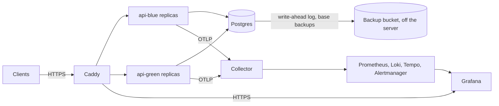

# Deploys

The reference deployment runs the API on one Linux server, in Docker Compose, with no downtime when a release replaces the last one. This document says what runs, what a server needs, how to set one up, how to deploy and roll back a release, and how to choose the services the API depends on. [backups.md](backups.md) describes the database's backups and restores, and [release.md](release.md) how a release is made.

## What runs



- **Caddy** is the only service the server publishes, on ports 80 and 443 (SEC-18). It obtains a certificate for each address through the Automatic Certificate Management Environment (ACME), from Let's Encrypt, answers HTTP with a redirect to HTTPS, and sets HTTP Strict Transport Security (HSTS) (OPS-20). It sends each request to a replica that its own health checks find ready (OPS-05).
- **The API** runs in two colors, `api-blue` and `api-green`, of `API_REPLICAS` replicas each, every replica limited to `API_CPUS` CPUs and `API_MEMORY` of memory. Between deploys one color runs; a deploy starts the other, then stops the first (D45).
- **Postgres**, when the deployment bundles it, runs from the release's Postgres image, the official image with pgBackRest (D44). It archives its write-ahead log continuously to a bucket off the server, and the `backup` service takes a base backup every day ([backups.md](backups.md)). Only the deployment's private network reaches it.
- **The collector** receives the API's telemetry, and passes it to the self-hosted stack, whose Grafana answers on its own address behind Caddy, where every viewer signs in (D42). [observability.md](observability.md) describes the stack.

[deploy/compose.yaml](../../deploy/compose.yaml) defines the services, and [deploy/deploy.sh](../../deploy/deploy.sh) runs them on the server.

## What a server needs

- **Linux on amd64 or arm64, with Docker Engine 29 or later and its Compose plugin**, which Docker's own packages install as `docker compose`. The user that Secure Shell (SSH) signs in as belongs to the `docker` group.
- **An encrypted disk** for its volumes, such as a provider's encrypted block storage, or a disk encrypted with LUKS (OPS-20).
- **A firewall** that admits SSH, and ports 80 and 443 from anywhere. Ports 80 and 443 must be open for Let's Encrypt to issue the certificates.
- **DNS records** that point `API_ADDRESS`, and with the self-hosted stack `GRAFANA_ADDRESS`, to the server, such as `api.example.com` and `grafana.example.com`.
- **A registry login** that can read the release's images: `docker login ghcr.io`, with a token that can read the repository's packages, for a private repository. The tools that verify a release read the login from `~/.docker/config.json`.
- **With the bundled database, a bucket off the server**, at any provider that speaks the S3 protocol over HTTPS, such as Backblaze B2, Cloudflare R2, Hetzner Object Storage or Amazon S3, with encryption at rest, and a key pair that reaches only that bucket ([backups.md](backups.md#the-bucket)).

## Setting up a server

The deployment's files live in `~/deployment` of the user SSH signs in as. On the server:

1. Install Docker and log in to the registry, as above.
2. Create the directory, and its settings and secrets:
   ```
   mkdir -p ~/deployment/secrets && chmod 700 ~/deployment/secrets
   ```
3. Write `~/deployment/settings.env` from [deploy/settings.env.example](../../deploy/settings.env.example), which lists every setting with its meaning. Set at least `IMAGE_REPOSITORY`, `SOURCE`, `API_ADDRESS`, and with the self-hosted stack `GRAFANA_ADDRESS`.
4. Write the secrets the operator holds into `~/deployment/secrets/`, one value per file, with nothing else in it:
   - With the bundled database: `backup_s3_key` and `backup_s3_key_secret`, the bucket's key pair, and `backup_cipher_pass`, the passphrase that encrypts the backups, such as the output of `openssl rand -base64 48`. Keep a copy of the passphrase off the server: without it, no backup can be restored ([backups.md](backups.md#what-to-keep-off-the-server)).
   - With a managed database: `database_admin_url`, `database_owner_url` and `database_url`, as `.env.example` describes `DATABASE_ADMIN_URL`, `DATABASE_OWNER_URL` and `DATABASE_URL`, each with `sslmode=verify-full` (OPS-20).

   The deploy writes the others the first time: the bundled database's passwords and the URLs made from them, and Grafana's administrator password. Compose mounts each secret file into the containers that read it, where any user of the container can read it, so the directory admits only its owner.
5. With a bucket of the operator's own whose certificate a private authority signed, put that authority's certificate at `~/deployment/certs/backup-ca.crt`.

Then deploy a release from your machine, as below. The first deploy creates the backups' stanza in the bucket and takes the first full backup.

## Deploying a release

On your machine, in your checkout of the repository, run:

```
just deploy deploy@203.0.113.7 1.4.0
```

The first argument is the server as SSH names it: `user@address`, or a `Host` of `~/.ssh/config`. The second is the release's version. `just deploy` needs git and SSH, which Windows, macOS and Linux all ship, and no login to the registry: the server pulls the images.

It refuses a version that no release has, and says to make one first ([release.md](release.md)). Otherwise it copies the deployment's files from the release's tag, `v1.4.0`, to `~/deployment/releases/1.4.0` on the server, never a checkout of the repository, and runs that release's `deploy.sh` there, which:

1. Verifies the release's two images, as `just verify-release` does ([release.md](release.md#verifying-a-release)), and refuses a release that doesn't verify.
2. Installs the release's files into `~/deployment`, beside the settings and the secrets.
3. Checks the settings, and the connection budget below (OPS-21).
4. Pulls the images by digest, and starts the services the replicas use: Caddy, the bundled Postgres and its backups, and the collector and the stack.
5. Runs `bootstrap` and `migrate` from the release's image. Migrations follow expand and contract, so the running replicas keep working against the new schema (DATA-10).
6. Starts the idle color's replicas from the release's image, waits until Docker reports each one healthy, then until Caddy's health checks find each one ready.
7. Stops the live color's replicas. Each one first answers its readiness probe with `draining`, keeps serving while Caddy stops sending it requests, then finishes the requests it holds (OPS-06).

A request in flight during a deploy is never refused: CI deploys the real images under continuous requests, and none fails (OPS-16).

What a deploy refuses, and what to do:

| It refuses when | What to do |
|---|---|
| No release has the version | Make the release with `just release` ([release.md](release.md)), then deploy it |
| The release doesn't verify | Read the error: the registry login on the server, or a release whose images aren't signed by your repository's CI |
| A setting is missing or invalid | Set it in `~/deployment/settings.env`, as `deploy/settings.env.example` says |
| The connections wouldn't fit | Lower `API_REPLICAS` or `DATABASE_MAX_CONNECTIONS`, or raise `POSTGRES_MAX_CONNECTIONS` (below) |
| The release changes Postgres or Caddy | Deploy it again with `--allow-restart` when a few seconds of failed requests are acceptable (below) |
| The new replicas don't become ready | Nothing to undo: the deploy removed them, and the live replicas never stopped. Its output ends with their last log lines |
| Another deploy, backup or restore runs | Wait for it. A deploy stopped by force leaves `~/deployment/state/lock`; remove it if no other task runs |

### Restarting Postgres or Caddy

Postgres and Caddy each run once, so restarting either interrupts requests for a few seconds. A deploy restarts them only when you allow it: when a release changes the Postgres image or Caddy's, or a setting they read, the deploy refuses and says which, and `just deploy <host> <version> --allow-restart` restarts them. A release whose Postgres image is built from the same files as the running one leaves Postgres running, since each release's image differs only in its labels ([release.md](release.md#the-images)). Changes to Caddy's sites or to the replicas it names reload Caddy, which drops no connection.

## Rolling back

To go back to an earlier release, deploy it: `just deploy <host> 1.3.2`. Its replicas run against the schema the later release migrated, which expand and contract keeps compatible, and `serve` starts against a schema with later migrations than its own (PLATFORM-030).

## Scaling

`API_REPLICAS` sets how many replicas serve, and `API_CPUS` and `API_MEMORY` what each one may use; `just load-test` measures what one replica serves under the default limits (OPS-18).

Each replica opens at most `DATABASE_MAX_CONNECTIONS` pooled connections, plus one of its own for readiness and the listener, and logs that number when it starts (PLATFORM-045). While a deploy runs, both colors do, so the deploy refuses settings under which

2 × `API_REPLICAS` × (`DATABASE_MAX_CONNECTIONS` + 1) + 1, for `migrate`

exceeds `POSTGRES_MAX_CONNECTIONS` less the 3 connections Postgres reserves for its superusers (OPS-21). With the defaults, 2 replicas and 10 connections each, that is 45 of 97. With a managed database, set `POSTGRES_MAX_CONNECTIONS` to the provider's limit.

## Choosing the services

Each service the API depends on is bundled or a provider's, chosen by one setting, with no file to edit. The deploy runs only the services the choice needs, and the API's settings change only in the addresses and credentials they hold.

| Setting | Values | What runs |
|---|---|---|
| `DATABASE` | `bundled`, the default | Postgres and its backups, on the server ([backups.md](backups.md)) |
| | `managed` | Nothing: the API connects to a provider's Postgres, whose provider backs it up with point-in-time recovery, which OPS-17 requires of it |
| `TELEMETRY` | `self-hosted`, the default | The collector, Prometheus, Loki, Tempo, Alertmanager, and Grafana at `GRAFANA_ADDRESS` |
| | `off` | Nothing: the API's logs go only to its containers' output |

Object storage for files joins the deployment with the `files` module, which offers the same choice.

## TLS and proxies

Caddy obtains and renews the certificates on its own, and keeps them in its `caddy-data` volume. HSTS tells browsers to reach the API over HTTPS only, for a year, and so do its subdomains.

Caddy replaces each request's `X-Forwarded-For` with the address it came from, so a client can't pretend to come from elsewhere. When a content delivery network or a load balancer stands in front of the server, list its addresses in `TRUSTED_PROXIES`, and Caddy keeps the header they send (SEC-12).

## Grafana

With the self-hosted stack, Grafana answers at `https://<GRAFANA_ADDRESS>`. Sign in as `admin`, with the password in `~/deployment/secrets/grafana_admin_password`, which the first deploy wrote; Grafana reads it only the first time it starts, so change it in Grafana afterwards. Add every other viewer as a user in Grafana: nobody views it anonymously, and nobody signs up (SEC-18). The dashboards are read-only, and change only through their files (OBS-13).

## The files on the server

| Path in `~/deployment` | Holds | Written by |
|---|---|---|
| `settings.env` | The deployment's settings | the operator |
| `secrets/` | One secret per file | the operator, and the first deploy |
| `certs/backup-ca.crt` | The authority of a private bucket's certificate, if any | the operator |
| `compose.yaml`, `deploy.sh`, `caddy/`, `observability/`, `tools/` | The live release's deployment files | each deploy |
| `releases/<version>/` | Each deployed release's files, as `just deploy` copied them | `just deploy` |
| `state/` | Which color serves, the images each color runs, and Caddy's sites and replicas | each deploy |

## On another platform

The image and its settings don't depend on this deployment, so a fork can run the API on Kubernetes, Amazon's Elastic Container Service or any platform that runs containers. That platform must provide:

- one Postgres that every replica shares, with point-in-time recovery (OPS-17);
- object storage, once the `files` module stores files;
- routing that sends requests only to replicas whose `/health/ready` answers 200, and stops within `SHUTDOWN_DELAY_SECONDS` of a replica answering `draining`;
- a grace period after the shutdown signal longer than `SHUTDOWN_DELAY_SECONDS` plus `SHUTDOWN_DRAIN_SECONDS` plus the 9 seconds that writing out telemetry may take;
- TLS for every connection that leaves the host, and encryption at rest (OPS-20);
- a connection budget that fits, as above, counting every replica that runs at once during a rollout.
