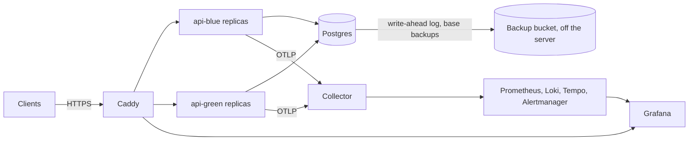

# Deploys

The reference deployment runs the API on one Linux server, in Docker Compose, with no downtime when a release replaces the last one. This document says what runs, what a server needs, how to set one up, how to deploy and roll back a release, how to check on a deployment, and how to choose the services the API depends on. [backups.md](backups.md) describes the database's backups and restores, and [release.md](release.md) how a release is made.

## What runs



- **Caddy** is the only service the server publishes, on ports 80 and 443 (SEC-18). It obtains a certificate for each address through the Automatic Certificate Management Environment (ACME), from Let's Encrypt, answers HTTP with a redirect to HTTPS, and sets HTTP Strict Transport Security (HSTS) (OPS-20). It sends each request to a replica that its own health checks find ready (OPS-05).
- **The API** runs in two colors, `api-blue` and `api-green`, of `API_REPLICAS` replicas each, every replica limited to `API_CPUS` CPUs and `API_MEMORY` of memory. Between deploys one color runs; a deploy starts the other, then stops the first (D45).
- **Postgres**, when the deployment bundles it, runs from the release's Postgres image, the official image with pgBackRest (D44). It archives its write-ahead log continuously to a bucket off the server, and the `backup` service takes a base backup every day ([backups.md](backups.md)). Only the deployment's private network reaches it.
- **The collector** receives the API's telemetry, and passes it to the self-hosted stack, whose Grafana answers on its own address behind Caddy, where every viewer signs in (D42). [observability.md](observability.md) describes the stack.

[deploy/compose.yaml](../../deploy/compose.yaml) defines the services, and [deploy/deploy.sh](../../deploy/deploy.sh) runs them on the server.

## What a server needs

- **Linux on amd64 or arm64, with Docker Engine 29 or later and its Compose and Buildx plugins**, which Docker's own packages install as `docker compose` and `docker buildx`; `deploy/verify-release.sh` reads a release's images through `docker buildx imagetools`. `just server-setup` installs them on Debian and Ubuntu. The user that Secure Shell (SSH) signs in as for the deployment's tasks belongs to the `docker` group: on a new server, which often has only `root`, the setup creates such a user, `deploy`, and gives it root's SSH keys. The `docker` group can do whatever `root` can, so guard that key as you would root's.
- **Memory for the services the settings choose.** On a trial server with 4 gigabytes, the bundled database and two replicas, the server used about 1.2 gigabytes with the self-hosted stack, Grafana the most at about 300 megabytes, and 0.75 gigabytes with a managed backend, the operating system and Docker included. Give it at least 2 gigabytes with the self-hosted stack, which needs room for its data to grow, and 1 gigabyte without it, since a deploy runs twice the replicas while it switches colors; `just server-check` checks it. The images take about 4.5 gigabytes of disk.
- **An encrypted disk** for its volumes (OPS-20). A provider encrypts below the server, where the server can't see it, so confirm it in the provider's documentation or in writing from its support: some providers encrypt neither their servers' disks nor their copies of them. Without it, encrypt the disk that holds Docker's data with Linux Unified Key Setup (LUKS), and plan where its key comes from at each boot, since a key on the same disk protects nothing: typed at the provider's console, sent over SSH, or fetched from a key server on another machine. Until the disk is unlocked, nothing of the deployment starts.
- **A firewall** that admits SSH, and ports 80 and 443 from anywhere. Ports 80 and 443 must be open for Let's Encrypt to issue the certificates.
- **DNS records** that point `API_ADDRESS`, and with the self-hosted stack `GRAFANA_ADDRESS`, to the server, such as `api.example.com` and `grafana.example.com`.
- **A registry login** that can read the release's images, for a private repository: `just server-setup` makes it with a token that can read the repository's packages. The tools that verify a release read the login from `~/.docker/config.json`.
- **With the bundled database, a bucket off the server**, at any provider that speaks the S3 protocol over HTTPS, such as Backblaze B2, Cloudflare R2, Hetzner Object Storage or Amazon S3, with encryption at rest, and a key pair that reaches only that bucket ([backups.md](backups.md#the-bucket)).

## Setting up a server

From your machine, in your checkout of the repository, run:

```
just server-setup root@203.0.113.7
```

The argument is the server as SSH names it, signed in as `root`, or as a user that may run `sudo` without a password. The setup follows the files of the latest release, or of the release a second argument names, as a deploy of it does: it sends that release's `deploy/` to the server, and asks for what that release's settings and Alertmanager need. Before it changes anything, it asks, on your machine:

- For each setting of [deploy/settings.env.example](../../deploy/settings.env.example) that the choices need, such as the bucket's with the bundled database and the managed backend's with `TELEMETRY=managed`, under the comment that says what it means, with the value the server holds, or the example's, which Enter keeps. `IMAGE_REPOSITORY` and `SOURCE` start from the checkout's repository on GitHub.
- For each secret the choices need, which you type unseen, and which Enter keeps when the server holds it:
  - With the bundled database: `backup_s3_key` and `backup_s3_key_secret`, the bucket's key pair; `backup_cipher_pass`, the passphrase that encrypts the backups, which the setup generates the first time and shows once; and `postgres_password`, the database's superuser password, which the setup also generates the first time and shows once, unless you give a lost server's, whose backups the new server restores. Keep a copy of the passphrase off the server: without it, no backup can be restored ([backups.md](backups.md#what-to-keep-off-the-server)).
  - With a managed database: `database_admin_url`, `database_owner_url` and `database_url`, as `.env.example` describes `DATABASE_ADMIN_URL`, `DATABASE_OWNER_URL` and `DATABASE_URL`, each with `sslmode=verify-full` (OPS-20).
  - With a managed backend: `managed_otlp_token`, the token the collector signs in with, and with `MANAGED_GRAFANA_URL`, `managed_grafana_token`, the token of a service account of that Grafana with the Admin role, which imports the dashboards and the alert rules ([observability.md](observability.md#a-managed-backend)).
  - With the self-hosted stack: each credential of an alert integration that the release's `alertmanager.yaml` names, in `secrets/alertmanager/` ([observability.md](observability.md#alerts)).
- For the certificate of a private authority, as a file on your machine, when one signed the certificate of a bucket of your own or of a managed backend.
- For a token that can read the repository's packages, through which the server pulls the release's images; a public repository's images need none.

Then, on the server, it:

1. Installs Docker Engine and its Compose and Buildx plugins from Docker's apt repository, on Debian and Ubuntu, once it has checked the repository's key against the fingerprint that Docker's documentation gives. A server that runs Docker 29 or later keeps it. On another distribution, install Docker first, as Docker's documentation says.
2. Signed in as `root`, creates the user `deploy`, which runs the deployment, and gives it root's authorized SSH keys; signed in as another user, that user runs it. The user joins the `docker` group. The other tasks sign in as that user.
3. Logs that user in to the registry, and writes `~/deployment/settings.env`, the secrets in `~/deployment/secrets/` and the certificates in `~/deployment/certs/`.

It ends with the lines to add to `~/.ssh/config` on your machine, which name the server, its address and the deployment's user, unless the server you gave it is such a `Host` already:

```
Host production
    HostName 203.0.113.7
    User deploy
```

With them, every task names the server `production`, as the rest of this document does, and `ssh production` signs in. Choose any name, and add a `Host` for each server, such as `staging` beside `production`.

Run it again to change a setting, a secret or the login: it asks again, starting from what the server holds, and keeps any setting the example doesn't list. The deploy writes the other secrets the first time the services need them: the bundled database's other passwords and the URLs made from them, and Grafana's administrator password. When `DATABASE` moves from `managed` to `bundled`, the deploy moves the managed database's URLs aside, to `<name>.before-bundled`, and writes the bundled one's. Compose mounts each secret file into the containers that read it, where any user of the container can read it, so each file is readable by every user, while the directory admits only the deployment's user.

### Checking a server

```
just server-check production
```

checks what a deploy of the latest release, or of the release a second argument names, needs, and changes nothing of the deployment. It runs that release's files, as the deploy will. On the server, it reads the settings and the secrets as a deploy does, and refuses what a deploy would refuse, the connection budget included (OPS-21); checks that Docker 29 or later runs, with both plugins; verifies the release, as a deploy does first ([release.md](release.md#verifying-a-release)), and pulls its images; checks the server's memory against the services the settings choose; with the bundled database, reads the bucket through the release's pgBackRest, with the key pair, the passphrase and the authority a deploy would use; and with a managed backend, sends it an export of no telemetry, and asks its Grafana for its folders with the import's token. From your machine, it checks that each address the settings name resolves to the server, which Let's Encrypt needs before it issues the address's certificate, and that the server's ports 80 and 443 answer, or refuse, where a firewall that drops them would leave no answer at all. Each check prints `ok` or `FAIL` with what it found, and `note` with what it can't see, whether the provider encrypts the disk, and with what a deploy will then do: when the bucket holds a database's backups and the server has no database yet, as after losing a server, the first deploy stops before its replicas start, for `just restore` to restore them ([backups.md](backups.md#restoring-onto-a-new-server)). Then deploy a release, as below. The first deploy that runs the bundled database creates the backups' stanza in the bucket, pgBackRest's record of the database it backs up, and takes the first full backup.

## Deploying a release

On your machine, in your checkout of the repository, run:

```
just deploy production
```

The argument is the server as SSH names it: a `Host` of `~/.ssh/config`, such as `production`, or `user@address`. The deploy takes the latest release, and says which; name another after the server, such as `just deploy production 1.4.0`. `just deploy` needs git and SSH, which Windows, macOS and Linux all ship, and no login to the registry: the server pulls the images.

It refuses a version that no release has, and says to make one first ([release.md](release.md)). Otherwise it copies the deployment's files from the release's tag, `v1.4.0`, to `~/deployment/releases/1.4.0` on the server, never a checkout of the repository, and runs that release's `deploy.sh` there, which:

1. Verifies the release's two images, as `just verify-release` does ([release.md](release.md#verifying-a-release)), and refuses a release that doesn't verify.
2. Installs the release's files into `~/deployment`, beside the settings and the secrets. A deploy that refuses or fails from here on, until step 7 ends, puts back the files it replaced; a service that already read the new ones keeps them until the next deploy makes it read its files. When a deploy can't put them back, because it was stopped by force, such as by a reboot, or the copy failed, which it reports, the next deploy, backup or restore puts them back before anything else.
3. Checks the settings, and the connection budget below (OPS-21).
4. Pulls the images by digest, and starts the services the replicas use: Caddy, the bundled Postgres and its backups, and the collector and the stack.
5. Runs `bootstrap` and `migrate` from the release's image. Migrations follow expand and contract, so the running replicas keep working against the new schema (DATA-10).
6. Starts the idle color's replicas from the release's image, waits until Docker reports each one healthy, then until Caddy's health checks find each one ready.
7. Stops the live color's replicas. Each one first answers its readiness probe with `draining`, keeps serving while Caddy stops sending it requests, then finishes the requests it holds (OPS-06). The release's replicas now serve, so its files stay, even if what follows fails.
8. Removes what earlier deploys left and nothing uses, so the disk doesn't fill with it (D57): every other release's files in `~/deployment/releases`, and the images of the deployment's repositories that no container uses and that neither the services the settings choose nor the tools name, such as the releases' before the previous one and those of pins a release moved. The previous release's API image stays, so rolling back to it pulls nothing, and so does every image of another repository.
9. With a managed backend, imports the release's dashboards and alert rules into its Grafana, and only warns if that fails ([observability.md](observability.md#a-managed-backend)).

A request in flight during a deploy is never refused: CI deploys the real images under continuous requests, and none fails (OPS-16).

What a deploy refuses, and what to do:

| It refuses when | What to do |
|---|---|
| No release has the version | Make the release with `just release` ([release.md](release.md)), then deploy it |
| The release doesn't verify | Read the error: the registry login on the server, or a release whose images aren't signed by your repository's CI |
| A setting is missing or invalid | Set it with `just server-setup`, which asks for it, as `deploy/settings.env.example` describes it |
| A secret that the settings need is missing | Give it with `just server-setup`, which asks for each one |
| The connections wouldn't fit | Lower `API_REPLICAS` or `DATABASE_MAX_CONNECTIONS`, or raise `POSTGRES_MAX_CONNECTIONS` (below) |
| The release changes Postgres or Caddy | Deploy it again with `--allow-restart` when a few seconds of failed requests are acceptable (below) |
| The new replicas don't become ready | Nothing to undo: the deploy removed them, and the live replicas never stopped. Its output ends with their last log lines |
| Another deploy, backup or restore runs | Wait for it. Its lock goes when its processes end, however they end, so a task stopped by force leaves none |

### Restarting Postgres or Caddy

Postgres and Caddy each run once, so restarting either interrupts requests for a few seconds. A deploy restarts them only when you allow it: when a release changes the Postgres image or Caddy's, their service in its `compose.yaml`, such as a health check, or a setting they read, the deploy refuses and says which, and the same command with `--allow-restart`, such as `just deploy production 1.4.0 --allow-restart`, restarts them. Caddy reads `TELEMETRY`, which says whether it exports its spans, so a move of `TELEMETRY` to or from `off` restarts it. A release whose Postgres image is built from the same files as the running one leaves Postgres running, since such an image runs the same Postgres and pgBackRest, at the versions it pins ([release.md](release.md#the-images)). Changes to Caddy's sites or to the replicas it names reload Caddy, which drops no connection.

## Rolling back

To go back to an earlier release, deploy it by its version: `just deploy production 1.3.2`. `just status production` shows the version that serves. Its replicas run against the schema the later release migrated, which expand and contract keeps compatible, and `serve` starts against a schema with later migrations than its own (PLATFORM-030).

## Checking on a deployment

```
just status production
```

shows whether a deploy, backup or restore runs, or a deploy stopped before its replicas served, whose files the next task puts back, then which color serves, each of the deployment's containers with its state, such as `Up 2 hours (healthy)`, and its image's version, when the backups last archived the write-ahead log and last completed a base backup, the data that each restore moved aside, with its size, until you remove it ([backups.md](backups.md#restoring)), and the server's free disk and memory. It changes nothing, so it also runs while a deploy does.

```
just logs production api
```

shows the last 100 lines of the logs of both colors' replicas. Name any of the deployment's services instead, such as `caddy`, `postgres` or `backup`, or none for all of them, and add `--follow` to go on showing the lines that follow, until Ctrl-C. With `caddy`, or no service named, the last 100 of Caddy's lines of the requests it answered itself follow, such as its 503 while no replica runs, each headed `caddy requests`: Caddy writes them to a file, which the collector reads when the deployment has telemetry, and each holds the request's trace ID as `traceID`. Each container keeps the last 100 megabytes of its log, in five files of 20 megabytes, the older ones compressed. With the self-hosted stack, Grafana also keeps the API's logs, to search ([observability.md](observability.md)).

## Scaling

`API_REPLICAS` sets how many replicas serve, and `API_CPUS` and `API_MEMORY` what each one may use; `just load-test` measures what one replica serves under the default limits (OPS-18).

Each replica opens at most `DATABASE_MAX_CONNECTIONS` pooled connections, plus one of its own for readiness and the listener, and logs that number when it starts (PLATFORM-045). While a deploy runs, both colors do, so the deploy refuses settings under which

2 × `API_REPLICAS` × (`DATABASE_MAX_CONNECTIONS` + 1) + 1, for `migrate`

exceeds `POSTGRES_MAX_CONNECTIONS` less the 3 connections Postgres reserves for its superusers (OPS-21). The other connections fit in those 3: on the bundled database, `bootstrap`, the backups and a restore connect as its superuser, one connection each, beside the scheduled backup: a deploy runs its `bootstrap` and its first backup one after the other, and a restore asks whether Postgres runs and replays the log, then runs pgBackRest's check, before it stops the replicas. On a managed database, `bootstrap` runs before the new color starts, while only the live one runs. With the defaults of [deploy/settings.env.example](../../deploy/settings.env.example), that is 45 of 97. With a managed database, set `POSTGRES_MAX_CONNECTIONS` to the provider's limit.

## Choosing the services

Each service the API depends on is bundled or a provider's, chosen by one setting, with no file to edit; [deploy/settings.env.example](../../deploy/settings.env.example) gives each one's default. The deploy runs only the services the choice needs, and stops the ones an earlier choice started once no replica uses them: their volumes stay, with the bundled database's data, while its backups' status goes, so no alert watches backups the deployment doesn't take. Before `DATABASE` moves to `managed`, write the managed database's URLs into `secrets/`: the deploy refuses while `database_url` names the bundled database. The API's settings change only in the addresses and credentials they hold.

| Setting | Values | What runs |
|---|---|---|
| `DATABASE` | `bundled` | Postgres and its backups, on the server ([backups.md](backups.md)) |
| | `managed` | Nothing: the API connects to a provider's Postgres server, which must back it up with point-in-time recovery, which restores the database as it stood at any moment it reaches, as OPS-17 requires, encrypt what it stores, as OPS-20 does, and hold no other deployment's database, such as a staging one's, since deployments on one server share its roles ([platform spec](../spec/platform.md#database-roles)) |
| `TELEMETRY` | `self-hosted` | The collector, Prometheus, Loki, Tempo, Alertmanager, and Grafana at `GRAFANA_ADDRESS` |
| | `managed` | The collector alone, which sends every signal to a managed backend, into whose Grafana each deploy imports the dashboards and the alert rules ([observability.md](observability.md#a-managed-backend)) |
| | `off` | Nothing: the API's logs go only to its containers' output |

Object storage for files joins the deployment with the `files` module, which offers the same choice.

## TLS and proxies

Caddy obtains and renews the certificates on its own, and keeps them in its `caddy-data` volume. HSTS tells browsers to reach the API over HTTPS only, for a year, and so do its subdomains.

Caddy replaces each request's `X-Forwarded-For` with the address it came from, so a client can't pretend to come from elsewhere. When a content delivery network or a load balancer stands in front of the server, list its addresses in `TRUSTED_PROXIES`, and Caddy keeps the header they send (SEC-12).

## Grafana

With the self-hosted stack, Grafana answers at `https://<GRAFANA_ADDRESS>`. Sign in as `admin`, with the password in `~/deployment/secrets/grafana_admin_password`, which the first deploy with the self-hosted stack wrote; Grafana reads it only the first time it starts, so change it in Grafana afterwards. Add every other viewer as a user in Grafana: nobody views it anonymously, and nobody signs up (SEC-18). The dashboards are read-only, and change only through their files (OBS-13). Grafana shows the alerts that fire, but no alert notifies anyone until your fork's `alertmanager.yaml` names an integration, such as email or a chat webhook, and every deploy warns until then ([observability.md](observability.md#alerts)).

With a managed backend, its Grafana shows the dashboards in the folder `API`, and its notification policies route the alerts ([observability.md](observability.md#a-managed-backend)).

## The files on the server

| Path in `~/deployment` | Holds | Written by |
|---|---|---|
| `settings.env` | The deployment's settings | `just server-setup` |
| `secrets/` | One secret per file | `just server-setup`, and the first deploy that needs each generated one |
| `certs/backup-ca.crt`, `certs/managed-otlp-ca.crt`, `certs/managed-grafana-ca.crt` | The authority of a private bucket's certificate, and of a managed backend's and its Grafana's, if any | `just server-setup` |
| `compose.yaml`, `deploy.sh`, `verify-release.sh`, `import-grafana.sh`, `settings.env.example`, `caddy/`, `observability/`, `tools/` | The deployment files of the last deploy whose replicas served, once one has: a deploy that refuses or fails before its own serve puts these back, as [Deploying a release](#deploying-a-release) says | each deploy |
| `releases/<version>/` | The files of the release that `just deploy` last copied; a deploy whose replicas serve removes every other release's | `just deploy` |
| `state/` | Which color serves, the images each color runs, Caddy's sites and replicas, the files each service of the stack last read, the files that a deploy replaced until its replicas serve, and the tasks' locks | each deploy, backup and restore |

## On another platform

The image and its settings don't depend on this deployment, so a fork can run the API on Kubernetes, Amazon's Elastic Container Service or any platform that runs containers. That platform must provide:

- one Postgres that every replica shares, with point-in-time recovery (OPS-17), on a server that holds no other deployment's database, since deployments on one server share its roles ([platform spec](../spec/platform.md#database-roles));
- object storage, once the `files` module stores files;
- routing that sends requests only to replicas whose `/health/ready` answers 200, and stops within `SHUTDOWN_DELAY_SECONDS` of a replica answering `draining`;
- a grace period after the shutdown signal longer than `SHUTDOWN_DELAY_SECONDS` plus `SHUTDOWN_DRAIN_SECONDS` plus the time that writing out telemetry may take, which the platform spec's [Telemetry export](../spec/platform.md#telemetry-export) bounds;
- TLS for every connection that leaves the host, and encryption at rest (OPS-20);
- a connection budget that fits, as above, counting every replica that runs at once during a rollout.
