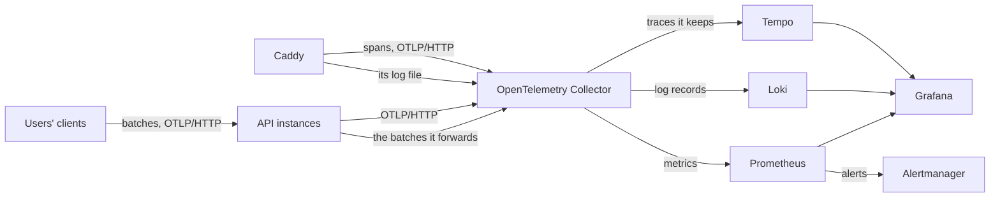

# Observability

How to see what the API does: its logs, traces and metrics, the dashboards that answer an operator's questions, and the alerts that say when to act. A trace records one request, or one run of a background job, as spans: one for each step, such as the proxy's handling of the request, the API's, and each database transaction inside it, each with its duration and its attributes. It is written for someone who hasn't used these tools before. An ID in parentheses names what a sentence follows: a rule of the [standards](../standards/README.md), such as OBS-08, a behavior of a [spec](../spec/README.md), such as PLATFORM-099, or a decision, such as D10, whose records [architecture.md](../architecture.md) says where to find. The [glossary](../architecture.md#11-glossary) defines the terms these documents share.

Everything here serves D10's guarantee: any trace ID the API returns leads to that request's logs, and to its trace whenever the request ended in an error (OBS-08).

## The questions it answers

Each dashboard panel's title is the question it answers (OBS-13). The overview links to one dashboard per area, each tagged `area`.

| Question | Where |
|---|---|
| Is the API up? | API overview: "How many instances of the API are exporting telemetry?" |
| Which routes are slow or failing, and since when? | API requests |
| Why did this request fail? | its trace ID, as in [Following a request](#following-a-request-from-its-trace-id) |
| Is a dependency degrading? | API platform: "Can each instance reach its database?" and "Does the mail server answer?", and Sign-in: "How do exchanges of providers' codes end?" |
| Are the bucket of files' bytes and the scanner answering? | Files: "Does the bucket answer?" and "Does the scanner answer?" <!-- part: files --> |
| Is the telemetry pipeline itself losing data? | Telemetry pipeline |
| Is the server running out of disk or memory? | Server |
| Does an instance's memory only grow? | API platform: "How much memory does each instance use?" |
| Is someone probing workspaces they don't belong to? | API platform: "Why does authorization refuse requests?" |
| Are clients retrying requests that are still running? | API platform: "How do requests with an idempotency key end?" |
| Are background jobs, such as emails, keeping up, and which fail? | API platform: "Are background jobs keeping up?" and "How do job runs end?" |
| Do events reach clients promptly, and why do their streams close? | API platform: "How long after commit do events reach the streams?", "How many events does each hub owe its streams?", "How many event streams are open?" and "Why do event streams close?" |
| Does the telemetry of users' clients reach the stores, and how much of it? | Clients' telemetry: "How do the clients' batches end?", "How many bytes of clients' telemetry does each replica forward a minute?", "How many bytes of each signal does the collector take from the replicas a minute?", "Is the collector refusing or failing to pass on the clients' telemetry?" and "Which points of the clients' metrics does the collector leave out of its sums?" <!-- part: client_telemetry --> |
| How do the requests of users' clients end, as the clients measure them? | Clients' telemetry: "How do the clients' requests end?" and "How long do the clients wait for their requests?" <!-- part: client_telemetry --> |

## How telemetry flows

- **The API** exports its spans, log records and metrics over the OpenTelemetry Protocol (OTLP), on HTTP, to the collector named by `OTEL_EXPORTER_OTLP_ENDPOINT`. Every signal carries the service's name, its version, the environment, and the instance's own `service.instance.id`, so instances running side by side stay apart. The [platform spec](../spec/platform.md#telemetry-export) says how the API exports.
- **The proxy**, Caddy, in the reference deployment, exports a span for each request but the probes, to the same collector, and the API's server span is its child, so a trace starts at the proxy (OBS-06). It writes a line for each request it answers itself, while no replica can (D53), to a file the collector reads; the API writes the line of every other request but a health probe and one that a replica's HTTP server refuses itself (PLATFORM-099). The collector keeps only those of the span's attributes whose names `platform::telemetry` lists, and the line's method and status, so neither holds a client's address or user agent (OBS-04, [proxy.yaml](../../deploy/observability/collector/proxy.yaml)).
- **The collector** ([config](../../deploy/observability/collector/config.yaml)) refuses data before it runs out of memory, and passes each signal to its store. It also reads the times of the bundled database's backup status files, for the backups' alerts, and the host's CPU, memory and filesystems, from the host's filesystem mounted read-only, for the server's: a filesystem it reports is one mounted whole, not a bind mount of part of one. On a server, it reads that mount as its image's user, which isn't root, with no Linux capability and a root filesystem that it can't write, so the host's own permissions bound what it reads: `secrets/`, which admits only the deployment's user, stays closed to it.
  It reads the time of the malware scanner's daily signatures too, for the alert on their age. <!-- part: files -->
  Its tail sampling decides which traces to keep, and drops the rest: it waits 15 seconds for a trace's spans, then keeps the trace if any policy keeps it (OBS-08):
  - every trace with an error status, or a response of 400 or above
  - every trace slower than the [latency objective](#service-level-objectives)
  - 10% of the rest
<!-- part: client_telemetry -->
- **Users' clients** send their spans, their log records and their metrics to the API, whose telemetry proxy forwards each batch of a user who consents to the collector ([client_telemetry spec](../spec/client_telemetry.md#the-proxy)). The collector takes these batches on a receiver of their own, on port 4319, and passes them through pipelines and exporters of their own ([clients.yaml](../../deploy/observability/collector/clients.yaml)), so nothing that a client sends passes through a pipeline, or waits in a queue, of the API's telemetry:
  - Its memory limiter for them has a lower limit than the one for the API's own, 70% of the collector's memory against 80%, each less a spike of 25%, so as its memory fills, the collector stops taking the clients' telemetry before the API's.
  - It drops the spans, the log records and the metrics of every resource whose `service.name` the file doesn't list, and answers the batch as taken. The template lists `app-desktop`, and a fork lists each of its clients. So no client's telemetry passes for the API's or Caddy's, and Loki labels its streams by the listed names alone.
  - It keeps of the resource of a span or of a log record its `service.name`, its `service.version` and, on spans, its `service.instance.id`, and nothing else that an SDK adds, such as the name of the user's machine (OBS-04). It writes them anew, from the first value of each, so a resource that names its service twice is stored under the first name alone (CLIENT_TELEMETRY-012).
  - It samples none of their traces: it keeps each span that it admits, and the telemetry proxy's budgets bound what the clients send (CLIENT_TELEMETRY-007, CLIENT_TELEMETRY-008).
  - It keeps of their metrics those that the file lists, each with the attributes and the values that the file lists for it, and of a metric's resource the client's name alone (CLIENT_TELEMETRY-015). It sets each point's time to the moment it takes it, and adds the points of every installation into one series for each set of those values, which it serves on port 9464, a port that a deployment publishes nowhere. Prometheus scrapes the series there, each under its client's name as its job (CLIENT_TELEMETRY-014). The [client_telemetry spec](../spec/client_telemetry.md#the-clients-metrics) says why.

  Tempo and Loki store the spans and the log records beside the API's own (D178). A request that a client sends with a `traceparent` of its own trace continues that trace (PLATFORM-041), so the trace holds the client's spans, and the API's when the tail sampling kept them, and the query of [Following a request](#following-a-request-from-its-trace-id) shows the client's log lines of the trace beside the API's.
<!-- end part: client_telemetry -->
- **Prometheus** ([config](../../deploy/observability/prometheus/prometheus.yaml)) receives the metrics through its OTLP receiver, and scrapes the collector, Loki, Tempo and Alertmanager for their own. It evaluates the [rules](../../deploy/observability/prometheus/rules.yaml) and sends firing alerts to Alertmanager. [metrics.md](metrics.md) lists every metric under its name in Prometheus.
  It scrapes the collector for the series of the clients' metrics too, on the port that serves them. <!-- part: client_telemetry -->
- **Loki** ([config](../../deploy/observability/loki/config.yaml)) keeps every log record the API exports, and the proxy's: logs are never sampled. The API's queue of records drops a record that arrives while it is full, as the [platform spec](../spec/platform.md#telemetry-export) says, and stdout drops no line while the API runs. A record's line is its message, such as `request completed`. The service's name, instance and environment are labels, such as `service_name`, and every other field, `trace_id` and `span_id` among them, is structured metadata that a query filters with `| trace_id="…"`.
- **Tempo** ([config](../../deploy/observability/tempo/config.yaml)) keeps the traces the collector passes on, and answers searches in its query language, TraceQL.
- **Grafana** reads all three, through the [data sources](../../deploy/observability/grafana/provisioning/datasources/datasources.yaml) it provisions. A log line links to its trace, and a span links to its trace's log lines.

Prometheus keeps metrics for 15 days, and Loki and Tempo keep logs and traces for 14 days.
They keep the clients' spans and log records as long (D178), and Prometheus the series of the clients' metrics. <!-- part: client_telemetry -->

### On a server

Prometheus, Loki, Tempo and Alertmanager ask no credential of what reaches them. Beside its own API, each answers Go's profiling endpoints, under `/debug/pprof/`: Loki's and Tempo's `register_instrumentation` keeps its default, since the one setting registers those endpoints and the `/metrics` that Prometheus scrapes, and each answers 404 at both with it off. So on a server the four join a network of their own, `stack`, which only the collector and Grafana join beside them (SEC-14). The replicas, Caddy and the API's one-shot subcommands join `telemetry`, where the collector takes what they send, and reach none of the four. Grafana, which Caddy reaches on the network that it shares with the replicas, signs each viewer in.

<!-- part: client_telemetry -->
### What the clients' telemetry adds

The telemetry proxy's budgets bound the spans and the log records that the clients' telemetry adds to Tempo and Loki. Each replica forwards at most `CLIENT_TELEMETRY_REPLICA_BYTES_PER_MINUTE` bytes of batches in each of its budget's windows of a minute (CLIENT_TELEMETRY-008), of which a day holds 1,441 at most, and one more each time the replica starts again. At the defaults, 4,194,304 bytes, that is about 6 gigabytes a day for each replica, of which Tempo and Loki take in the spans and the log records that the collector keeps, before they compress them, and keep them for 14 days. The clients' metrics add the series that the collector's lists allow, whatever bytes their batches hold (CLIENT_TELEMETRY-015).

The Clients' telemetry dashboard shows what the replicas forward, under "How many bytes of clients' telemetry does each replica forward a minute?", and `ClientTelemetryBudgetSpent` opens a ticket when a replica's budget refuses batches ([runbooks.md](runbooks.md#clienttelemetrybudgetspent)). A deployment that raises the budget gives Tempo's and Loki's volumes the disk that the new one can fill; [DiskFillingUp](runbooks.md#diskfillingup) fires for a disk of the server that fills, the one that holds those volumes among them. With a managed backend, the budgets bound the spans and the log records that the backend is sent, beside the clients' series, which the collector sends it at each scrape.
<!-- end part: client_telemetry -->

## The logs

Each part of a deployment writes a log of its own, and this is what each holds, in which form, where it goes and how long it is kept, as requirement 16.1.1 of the Application Security Verification Standard (ASVS) asks. Each container's log writes the time of a line in UTC, Caddy's as seconds since 1970, and the server's own logs in the server's time zone. The server's clock sets those times, and, with the bundled database, the times that the database stores (DATA-03), so `just server-check` checks that it is synchronized ([deploy.md](deploy.md#checking-a-server)).

| Log | What it holds | Form | Where it goes | Kept |
|---|---|---|---|---|
| The API's, of its replicas and its subcommands | A line for each event, at the level that OBS-03 gives it, each request's completion among them (PLATFORM-044), with no personal data and no secret (OBS-04) | JSON, with `timestamp`, `level`, `message` and the fields of OBS-02 | The container's output, and, with telemetry, the collector, which passes it to Loki or to a managed backend | In Loki for 14 days, at a managed backend as its plan says |
| The audit log | Who did what to which resource, and when, for each change that a module's behaviors record, with, for a change that a request made, the request's client IP address, user agent and trace ID (SEC-18, AUDIT-001 to AUDIT-003) | Rows of the database, with the time of the database's clock (DATA-03) | The database, and its backups; the routes of the [audit spec](../spec/audit.md) read it | For `AUDIT_RETENTION_DAYS` (AUDIT-011) |
| Caddy's own | Its start, the reloads of its sites, and what it does about its certificates, without its health checks' lines | JSON, with `ts`, the seconds since 1970 | The container's output | As a container's output is |
| Caddy's, of the requests it answers itself | A line for each such request, such as its 503 while no replica runs, with the request's trace ID and no field that holds personal data (OBS-04) | JSON | A file that Caddy starts anew at 10 mebibytes, keeping the 2 before it; with telemetry, the collector reads it into Loki | In Loki, as the API's |
| The bundled Postgres's | Its start and its stop, each checkpoint, and each error, without the error's detail (OBS-04), with the statement that failed, which holds none of its values, since the API binds them (DATA-14), but the statement with which `bootstrap` sets a role's password, which holds the password as a verifier of the Salted Challenge Response Authentication Mechanism (SCRAM), and never the password itself; and what pgBackRest archived, each backup's lines being in the `backup` service's output | Text, each line with its time | The container's output | As a container's output is |
| The collector's, Prometheus's, Loki's, Tempo's and Alertmanager's | Each one's start and what it failed to do | Text, as pairs of a name and a value, the collector's partly JSON | The container's output | As a container's output is |
| Grafana's | Its start, and each request that it refused, with the viewer's name once they have signed in, and the address that the request came from, Caddy's | Text, as pairs of a name and a value | The container's output | As a container's output is |
| The server's own | Who signed in over Secure Shell (SSH), and what Docker did: the operating system's logs, which the deployment neither reads nor changes | The operating system's | The server | As the operating system keeps them |

The scanner's log holds its start, the signatures it loaded, and each signature that it finds in an upload, as text with the time of each line, in UTC without naming the zone, in its container's output ([platform spec](../spec/platform.md#scanner)). <!-- part: files -->

Docker keeps a container's output, its last 100 megabytes, and the operator reads it over SSH, with `just logs` ([deploy.md](deploy.md#checking-on-a-deployment)), as whoever is in the server's `docker` group can. Grafana's viewers read what Loki holds, once they have signed in (SEC-14). Inside the deployment, Loki asks no credential, and answers the collector and Grafana alone ([on a server](#on-a-server)).

## A managed backend

A deployment may send its telemetry to a managed backend that accepts the OpenTelemetry Protocol (OTLP), such as Grafana Cloud, instead of running Prometheus, Loki, Tempo, Grafana and Alertmanager itself (D42). With `TELEMETRY=managed`, the reference deployment runs only the collector, with [managed.yaml](../../deploy/observability/collector/managed.yaml) merged over its configuration: the same receivers and processors, tail sampling among them (OBS-08), with what the self-hosted stack does elsewhere, below, and the backend as the one place that it exports to. The API exports to the collector as before, so its settings don't change, and the backend's tokens stay in the deployment's `secrets/`: the collector sends the telemetry with one, the deploy's import signs in to the backend's Grafana with the other, and `just server-check` tries both.

The deployment's settings name the backend's OTLP endpoint, which is HTTPS (OPS-17), and the user the collector signs in as: `MANAGED_OTLP_ENDPOINT` and `MANAGED_OTLP_USER`, which [deploy/settings.env.example](../../deploy/settings.env.example) describes. The token goes in the secret file `secrets/managed_otlp_token`. A backend whose certificate a private authority signed is trusted through that authority's certificate in `certs/managed-otlp-ca.crt`.

The clients' spans and log records, which the telemetry proxy forwards, go to the backend too, through an exporter of their own, and so do the series that the collector adds up from the clients' metrics, which it scrapes from itself, as it does its own metrics. <!-- part: client_telemetry -->

The managed configuration adds what the self-hosted stack does elsewhere: the collector scrapes its own metrics, which Prometheus scrapes in the stack, for the alerts on telemetry that is lost, and it copies `deployment.environment.name` and the `file.name` of each file whose time it reads from each metric's resource into its labels, which the self-hosted Prometheus promotes.

With Grafana Cloud, each deploy also imports the release's dashboards and alert rules into the stack's Grafana, once the release's replicas serve (OBS-13, OBS-14). `MANAGED_GRAFANA_URL` names that Grafana, such as `https://<stack>.grafana.net`, and the secret file `secrets/managed_grafana_token` holds the token of a service account with the Admin role, since Grafana refuses an Editor both a folder's permissions and the conversion of rules. A Grafana whose certificate a private authority signed is trusted through that authority's certificate in `certs/managed-grafana-ca.crt`. [deploy/import-grafana.sh](../../deploy/import-grafana.sh) runs the import, with curl and yq from the images that [deploy/tools/compose.yaml](../../deploy/tools/compose.yaml) pins:

- The dashboards go into the folder `API`, which Viewers and Editors may only view, so only the import and the Grafana's administrators change them, and the next deploy puts back what an administrator changed. Each data source a dashboard names becomes the stack's own: `prometheus` becomes `grafanacloud-prom`, `loki` becomes `grafanacloud-logs`, and `tempo` becomes `grafanacloud-traces`. The import fails on a dashboard that names any other, or one the Grafana lacks.
- The rules go into the folder's subfolder `Alerts`, through Grafana's conversion of Prometheus rules, as rules that Grafana evaluates against `grafanacloud-prom`, every minute, a minute behind so that late samples have arrived. A recording rule writes its series back there. Grafana marks the rules provisioned, and its interface changes no provisioned rule. They are Grafana's rules rather than the stack's Mimir ruler's, since Grafana Cloud gives a new stack no Alertmanager that a ruler's alerts would reach.
- A dashboard or a rule group that an earlier import made, and that the release lacks, is deleted.

Grafana's notification policies route the alerts, not `alertmanager.yaml`: Grafana imports an Alertmanager's configuration only through a preview that Grafana Cloud enables on request. In Grafana's Alerting, add a contact point for each severity, and policies that route `severity=page` and `severity=ticket` to them. Until a policy reaches a contact point, the alerts notify no one, and every deploy warns.

A Grafana Cloud instance that no one used for a while sleeps, and answers 503 while it loads again, so the import, and `just server-check`, wait up to three minutes for a Grafana that answers so. A failed import only warns, and the Grafana keeps what it last imported, since a backend that is down mustn't keep a release from deploying; deploying the release again imports again. With a backend that has no Grafana, `MANAGED_GRAFANA_URL` stays empty, every deploy warns that nothing imports the dashboards and the alerts, and the backend's own tools must hold them.

CI sends to a stand-in backend, a collector that admits only the deployment's credentials over TLS, and checks that the trace and the logs of a 4xx response arrive.

## Running it on your machine

Once `just setup` has checked the tools, watchexec among them, and written `.env` ([README](../../README.md)), `just dev observe` starts the stack in Compose, next to Postgres, and runs the API with its telemetry exported to the collector, restarting it whenever its code or a migration changes, until you stop the task. The API answers at `http://127.0.0.1:8080`, the `LISTEN_ADDR` of `.env`, and each service of the stack on 127.0.0.1:

| Service | Address |
|---|---|
| Grafana | <http://127.0.0.1:3000> |
| Prometheus | <http://127.0.0.1:9090> |
| Alertmanager | <http://127.0.0.1:9093> |
| Loki | <http://127.0.0.1:3100> |
| Tempo | <http://127.0.0.1:3200> |
| The collector's OTLP receiver | <http://127.0.0.1:4318> |
| The collector's receiver of clients' batches | <http://127.0.0.1:4319> <!-- part: client_telemetry --> |

The API forwards its clients' telemetry to that receiver once `.env` sets `CLIENT_TELEMETRY_ENDPOINT=http://127.0.0.1:4319`; `.env.example` leaves it unset, so `just dev` without the stack forwards none, and tells its clients so (CLIENT_TELEMETRY-010). <!-- part: client_telemetry -->

To see a trace, send a request that fails, such as `curl -i http://127.0.0.1:8080/v1/no-such-resource`, which answers 404 with its trace ID, and follow it as [Following a request](#following-a-request-from-its-trace-id) says once tail sampling's 15 seconds have passed: the collector keeps every trace of a response of 400 or above, and a successful fast request's one time in ten.

Grafana opens without signing in, as a viewer who can explore. On a server, it answers on an address of its own behind Caddy, where every viewer signs in ([deploy.md](deploy.md#grafana)). Its dashboards are read-only: each is a file in [deploy/observability/grafana/dashboards](../../deploy/observability/grafana/dashboards), and changing one means changing its file. A running collector or Prometheus keeps the configuration that it started with: after a change of its file, `docker compose --profile observability restart collector prometheus` has it read the new one. `docker compose stop collector prometheus alertmanager loki tempo grafana` stops the stack and leaves Postgres running. `docker compose --profile observability down` stops every service, Postgres among them, and adding `--volumes` deletes what each stored, the development database included.

## Following a request from its trace ID

Every response except the health probes carries its trace context in `server-timing`, as `trace;desc=00-<trace ID>--01`, and every error body holds the trace ID as `trace_id` (API-16, API-07), the proxy's `request.unavailable` too (D53). The one answer without either is the bare 400, 431 or 414 that a replica's HTTP server gives a request that it can't read, or whose headers or target are more than it takes: the API logs nothing of such a request (PLATFORM-099). A user who reports a failure can quote it. To follow it:

1. In Grafana, open Explore, choose the Loki data source, set a time range that holds the request, and run `{service_name=~".+"} | trace_id="<trace ID>"`. Every log line of the request appears, with its fields: the API's, or, for a request that no replica answered, the proxy's.
2. Open a line, and choose "Open the trace" under its links. The trace opens beside the logs, with each span's duration and attributes.
3. From a span, "Related logs" runs the query of the first step for the span's trace.

Of the caller, the API's span of the request carries `user.id` once authentication proved who they are, and `workspace.id` once authorization admitted them to a workspace (OBS-09, [platform spec](../spec/platform.md#telemetry-names)). No log line of the API's or the proxy's carries either, and none of their spans or lines carries the caller's IP address or user agent (OBS-04): the audit log records those two, for a change that a request made, with its trace ID ([the logs](#the-logs)).

Without telemetry (`TELEMETRY=off`), the request's lines are only in the services' output on the server: `just logs production api caddy | grep <trace ID>` finds the API's, or, for a request that no replica answered, the proxy's ([deploy.md](deploy.md#checking-on-a-deployment)).

A trace is kept when the request failed, answered 400 or above, or took longer than the latency objective, and a successful fast request's trace only sometimes. Its logs are never sampled.

To find the slow requests of a time range instead, the API requests dashboard lists them under "Which requests took longer than the latency objective?", each opening its trace.

## Service-level objectives

| Objective | Target, over 30 days | Error budget |
|---|---|---|
| Availability | 99.9% of requests answer without a 5xx, the 503 of a feature that the deployment turned off aside (OPS-04) | 0.1% of requests |
| Latency | 99% of requests answer within 0.5 seconds | 1% of requests |

The health probes don't count, since they aren't measured (OBS-15), nor the requests that the proxy answers while no replica can (OPS-05): the objectives count the API's own measurements, and `ApiTelemetryMissing` pages once no instance has exported metrics for five minutes. The latency objective is one number in four places: the collector's latency policy, the rules that count slow requests, the dashboard's list of slow traces, and the line its slowest requests' panel draws. `check-telemetry-config` fails while they differ, and `just load-test` reads it from the collector's policy.

## Alerts

Each objective has two alerts that fire on how fast the errors spend its budget (OBS-14). The fast alert pages when an hour's errors would spend 2% of a 30-day budget, or 6 hours' errors 5% of it. The slow alert opens a ticket when a day's errors would spend 10% of it, or 3 days' errors 10% of it at a steady rate. The other alerts name a cause, of the kinds that OBS-14 lists, each with its runbook in [runbooks.md](runbooks.md); those of the backups are in [backups.md](backups.md#alerts).

Every alert has a severity, `page` or `ticket`, a section in [runbooks.md](runbooks.md), and a test in [rules.test.yaml](../../deploy/observability/prometheus/rules.test.yaml). Grafana's alert list shows the alerts that fire, and the API overview links to it as "Firing alerts". Alertmanager routes each alert by its severity to the receiver of the same name, and the [receivers](../../deploy/observability/alertmanager/alertmanager.yaml) notify no one in the template. A deploy with the self-hosted stack warns while no receiver names an integration. A fork adds its integrations, such as email or a chat webhook, to `page` and `ticket` in that file, in its repository, so every deploy installs them. Each credential comes from a file of the deployment's `secrets/alertmanager/`, which the deploy creates and keeps, and which Alertmanager sees as `/etc/alertmanager-secrets/`, through the integration's option for a file, such as `api_url_file` of `slack_configs`, `url_file` of `webhook_configs` or `auth_password_file` of `email_configs`. `just server-setup` asks for each file that the integrations name, and writes it readable by every user, as the other secret files are, since `secrets/` itself admits only the deployment's owner ([deploy.md](deploy.md#setting-up-a-server)). CI delivers an alert through such a webhook (OBS-14).

## Adding a metric

A metric is declared in code, as OBS-11 says, and a dashboard or an alert must read it (OBS-12). To add one:

1. Declare it in the module's `metrics.rs`, which its `mod.rs` names with `mod metrics;`, as a `static` of `Counter`, `Histogram` or `Gauge` from `platform::telemetry::metrics`, named `<module>.<name>`, with its unit, its description and its labels, each a constant of `platform::telemetry::names`, where a new label's name joins the list (OBS-05, OBS-11). Record it with the declaration's `add`, `observe` or `set`, as [auth's metrics.rs](../../crates/app/src/modules/auth/metrics.rs) does.
2. Run `just metrics`, which rewrites [metrics.md](metrics.md) from the declarations. Its "In Prometheus" column gives the name that a query reads, such as `auth_sign_ins_total` for `auth.sign_ins`.
3. Add a panel whose query reads it, and whose title is the question it answers, ending in a question mark, to its area's dashboard in [deploy/observability/grafana/dashboards](../../deploy/observability/grafana/dashboards) (OBS-13). A new area's dashboard is a new file there, as `sign-in.json` is: a `uid` of its own, `editable` set to `false`, the tag `area`, by which the overview links to it, and no data source but those whose uids are `prometheus`, `loki` and `tempo`, which [a managed backend's](#a-managed-backend) import maps.
4. An alert, of a kind that OBS-14 lists, is a rule in [rules.yaml](../../deploy/observability/prometheus/rules.yaml), with the label `severity`, `page` or `ticket`, and the annotation `runbook`, `docs/operations/runbooks.md#` and the anchor of its section in [runbooks.md](runbooks.md), which says what to do; a test in [rules.test.yaml](../../deploy/observability/prometheus/rules.test.yaml) expects it to fire, as OBS-14 asks.
5. Run `just check-metrics`, whose checks the rules OBS-11 to OBS-13 name, and, for an alert, `just alert-rules`, which checks each alert's severity, runbook and test, then runs promtool's checks and tests of the rules in Docker. `just checks` runs both, with `check-telemetry-config`, which holds the thresholds of a panel of the requests' durations, and of a list of slow traces, to the latency objective.
