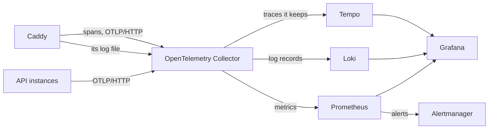

# Observability

How to see what the API does: its logs, traces and metrics, the dashboards that answer an operator's questions, and the alerts that say when to act. It is written for someone who hasn't used these tools before.

Everything here serves D10's guarantee: any trace ID the API returns leads to that request's logs, and to its trace whenever the request ended in an error (OBS-08).

## The questions it answers

Each dashboard panel's title is the question it answers (OBS-13). The overview links to one dashboard per area.

| Question | Where |
|---|---|
| Is the API up? | API overview: "How many instances of the API are exporting telemetry?" |
| Which routes are slow or failing, and since when? | API requests |
| Why did this request fail? | its trace ID, as in [Following a request](#following-a-request-from-its-trace-id) |
| Is a dependency degrading? Postgres, for now | API platform: "Can each instance reach its database?" |
| Is the telemetry pipeline itself losing data? | Telemetry pipeline |
| Is the server running out of disk or memory? | Server |
| Does an instance's memory only grow? | API platform: "How much memory does each instance use?" |

## How telemetry flows

- **The API** exports its spans, log records and metrics over the OpenTelemetry Protocol (OTLP), on HTTP, to the collector named by `OTEL_EXPORTER_OTLP_ENDPOINT`. Every signal carries the service's name, its version, the environment, and the instance's own `service.instance.id`, so instances running side by side stay apart. The [platform spec](../spec/platform.md#telemetry-export) says how the API exports.
- **The proxy**, Caddy, in the reference deployment, exports a span for each request but the probes, to the same collector, and the API's server span is its child, so a trace starts at the proxy (OBS-06). It writes a line for each request it answers itself, while no replica can (D53), to a file the collector reads; the API writes the line of every other request. The collector keeps only those of the span's attributes whose names `platform::telemetry` lists, and the line's method and status, so neither holds a client's address or user agent (OBS-04, [proxy.yaml](../../deploy/observability/collector/proxy.yaml)).
- **The collector** ([config](../../deploy/observability/collector/config.yaml)) refuses data before it runs out of memory, and passes each signal to its store. It also reads the times of the bundled database's backup status files, for the backups' alerts, and the host's CPU, memory and filesystems, from the host's filesystem mounted read-only, for the server's: a filesystem it reports is one mounted whole, not a bind mount of part of one. Its tail sampling waits 15 seconds for a trace's spans, then keeps the trace if any policy keeps it (OBS-08):
  - every trace with an error status, or a response of 400 or above
  - every trace slower than the [latency objective](#service-level-objectives)
  - 10% of the rest
- **Prometheus** ([config](../../deploy/observability/prometheus/prometheus.yaml)) receives the metrics through its OTLP receiver, and scrapes the collector, Loki, Tempo and Alertmanager for their own. It evaluates the [rules](../../deploy/observability/prometheus/rules.yaml) and sends firing alerts to Alertmanager. [metrics.md](metrics.md) lists every metric under its name in Prometheus.
- **Loki** ([config](../../deploy/observability/loki/config.yaml)) keeps every log record the API exports, and the proxy's: logs are never sampled. The API's queue of records drops a record that arrives while it is full, as the [platform spec](../spec/platform.md#telemetry-export) says, and stdout drops no line while the API runs. A record's line is its message, such as `request completed`. The service's name, instance and environment are labels, such as `service_name`, and every other field, `trace_id` and `span_id` among them, is structured metadata that a query filters with `| trace_id="…"`.
- **Tempo** ([config](../../deploy/observability/tempo/config.yaml)) keeps the traces the collector passes on, and answers searches in its query language, TraceQL.
- **Grafana** reads all three, through the [data sources](../../deploy/observability/grafana/provisioning/datasources/datasources.yaml) it provisions. A log line links to its trace, and a span links to its trace's log lines.

Prometheus keeps metrics for 15 days, and Loki and Tempo keep logs and traces for 14 days.

## A managed backend

A deployment may send its telemetry to a managed backend that accepts the OpenTelemetry Protocol (OTLP), such as Grafana Cloud, instead of running Prometheus, Loki, Tempo, Grafana and Alertmanager itself (D42). With `TELEMETRY=managed`, the reference deployment runs only the collector, with [managed.yaml](../../deploy/observability/collector/managed.yaml) merged over its configuration: the same receivers and processors, tail sampling among them (OBS-08), with what the self-hosted stack does elsewhere, below, and one exporter, to the backend. The API exports to the collector as before, so its settings don't change, and the backend's tokens stay in the deployment's `secrets/`: the collector sends the telemetry with one, the deploy's import signs in to the backend's Grafana with the other, and `just server-check` tries both.

The deployment's settings name the backend's OTLP endpoint, which is HTTPS (OPS-20), and the user the collector signs in as: `MANAGED_OTLP_ENDPOINT` and `MANAGED_OTLP_USER`, which [deploy/settings.env.example](../../deploy/settings.env.example) describes. The token goes in the secret file `secrets/managed_otlp_token`. A backend whose certificate a private authority signed is trusted through that authority's certificate in `certs/managed-otlp-ca.crt`.

The managed configuration adds what the self-hosted stack does elsewhere: the collector scrapes its own metrics, which Prometheus scrapes in the stack, for the alerts on telemetry that is lost, and it copies `deployment.environment.name` and the backup status files' `file.name` from each metric's resource into its labels, which the self-hosted Prometheus promotes.

With Grafana Cloud, each deploy also imports the release's dashboards and alert rules into the stack's Grafana, once the release's replicas serve (OBS-13, OBS-14). `MANAGED_GRAFANA_URL` names that Grafana, such as `https://<stack>.grafana.net`, and the secret file `secrets/managed_grafana_token` holds the token of a service account with the Admin role, since Grafana refuses an Editor both a folder's permissions and the conversion of rules. A Grafana whose certificate a private authority signed is trusted through that authority's certificate in `certs/managed-grafana-ca.crt`. [deploy/import-grafana.sh](../../deploy/import-grafana.sh) runs the import, with curl and yq from the images that [deploy/tools/compose.yaml](../../deploy/tools/compose.yaml) pins:

- The dashboards go into the folder `API`, which Viewers and Editors may only view, so only the import and the Grafana's administrators change them, and the next deploy puts back what an administrator changed. Each data source a dashboard names becomes the stack's own: `prometheus` becomes `grafanacloud-prom`, `loki` becomes `grafanacloud-logs`, and `tempo` becomes `grafanacloud-traces`. The import fails on a dashboard that names any other, or one the Grafana lacks.
- The rules go into the folder's subfolder `Alerts`, through Grafana's conversion of Prometheus rules, as rules that Grafana evaluates against `grafanacloud-prom`, every minute, a minute behind so that late samples have arrived. A recording rule writes its series back there. Grafana marks the rules provisioned, and its interface changes no provisioned rule. They are Grafana's rules rather than the stack's Mimir ruler's, since Grafana Cloud gives a new stack no Alertmanager that a ruler's alerts would reach.
- A dashboard or a rule group that an earlier import made, and that the release lacks, is deleted.

Grafana's notification policies route the alerts, not `alertmanager.yaml`: Grafana imports an Alertmanager's configuration only through a preview that Grafana Cloud enables on request. In Grafana's Alerting, add a contact point for each severity, and policies that route `severity=page` and `severity=ticket` to them. Until a policy reaches a contact point, the alerts notify no one, and every deploy warns.

A failed import only warns, and the Grafana keeps what it last imported, since a backend that is down mustn't keep a release from deploying; deploying the release again imports again. With a backend that has no Grafana, `MANAGED_GRAFANA_URL` stays empty, every deploy warns that nothing imports the dashboards and the alerts, and the backend's own tools must hold them.

CI sends to a stand-in backend, a collector that admits only the deployment's credentials over TLS, and checks that the trace and the logs of a 4xx response arrive.

## Running it on your machine

`just dev observe` starts the stack in Compose, next to Postgres, and runs the API with its telemetry exported to the collector. Each service answers on 127.0.0.1:

| Service | Address |
|---|---|
| Grafana | <http://127.0.0.1:3000> |
| Prometheus | <http://127.0.0.1:9090> |
| Alertmanager | <http://127.0.0.1:9093> |
| Loki | <http://127.0.0.1:3100> |
| Tempo | <http://127.0.0.1:3200> |
| The collector's OTLP receiver | <http://127.0.0.1:4318> |

Grafana opens without signing in, as a viewer who can explore. On a server, it answers on an address of its own behind Caddy, where every viewer signs in ([deploy.md](deploy.md#grafana)). Its dashboards are read-only: each is a file in [deploy/observability/grafana/dashboards](../../deploy/observability/grafana/dashboards), and changing one means changing its file. `docker compose stop collector prometheus alertmanager loki tempo grafana` stops the stack and leaves Postgres running. `docker compose --profile observability down` stops every service, Postgres among them, and adding `--volumes` deletes what each stored, the development database included.

## Following a request from its trace ID

Every response except the health probes carries its trace context in `server-timing`, as `trace;desc=00-<trace ID>--01`, and every error body holds the trace ID as `trace_id` (API-16, API-07), the proxy's `request.unavailable` too (D53). A user who reports a failure can quote it. To follow it:

1. In Grafana, open Explore, choose the Loki data source, and run `{service_name=~".+"} | trace_id="<trace ID>"`. Every log line of the request appears, with its fields: the API's, or, for a request that no replica answered, the proxy's.
2. Open a line, and choose "Open the trace" under its links. The trace opens beside the logs, with each span's duration and attributes.
3. From a span, "Related logs" runs the query of the first step for the span's trace.

A trace is kept when the request failed, answered 400 or above, or took longer than the latency objective, and a successful fast request's trace only sometimes. Its logs are never sampled.

To find the slow requests of a time range instead, the API requests dashboard lists them under "Which requests took longer than the latency objective?", each opening its trace.

## Service-level objectives

| Objective | Target, over 30 days | Error budget |
|---|---|---|
| Availability | 99.9% of requests answer without a 5xx | 0.1% of requests |
| Latency | 99% of requests answer within 0.5 seconds | 1% of requests |

The health probes don't count, since they aren't measured (OBS-15), nor the requests that the proxy answers while no replica can (OPS-05): the objectives count the API's own measurements, and `ApiTelemetryMissing` pages once no instance has exported metrics for five minutes. The latency objective is one number in four places: the collector's latency policy, the rules that count slow requests, the dashboard's list of slow traces, and the line its slowest requests' panel draws. `check-telemetry-config` fails while they differ, and `just load-test` reads it from the collector's policy.

## Alerts

Each objective has two alerts that fire on how fast the errors spend its budget (OBS-14). The fast alert pages when an hour's errors would spend 2% of a 30-day budget, or 6 hours' errors 5% of it. The slow alert opens a ticket when a day's errors would spend 10% of it, or 3 days' errors 10% of it at a steady rate. The other alerts name a cause: the database is unreachable, telemetry is being lost, the bundled database's backups have stopped, or the server's disk fills or its memory runs low ([backups.md](backups.md#alerts)).

Every alert has a severity, `page` or `ticket`, a section in [runbooks.md](runbooks.md), and a test in [rules.test.yaml](../../deploy/observability/prometheus/rules.test.yaml). Grafana's alert list shows the alerts that fire, and the API overview links to it as "Firing alerts". Alertmanager routes each alert by its severity to the receiver of the same name, and the [receivers](../../deploy/observability/alertmanager/alertmanager.yaml) notify no one in the template. A deploy with the self-hosted stack warns while no receiver names an integration. A fork adds its integrations, such as email or a chat webhook, to `page` and `ticket` in that file, in its repository, so every deploy installs them. Each credential comes from a file of the deployment's `secrets/alertmanager/`, which the deploy creates and keeps, and which Alertmanager sees as `/etc/alertmanager-secrets/`, through the integration's option for a file, such as `api_url_file` of `slack_configs`, `url_file` of `webhook_configs` or `auth_password_file` of `email_configs`. `just server-setup` asks for each file that the integrations name, and writes it readable by every user, as the other secret files are, since `secrets/` itself admits only the deployment's owner ([deploy.md](deploy.md#setting-up-a-server)). CI delivers an alert through such a webhook (OBS-14).

## Adding a metric

A metric is declared in code, as OBS-11 says, and a dashboard or an alert must read it (OBS-12). `just metrics` rewrites [metrics.md](metrics.md) from the declarations, and `check-metrics` fails while the committed catalog differs from it.
