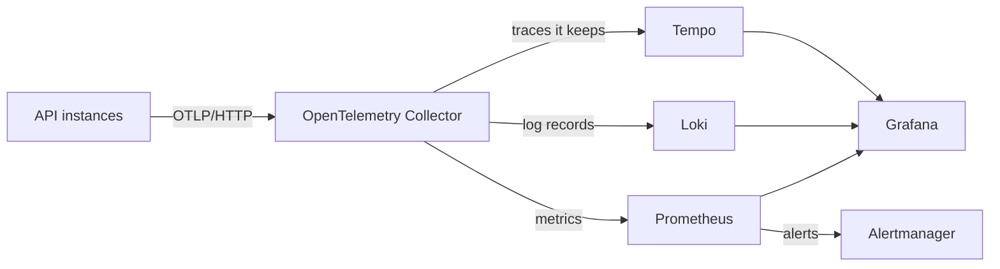

# Observability

How to see what the API does: its logs, traces and metrics, the dashboards that answer an operator's questions, and the alerts that say when to act. It is written for someone who hasn't used these tools before.

Everything here serves D10's guarantee: any trace ID the API returns leads to that request's logs, and to its trace whenever the request ended in an error (OBS-08).

## The questions it answers

Each dashboard panel's title is the question it answers (OBS-13). The overview links to one dashboard per area.

| Question | Where |
|---|---|
| Is the API up? | API overview: "How many instances of the API are exporting telemetry?" |
| Which routes are slow or failing, and since when? | API requests |
| Why did this request fail? | its trace ID, as in [Following a request](#following-a-request-from-its-trace-id) |
| Is a dependency degrading? Postgres, for now | API platform: "Can each instance reach its database?" |
| Is the telemetry pipeline itself losing data? | Telemetry pipeline |

## How telemetry flows

- **The API** exports its spans, log records and metrics over the OpenTelemetry Protocol (OTLP), on HTTP, to the collector named by `OTEL_EXPORTER_OTLP_ENDPOINT`. Every signal carries the service's name, its version, the environment, and the instance's own `service.instance.id`, so instances running side by side stay apart. The [platform spec](../spec/platform.md#telemetry-export) says how the API exports.
- **The collector** ([config](../../deploy/observability/collector/config.yaml)) refuses data before it runs out of memory, and passes each signal to its store. It also reads the times of the bundled database's backup status files, for the backups' alerts. Its tail sampling waits 15 seconds for a trace's spans, then keeps the trace if any policy keeps it (OBS-08):
  - every trace with an error status, or a response of 400 or above
  - every trace slower than the [latency objective](#service-level-objectives)
  - 10% of the rest
- **Prometheus** ([config](../../deploy/observability/prometheus/prometheus.yaml)) receives the metrics through its OTLP receiver, and scrapes the collector, Loki, Tempo and Alertmanager for their own. It evaluates the [rules](../../deploy/observability/prometheus/rules.yaml) and sends firing alerts to Alertmanager. [metrics.md](metrics.md) lists every metric under its name in Prometheus.
- **Loki** ([config](../../deploy/observability/loki/config.yaml)) keeps every log record the API exports: logs are never sampled. The API's queue of records drops a record that arrives while it is full, as the [platform spec](../spec/platform.md#telemetry-export) says, and stdout drops no line while the API runs. A record's line is its message, such as `request completed`. The service's name, instance and environment are labels, such as `service_name`, and every other field, `trace_id` and `span_id` among them, is structured metadata that a query filters with `| trace_id="…"`.
- **Tempo** ([config](../../deploy/observability/tempo/config.yaml)) keeps the traces the collector passes on, and answers searches in its query language, TraceQL.
- **Grafana** reads all three, through the [data sources](../../deploy/observability/grafana/provisioning/datasources/datasources.yaml) it provisions. A log line links to its trace, and a span links to its trace's log lines.

Prometheus keeps metrics for 15 days, and Loki and Tempo keep logs and traces for 14 days.

## Running it on your machine

`just dev observe` starts the stack in Compose, next to Postgres, and runs the API with its telemetry exported to the collector. Each service answers on 127.0.0.1:

| Service | Address |
|---|---|
| Grafana | <http://127.0.0.1:3000> |
| Prometheus | <http://127.0.0.1:9090> |
| Alertmanager | <http://127.0.0.1:9093> |
| Loki | <http://127.0.0.1:3100> |
| Tempo | <http://127.0.0.1:3200> |
| The collector's OTLP receiver | <http://127.0.0.1:4318> |

Grafana opens without signing in, as a viewer who can explore. On a server, it answers on an address of its own behind Caddy, where every viewer signs in ([deploy.md](deploy.md#grafana)). Its dashboards are read-only: each is a file in [deploy/observability/grafana/dashboards](../../deploy/observability/grafana/dashboards), and changing one means changing its file. `docker compose stop collector prometheus alertmanager loki tempo grafana` stops the stack and leaves Postgres running. `docker compose --profile observability down` stops every service, Postgres among them, and adding `--volumes` deletes what each stored, the development database included.

## Following a request from its trace ID

Every response except the health probes carries its trace context in `server-timing`, as `trace;desc=00-<trace ID>--01`, and every error body holds the trace ID as `trace_id` (API-16, API-07). A user who reports a failure can quote it. To follow it:

1. In Grafana, open Explore, choose the Loki data source, and run `{service_name="antworker-api"} | trace_id="<trace ID>"`. Every log line of the request appears, with its fields.
2. Open a line, and choose "Open the trace" under its links. The trace opens beside the logs, with each span's duration and attributes.
3. From a span, "Related logs" runs the query of the first step for the span's trace.

A trace is kept when the request failed, answered 400 or above, or took longer than the latency objective, and a successful fast request's trace only sometimes. Its logs are never sampled.

To find the slow requests of a time range instead, the API requests dashboard lists them under "Which requests took longer than the latency objective?", each opening its trace.

## Service-level objectives

| Objective | Target, over 30 days | Error budget |
|---|---|---|
| Availability | 99.9% of requests answer without a 5xx | 0.1% of requests |
| Latency | 99% of requests answer within 0.5 seconds | 1% of requests |

The health probes don't count, since they aren't measured (OBS-15). The latency objective is one number in four places: the collector's latency policy, the rules that count slow requests, the dashboard's list of slow traces, and the line its slowest requests' panel draws. `check-telemetry-config` fails while they differ.

## Alerts

Each objective has two alerts that fire on how fast the errors spend its budget (OBS-14). The fast alert pages when an hour's errors would spend 2% of a 30-day budget, or 6 hours' errors 5% of it. The slow alert opens a ticket when a day's errors would spend 10% of it, or 3 days' errors 10% of it at a steady rate. The other alerts name a cause: the database is unreachable, telemetry is being lost, or the bundled database's backups have stopped ([backups.md](backups.md#alerts)).

Every alert has a severity, `page` or `ticket`, a section in [runbooks.md](runbooks.md), and a test in [rules.test.yaml](../../deploy/observability/prometheus/rules.test.yaml). Alertmanager routes each alert by its severity to the receiver of the same name, and the [receivers](../../deploy/observability/alertmanager/alertmanager.yaml) notify no one until a deployment adds its integrations, such as email or a chat webhook, to `page` and `ticket`.

## Adding a metric

A metric is declared in code, as OBS-11 says, and a dashboard or an alert must read it (OBS-12). `just metrics` rewrites [metrics.md](metrics.md) from the declarations, and `check-metrics` fails while the committed catalog differs from it.
